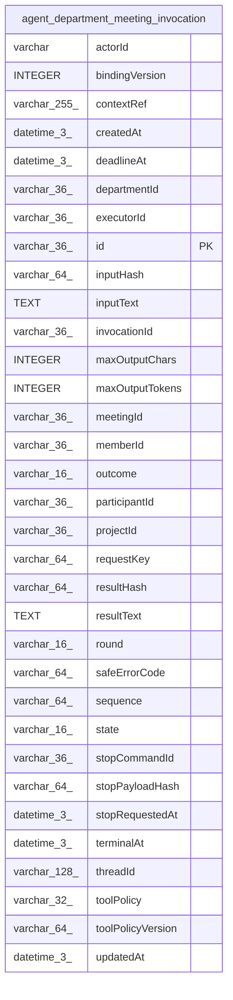

# agent_department_meeting_invocation

## Description

<details>
<summary><strong>Table Definition</strong></summary>

```sql
CREATE TABLE "agent_department_meeting_invocation" ("id" varchar(36) PRIMARY KEY NOT NULL, "projectId" varchar(36) NOT NULL, "departmentId" varchar(36) NOT NULL, "meetingId" varchar(36) NOT NULL, "participantId" varchar(36) NOT NULL, "invocationId" varchar(36) NOT NULL, "round" varchar(16) NOT NULL, "actorId" varchar NOT NULL, "memberId" varchar(36) NOT NULL, "executorId" varchar(36) NOT NULL, "bindingVersion" integer NOT NULL, "requestKey" varchar(64) NOT NULL, "inputHash" varchar(64) NOT NULL, "contextRef" varchar(255) NOT NULL, "inputText" text NOT NULL, "maxOutputChars" integer NOT NULL, "maxOutputTokens" integer NOT NULL, "toolPolicy" varchar(32) NOT NULL, "toolPolicyVersion" varchar(64), "threadId" varchar(128) NOT NULL, "state" varchar(16) NOT NULL DEFAULT ('reserved'), "outcome" varchar(16), "safeErrorCode" varchar(64), "deadlineAt" datetime(3), "terminalAt" datetime(3), "sequence" varchar(64) NOT NULL DEFAULT ('0'), "resultText" text, "resultHash" varchar(64), "stopCommandId" varchar(36), "stopPayloadHash" varchar(64), "stopRequestedAt" datetime(3), "createdAt" datetime(3) NOT NULL, "updatedAt" datetime(3) NOT NULL, CONSTRAINT "CHK_agent_department_meeting_invocation_round" CHECK ("round" IN ('contribution', 'synthesis')), CONSTRAINT "CHK_agent_department_meeting_invocation_state" CHECK ("state" IN ('reserved', 'accepted', 'running', 'stopping', 'unknown', 'terminal')), CONSTRAINT "CHK_agent_department_meeting_invocation_outcome" CHECK ("outcome" IN ('succeeded', 'failed', 'cancelled')))
```

</details>

## Columns

| Name | Type | Default | Nullable | Children | Parents | Comment |
| ---- | ---- | ------- | -------- | -------- | ------- | ------- |
| actorId | varchar |  | false |  |  |  |
| bindingVersion | INTEGER |  | false |  |  |  |
| contextRef | varchar(255) |  | false |  |  |  |
| createdAt | datetime(3) |  | false |  |  |  |
| deadlineAt | datetime(3) |  | true |  |  |  |
| departmentId | varchar(36) |  | false |  |  |  |
| executorId | varchar(36) |  | false |  |  |  |
| id | varchar(36) |  | false |  |  |  |
| inputHash | varchar(64) |  | false |  |  |  |
| inputText | TEXT |  | false |  |  |  |
| invocationId | varchar(36) |  | false |  |  |  |
| maxOutputChars | INTEGER |  | false |  |  |  |
| maxOutputTokens | INTEGER |  | false |  |  |  |
| meetingId | varchar(36) |  | false |  |  |  |
| memberId | varchar(36) |  | false |  |  |  |
| outcome | varchar(16) |  | true |  |  |  |
| participantId | varchar(36) |  | false |  |  |  |
| projectId | varchar(36) |  | false |  |  |  |
| requestKey | varchar(64) |  | false |  |  |  |
| resultHash | varchar(64) |  | true |  |  |  |
| resultText | TEXT |  | true |  |  |  |
| round | varchar(16) |  | false |  |  |  |
| safeErrorCode | varchar(64) |  | true |  |  |  |
| sequence | varchar(64) | '0' | false |  |  |  |
| state | varchar(16) | 'reserved' | false |  |  |  |
| stopCommandId | varchar(36) |  | true |  |  |  |
| stopPayloadHash | varchar(64) |  | true |  |  |  |
| stopRequestedAt | datetime(3) |  | true |  |  |  |
| terminalAt | datetime(3) |  | true |  |  |  |
| threadId | varchar(128) |  | false |  |  |  |
| toolPolicy | varchar(32) |  | false |  |  |  |
| toolPolicyVersion | varchar(64) |  | true |  |  |  |
| updatedAt | datetime(3) |  | false |  |  |  |

## Constraints

| Name | Type | Definition |
| ---- | ---- | ---------- |
| - | CHECK | CHECK ("round" IN ('contribution', 'synthesis')) |
| - | CHECK | CHECK ("state" IN ('reserved', 'accepted', 'running', 'stopping', 'unknown', 'terminal')) |
| - | CHECK | CHECK ("outcome" IN ('succeeded', 'failed', 'cancelled')) |
| id | PRIMARY KEY | PRIMARY KEY (id) |
| sqlite_autoindex_agent_department_meeting_invocation_1 | PRIMARY KEY | PRIMARY KEY (id) |

## Indexes

| Name | Definition |
| ---- | ---------- |
| IDX_agent_department_meeting_invocation_projectId_meetingId_state | CREATE INDEX "IDX_agent_department_meeting_invocation_projectId_meetingId_state" ON "agent_department_meeting_invocation" ("projectId", "meetingId", "state")  |
| IDX_agent_dept_meeting_inv_id | CREATE UNIQUE INDEX "IDX_agent_dept_meeting_inv_id" ON "agent_department_meeting_invocation" ("projectId", "invocationId")  |
| IDX_agent_dept_meeting_inv_request | CREATE UNIQUE INDEX "IDX_agent_dept_meeting_inv_request" ON "agent_department_meeting_invocation" ("projectId", "requestKey")  |
| sqlite_autoindex_agent_department_meeting_invocation_1 | PRIMARY KEY (id) |

## Relations



---

> Generated by [tbls](https://github.com/k1LoW/tbls)
