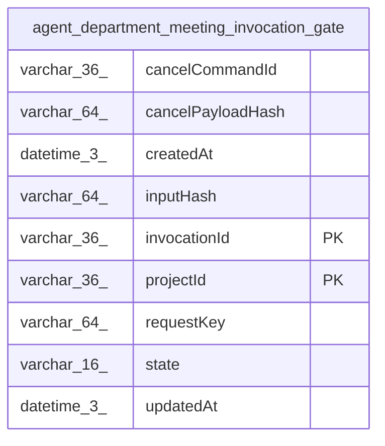

# agent_department_meeting_invocation_gate

## Description

<details>
<summary><strong>Table Definition</strong></summary>

```sql
CREATE TABLE "agent_department_meeting_invocation_gate" ("projectId" varchar(36) NOT NULL, "invocationId" varchar(36) NOT NULL, "requestKey" varchar(64) NOT NULL, "inputHash" varchar(64) NOT NULL, "state" varchar(16) NOT NULL DEFAULT ('open'), "cancelCommandId" varchar(36), "cancelPayloadHash" varchar(64), "createdAt" datetime(3) NOT NULL, "updatedAt" datetime(3) NOT NULL, CONSTRAINT "CHK_agent_department_meeting_invocation_gate_state" CHECK ("state" IN ('open', 'cancelled')), PRIMARY KEY ("projectId", "invocationId"))
```

</details>

## Columns

| Name | Type | Default | Nullable | Children | Parents | Comment |
| ---- | ---- | ------- | -------- | -------- | ------- | ------- |
| cancelCommandId | varchar(36) |  | true |  |  |  |
| cancelPayloadHash | varchar(64) |  | true |  |  |  |
| createdAt | datetime(3) |  | false |  |  |  |
| inputHash | varchar(64) |  | false |  |  |  |
| invocationId | varchar(36) |  | false |  |  |  |
| projectId | varchar(36) |  | false |  |  |  |
| requestKey | varchar(64) |  | false |  |  |  |
| state | varchar(16) | 'open' | false |  |  |  |
| updatedAt | datetime(3) |  | false |  |  |  |

## Constraints

| Name | Type | Definition |
| ---- | ---- | ---------- |
| - | CHECK | CHECK ("state" IN ('open', 'cancelled')) |
| invocationId | PRIMARY KEY | PRIMARY KEY (invocationId) |
| projectId | PRIMARY KEY | PRIMARY KEY (projectId) |
| sqlite_autoindex_agent_department_meeting_invocation_gate_1 | PRIMARY KEY | PRIMARY KEY (projectId, invocationId) |

## Indexes

| Name | Definition |
| ---- | ---------- |
| IDX_agent_dept_meeting_gate_request | CREATE UNIQUE INDEX "IDX_agent_dept_meeting_gate_request" ON "agent_department_meeting_invocation_gate" ("projectId", "requestKey")  |
| sqlite_autoindex_agent_department_meeting_invocation_gate_1 | PRIMARY KEY (projectId, invocationId) |

## Relations



---

> Generated by [tbls](https://github.com/k1LoW/tbls)
