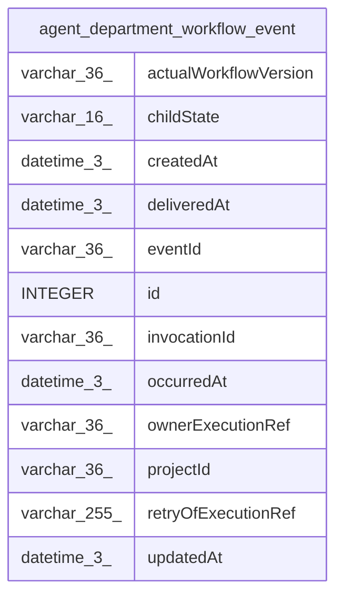

# agent_department_workflow_event

## Description

<details>
<summary><strong>Table Definition</strong></summary>

```sql
CREATE TABLE "agent_department_workflow_event" ("id" integer PRIMARY KEY NOT NULL, "eventId" varchar(36) NOT NULL, "projectId" varchar(36) NOT NULL, "invocationId" varchar(36) NOT NULL, "ownerExecutionRef" varchar(36) NOT NULL, "actualWorkflowVersion" varchar(36) NOT NULL, "childState" varchar(16) NOT NULL, "occurredAt" datetime(3) NOT NULL, "deliveredAt" datetime(3), "createdAt" datetime(3) NOT NULL, "updatedAt" datetime(3) NOT NULL, "retryOfExecutionRef" varchar(255), CONSTRAINT "CHK_agent_department_workflow_event_childState" CHECK (("childState" IN ('running', 'waiting', 'retrying', 'succeeded', 'failed', 'cancelled', 'unknown'))))
```

</details>

## Columns

| Name | Type | Default | Nullable | Children | Parents | Comment |
| ---- | ---- | ------- | -------- | -------- | ------- | ------- |
| actualWorkflowVersion | varchar(36) |  | false |  |  |  |
| childState | varchar(16) |  | false |  |  |  |
| createdAt | datetime(3) |  | false |  |  |  |
| deliveredAt | datetime(3) |  | true |  |  |  |
| eventId | varchar(36) |  | false |  |  |  |
| id | INTEGER |  | false |  |  |  |
| invocationId | varchar(36) |  | false |  |  |  |
| occurredAt | datetime(3) |  | false |  |  |  |
| ownerExecutionRef | varchar(36) |  | false |  |  |  |
| projectId | varchar(36) |  | false |  |  |  |
| retryOfExecutionRef | varchar(255) |  | true |  |  |  |
| updatedAt | datetime(3) |  | false |  |  |  |

## Constraints

| Name | Type | Definition |
| ---- | ---- | ---------- |
| - | CHECK | CHECK (("childState" IN ('running', 'waiting', 'retrying', 'succeeded', 'failed', 'cancelled', 'unknown'))) |
| id | PRIMARY KEY | PRIMARY KEY (id) |

## Indexes

| Name | Definition |
| ---- | ---------- |
| IDX_agent_department_workflow_event_eventId | CREATE UNIQUE INDEX "IDX_agent_department_workflow_event_eventId" ON "agent_department_workflow_event" ("eventId")  |
| IDX_agent_department_workflow_event_invocationId_id | CREATE INDEX "IDX_agent_department_workflow_event_invocationId_id" ON "agent_department_workflow_event" ("invocationId", "id")  |
| IDX_agent_department_workflow_event_pending | CREATE INDEX "IDX_agent_department_workflow_event_pending" ON "agent_department_workflow_event" ("deliveredAt", "id") WHERE "deliveredAt" IS NULL |

## Relations



---

> Generated by [tbls](https://github.com/k1LoW/tbls)
