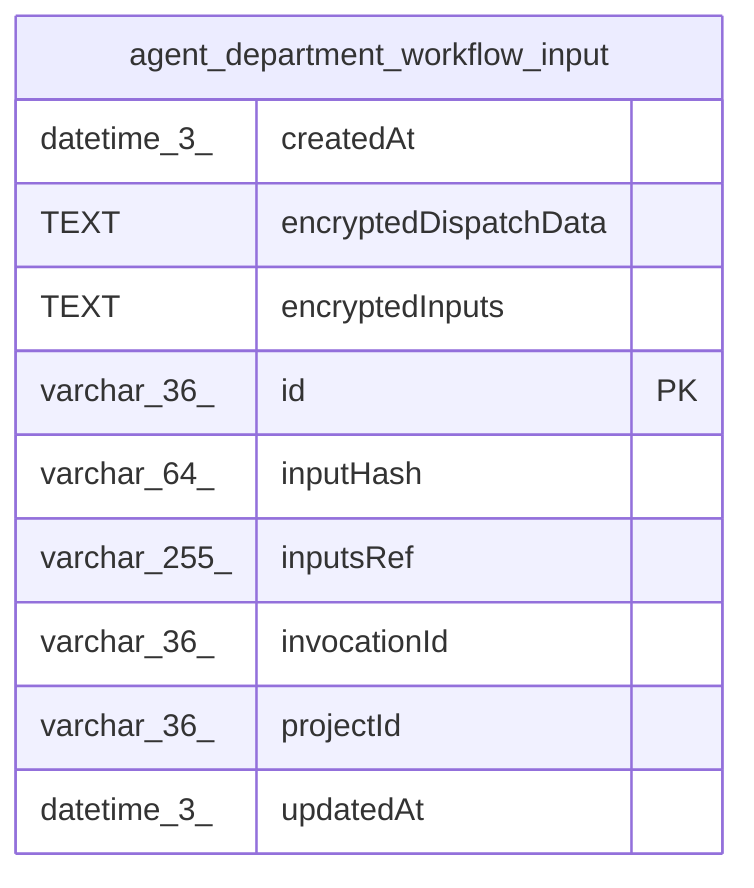

# agent_department_workflow_input

## Description

<details>
<summary><strong>Table Definition</strong></summary>

```sql
CREATE TABLE "agent_department_workflow_input" ("id" varchar(36) PRIMARY KEY NOT NULL, "projectId" varchar(36) NOT NULL, "invocationId" varchar(36) NOT NULL, "inputsRef" varchar(255) NOT NULL, "inputHash" varchar(64) NOT NULL, "encryptedInputs" text NOT NULL, "createdAt" datetime(3) NOT NULL, "updatedAt" datetime(3) NOT NULL, "encryptedDispatchData" text)
```

</details>

## Columns

| Name | Type | Default | Nullable | Children | Parents | Comment |
| ---- | ---- | ------- | -------- | -------- | ------- | ------- |
| createdAt | datetime(3) |  | false |  |  |  |
| encryptedDispatchData | TEXT |  | true |  |  |  |
| encryptedInputs | TEXT |  | false |  |  |  |
| id | varchar(36) |  | false |  |  |  |
| inputHash | varchar(64) |  | false |  |  |  |
| inputsRef | varchar(255) |  | false |  |  |  |
| invocationId | varchar(36) |  | false |  |  |  |
| projectId | varchar(36) |  | false |  |  |  |
| updatedAt | datetime(3) |  | false |  |  |  |

## Constraints

| Name | Type | Definition |
| ---- | ---- | ---------- |
| id | PRIMARY KEY | PRIMARY KEY (id) |
| sqlite_autoindex_agent_department_workflow_input_1 | PRIMARY KEY | PRIMARY KEY (id) |

## Indexes

| Name | Definition |
| ---- | ---------- |
| IDX_agent_department_workflow_input_invocation | CREATE UNIQUE INDEX "IDX_agent_department_workflow_input_invocation" ON "agent_department_workflow_input" ("projectId", "invocationId")  |
| IDX_agent_department_workflow_input_ref | CREATE UNIQUE INDEX "IDX_agent_department_workflow_input_ref" ON "agent_department_workflow_input" ("projectId", "inputsRef")  |
| sqlite_autoindex_agent_department_workflow_input_1 | PRIMARY KEY (id) |

## Relations



---

> Generated by [tbls](https://github.com/k1LoW/tbls)
