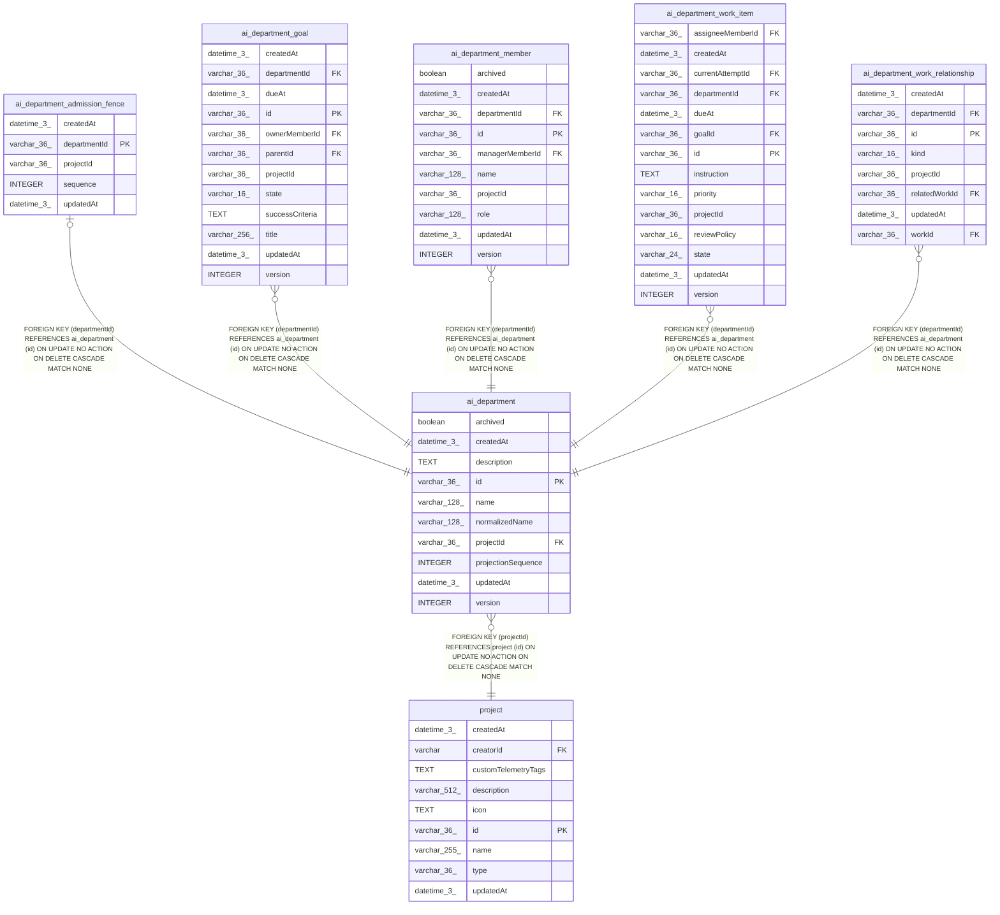

# ai_department

## Description

<details>
<summary><strong>Table Definition</strong></summary>

```sql
CREATE TABLE "ai_department" ("id" varchar(36) PRIMARY KEY NOT NULL, "projectId" varchar(36) NOT NULL, "name" varchar(128) NOT NULL, "normalizedName" varchar(128) NOT NULL, "description" text, "archived" boolean NOT NULL DEFAULT (false), "version" integer NOT NULL DEFAULT (1), "createdAt" datetime(3) NOT NULL DEFAULT (STRFTIME('%Y-%m-%d %H:%M:%f', 'NOW')), "updatedAt" datetime(3) NOT NULL DEFAULT (STRFTIME('%Y-%m-%d %H:%M:%f', 'NOW')), "projectionSequence" integer NOT NULL DEFAULT (0), CONSTRAINT "FK_00e31fe48fbfd3220de087cc1c6" FOREIGN KEY ("projectId") REFERENCES "project" ("id") ON DELETE CASCADE ON UPDATE NO ACTION)
```

</details>

## Columns

| Name | Type | Default | Nullable | Children | Parents | Comment |
| ---- | ---- | ------- | -------- | -------- | ------- | ------- |
| archived | boolean | false | false |  |  |  |
| createdAt | datetime(3) | STRFTIME('%Y-%m-%d %H:%M:%f', 'NOW') | false |  |  |  |
| description | TEXT |  | true |  |  |  |
| id | varchar(36) |  | false | [ai_department_admission_fence](ai_department_admission_fence.md) [ai_department_goal](ai_department_goal.md) [ai_department_member](ai_department_member.md) [ai_department_work_item](ai_department_work_item.md) [ai_department_work_relationship](ai_department_work_relationship.md) |  |  |
| name | varchar(128) |  | false |  |  |  |
| normalizedName | varchar(128) |  | false |  |  |  |
| projectId | varchar(36) |  | false |  | [project](project.md) |  |
| projectionSequence | INTEGER | 0 | false |  |  |  |
| updatedAt | datetime(3) | STRFTIME('%Y-%m-%d %H:%M:%f', 'NOW') | false |  |  |  |
| version | INTEGER | 1 | false |  |  |  |

## Constraints

| Name | Type | Definition |
| ---- | ---- | ---------- |
| - (Foreign key ID: 0) | FOREIGN KEY | FOREIGN KEY (projectId) REFERENCES project (id) ON UPDATE NO ACTION ON DELETE CASCADE MATCH NONE |
| id | PRIMARY KEY | PRIMARY KEY (id) |
| sqlite_autoindex_ai_department_1 | PRIMARY KEY | PRIMARY KEY (id) |

## Indexes

| Name | Definition |
| ---- | ---------- |
| IDX_ai_department_projectId_normalizedName | CREATE UNIQUE INDEX "IDX_ai_department_projectId_normalizedName" ON "ai_department" ("projectId", "normalizedName") WHERE "archived" = false |
| sqlite_autoindex_ai_department_1 | PRIMARY KEY (id) |

## Relations



---

> Generated by [tbls](https://github.com/k1LoW/tbls)
