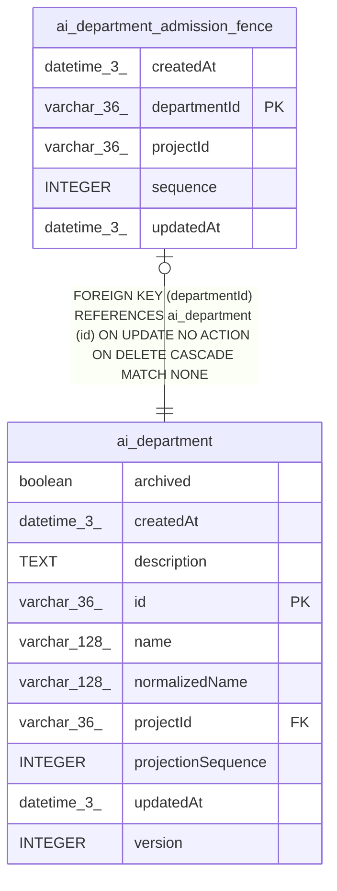

# ai_department_admission_fence

## Description

<details>
<summary><strong>Table Definition</strong></summary>

```sql
CREATE TABLE "ai_department_admission_fence" ("departmentId" varchar(36) PRIMARY KEY NOT NULL, "projectId" varchar(36) NOT NULL, "sequence" integer NOT NULL DEFAULT (0), "createdAt" datetime(3) NOT NULL DEFAULT (STRFTIME('%Y-%m-%d %H:%M:%f', 'NOW')), "updatedAt" datetime(3) NOT NULL DEFAULT (STRFTIME('%Y-%m-%d %H:%M:%f', 'NOW')), CONSTRAINT "FK_849414c58e75c8e78d9da9f3a0d" FOREIGN KEY ("departmentId") REFERENCES "ai_department" ("id") ON DELETE CASCADE)
```

</details>

## Columns

| Name | Type | Default | Nullable | Children | Parents | Comment |
| ---- | ---- | ------- | -------- | -------- | ------- | ------- |
| createdAt | datetime(3) | STRFTIME('%Y-%m-%d %H:%M:%f', 'NOW') | false |  |  |  |
| departmentId | varchar(36) |  | false |  | [ai_department](ai_department.md) |  |
| projectId | varchar(36) |  | false |  |  |  |
| sequence | INTEGER | 0 | false |  |  |  |
| updatedAt | datetime(3) | STRFTIME('%Y-%m-%d %H:%M:%f', 'NOW') | false |  |  |  |

## Constraints

| Name | Type | Definition |
| ---- | ---- | ---------- |
| - (Foreign key ID: 0) | FOREIGN KEY | FOREIGN KEY (departmentId) REFERENCES ai_department (id) ON UPDATE NO ACTION ON DELETE CASCADE MATCH NONE |
| departmentId | PRIMARY KEY | PRIMARY KEY (departmentId) |
| sqlite_autoindex_ai_department_admission_fence_1 | PRIMARY KEY | PRIMARY KEY (departmentId) |

## Indexes

| Name | Definition |
| ---- | ---------- |
| IDX_ai_department_admission_fence_projectId_departmentId | CREATE UNIQUE INDEX "IDX_ai_department_admission_fence_projectId_departmentId" ON "ai_department_admission_fence" ("projectId", "departmentId")  |
| sqlite_autoindex_ai_department_admission_fence_1 | PRIMARY KEY (departmentId) |

## Relations



---

> Generated by [tbls](https://github.com/k1LoW/tbls)
