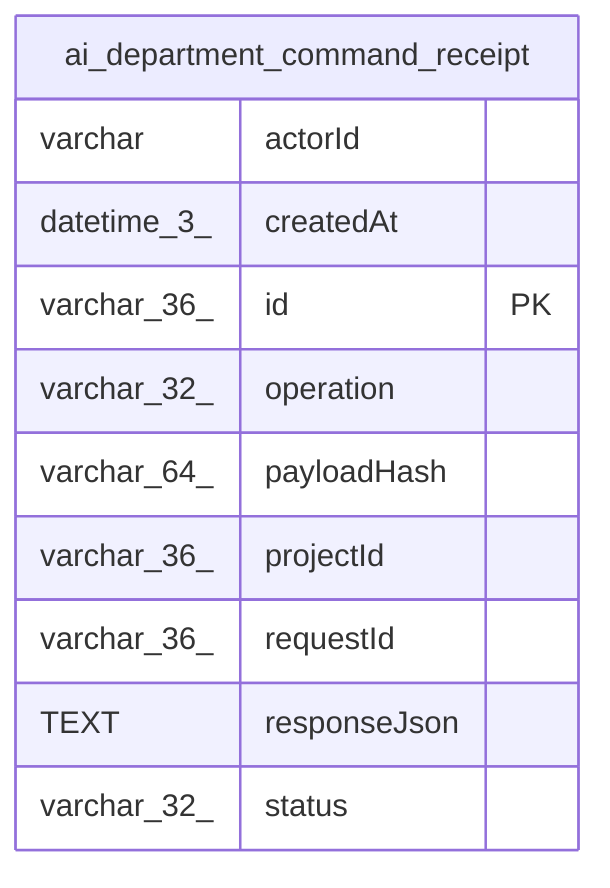

# ai_department_command_receipt

## Description

<details>
<summary><strong>Table Definition</strong></summary>

```sql
CREATE TABLE "ai_department_command_receipt" ("id" varchar(36) PRIMARY KEY NOT NULL, "projectId" varchar(36) NOT NULL, "actorId" varchar NOT NULL, "requestId" varchar(36) NOT NULL, "payloadHash" varchar(64) NOT NULL, "operation" varchar(32) NOT NULL, "status" varchar(32) NOT NULL, "responseJson" text, "createdAt" datetime(3) NOT NULL)
```

</details>

## Columns

| Name | Type | Default | Nullable | Children | Parents | Comment |
| ---- | ---- | ------- | -------- | -------- | ------- | ------- |
| actorId | varchar |  | false |  |  |  |
| createdAt | datetime(3) |  | false |  |  |  |
| id | varchar(36) |  | false |  |  |  |
| operation | varchar(32) |  | false |  |  |  |
| payloadHash | varchar(64) |  | false |  |  |  |
| projectId | varchar(36) |  | false |  |  |  |
| requestId | varchar(36) |  | false |  |  |  |
| responseJson | TEXT |  | true |  |  |  |
| status | varchar(32) |  | false |  |  |  |

## Constraints

| Name | Type | Definition |
| ---- | ---- | ---------- |
| id | PRIMARY KEY | PRIMARY KEY (id) |
| sqlite_autoindex_ai_department_command_receipt_1 | PRIMARY KEY | PRIMARY KEY (id) |

## Indexes

| Name | Definition |
| ---- | ---------- |
| IDX_f09cfc5ea90ad3f4e9999b792b | CREATE UNIQUE INDEX "IDX_f09cfc5ea90ad3f4e9999b792b" ON "ai_department_command_receipt" ("projectId", "actorId", "requestId")  |
| sqlite_autoindex_ai_department_command_receipt_1 | PRIMARY KEY (id) |

## Relations



---

> Generated by [tbls](https://github.com/k1LoW/tbls)
