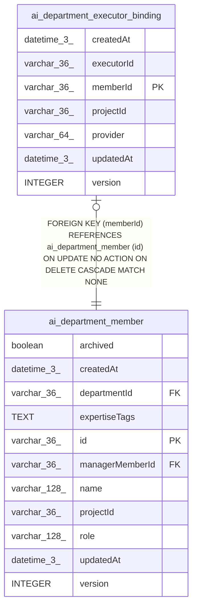

# ai_department_executor_binding

## Description

<details>
<summary><strong>Table Definition</strong></summary>

```sql
CREATE TABLE "ai_department_executor_binding" ("memberId" varchar(36) PRIMARY KEY NOT NULL, "projectId" varchar(36) NOT NULL, "provider" varchar(64) NOT NULL, "executorId" varchar(36) NOT NULL, "version" integer NOT NULL DEFAULT (1), "createdAt" datetime(3) NOT NULL DEFAULT (STRFTIME('%Y-%m-%d %H:%M:%f', 'NOW')), "updatedAt" datetime(3) NOT NULL DEFAULT (STRFTIME('%Y-%m-%d %H:%M:%f', 'NOW')), CONSTRAINT "FK_90aa8e6894c252838848a808083" FOREIGN KEY ("memberId") REFERENCES "ai_department_member" ("id") ON DELETE CASCADE)
```

</details>

## Columns

| Name | Type | Default | Nullable | Children | Parents | Comment |
| ---- | ---- | ------- | -------- | -------- | ------- | ------- |
| createdAt | datetime(3) | STRFTIME('%Y-%m-%d %H:%M:%f', 'NOW') | false |  |  |  |
| executorId | varchar(36) |  | false |  |  |  |
| memberId | varchar(36) |  | false |  | [ai_department_member](ai_department_member.md) |  |
| projectId | varchar(36) |  | false |  |  |  |
| provider | varchar(64) |  | false |  |  |  |
| updatedAt | datetime(3) | STRFTIME('%Y-%m-%d %H:%M:%f', 'NOW') | false |  |  |  |
| version | INTEGER | 1 | false |  |  |  |

## Constraints

| Name | Type | Definition |
| ---- | ---- | ---------- |
| - (Foreign key ID: 0) | FOREIGN KEY | FOREIGN KEY (memberId) REFERENCES ai_department_member (id) ON UPDATE NO ACTION ON DELETE CASCADE MATCH NONE |
| memberId | PRIMARY KEY | PRIMARY KEY (memberId) |
| sqlite_autoindex_ai_department_executor_binding_1 | PRIMARY KEY | PRIMARY KEY (memberId) |

## Indexes

| Name | Definition |
| ---- | ---------- |
| sqlite_autoindex_ai_department_executor_binding_1 | PRIMARY KEY (memberId) |

## Relations



---

> Generated by [tbls](https://github.com/k1LoW/tbls)
