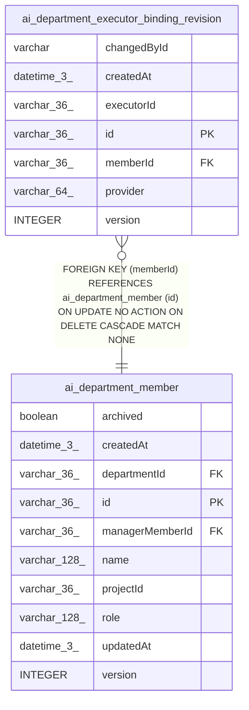

# ai_department_executor_binding_revision

## Description

<details>
<summary><strong>Table Definition</strong></summary>

```sql
CREATE TABLE "ai_department_executor_binding_revision" ("id" varchar(36) PRIMARY KEY NOT NULL, "memberId" varchar(36) NOT NULL, "version" integer NOT NULL, "provider" varchar(64) NOT NULL, "executorId" varchar(36) NOT NULL, "changedById" varchar NOT NULL, "createdAt" datetime(3) NOT NULL, CONSTRAINT "FK_487f0479b3843eee5b5fe6ad1b6" FOREIGN KEY ("memberId") REFERENCES "ai_department_member" ("id") ON DELETE CASCADE)
```

</details>

## Columns

| Name | Type | Default | Nullable | Children | Parents | Comment |
| ---- | ---- | ------- | -------- | -------- | ------- | ------- |
| changedById | varchar |  | false |  |  |  |
| createdAt | datetime(3) |  | false |  |  |  |
| executorId | varchar(36) |  | false |  |  |  |
| id | varchar(36) |  | false |  |  |  |
| memberId | varchar(36) |  | false |  | [ai_department_member](ai_department_member.md) |  |
| provider | varchar(64) |  | false |  |  |  |
| version | INTEGER |  | false |  |  |  |

## Constraints

| Name | Type | Definition |
| ---- | ---- | ---------- |
| - (Foreign key ID: 0) | FOREIGN KEY | FOREIGN KEY (memberId) REFERENCES ai_department_member (id) ON UPDATE NO ACTION ON DELETE CASCADE MATCH NONE |
| id | PRIMARY KEY | PRIMARY KEY (id) |
| sqlite_autoindex_ai_department_executor_binding_revision_1 | PRIMARY KEY | PRIMARY KEY (id) |

## Indexes

| Name | Definition |
| ---- | ---------- |
| IDX_1cac7eeb51d2b236058691e339 | CREATE UNIQUE INDEX "IDX_1cac7eeb51d2b236058691e339" ON "ai_department_executor_binding_revision" ("memberId", "version")  |
| sqlite_autoindex_ai_department_executor_binding_revision_1 | PRIMARY KEY (id) |

## Relations



---

> Generated by [tbls](https://github.com/k1LoW/tbls)
