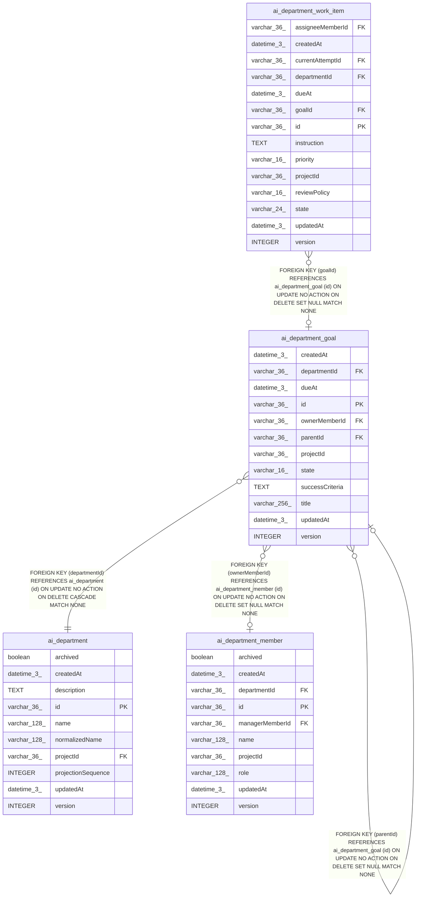

# ai_department_goal

## Description

<details>
<summary><strong>Table Definition</strong></summary>

```sql
CREATE TABLE "ai_department_goal" ("id" varchar(36) PRIMARY KEY NOT NULL, "projectId" varchar(36) NOT NULL, "departmentId" varchar(36) NOT NULL, "title" varchar(256) NOT NULL, "successCriteria" text, "parentId" varchar(36), "ownerMemberId" varchar(36), "dueAt" datetime(3), "state" varchar(16) NOT NULL DEFAULT ('active'), "version" integer NOT NULL DEFAULT (1), "createdAt" datetime(3) NOT NULL DEFAULT (STRFTIME('%Y-%m-%d %H:%M:%f', 'NOW')), "updatedAt" datetime(3) NOT NULL DEFAULT (STRFTIME('%Y-%m-%d %H:%M:%f', 'NOW')), CONSTRAINT "FK_68387991320409a956f3ae9bce0" FOREIGN KEY ("departmentId") REFERENCES "ai_department" ("id") ON DELETE CASCADE, CONSTRAINT "FK_c4d22c0f1b852dddf259971d2c9" FOREIGN KEY ("parentId") REFERENCES "ai_department_goal" ("id") ON DELETE SET NULL, CONSTRAINT "FK_f5b5966dc88b988471e15dcff89" FOREIGN KEY ("ownerMemberId") REFERENCES "ai_department_member" ("id") ON DELETE SET NULL)
```

</details>

## Columns

| Name | Type | Default | Nullable | Children | Parents | Comment |
| ---- | ---- | ------- | -------- | -------- | ------- | ------- |
| createdAt | datetime(3) | STRFTIME('%Y-%m-%d %H:%M:%f', 'NOW') | false |  |  |  |
| departmentId | varchar(36) |  | false |  | [ai_department](ai_department.md) |  |
| dueAt | datetime(3) |  | true |  |  |  |
| id | varchar(36) |  | false | [ai_department_goal](ai_department_goal.md) [ai_department_work_item](ai_department_work_item.md) |  |  |
| ownerMemberId | varchar(36) |  | true |  | [ai_department_member](ai_department_member.md) |  |
| parentId | varchar(36) |  | true |  | [ai_department_goal](ai_department_goal.md) |  |
| projectId | varchar(36) |  | false |  |  |  |
| state | varchar(16) | 'active' | false |  |  |  |
| successCriteria | TEXT |  | true |  |  |  |
| title | varchar(256) |  | false |  |  |  |
| updatedAt | datetime(3) | STRFTIME('%Y-%m-%d %H:%M:%f', 'NOW') | false |  |  |  |
| version | INTEGER | 1 | false |  |  |  |

## Constraints

| Name | Type | Definition |
| ---- | ---- | ---------- |
| - (Foreign key ID: 0) | FOREIGN KEY | FOREIGN KEY (ownerMemberId) REFERENCES ai_department_member (id) ON UPDATE NO ACTION ON DELETE SET NULL MATCH NONE |
| - (Foreign key ID: 1) | FOREIGN KEY | FOREIGN KEY (parentId) REFERENCES ai_department_goal (id) ON UPDATE NO ACTION ON DELETE SET NULL MATCH NONE |
| - (Foreign key ID: 2) | FOREIGN KEY | FOREIGN KEY (departmentId) REFERENCES ai_department (id) ON UPDATE NO ACTION ON DELETE CASCADE MATCH NONE |
| id | PRIMARY KEY | PRIMARY KEY (id) |
| sqlite_autoindex_ai_department_goal_1 | PRIMARY KEY | PRIMARY KEY (id) |

## Indexes

| Name | Definition |
| ---- | ---------- |
| IDX_4a426d6c3706582f61dd95e802 | CREATE INDEX "IDX_4a426d6c3706582f61dd95e802" ON "ai_department_goal" ("departmentId", "parentId")  |
| IDX_ab7604d426b6cd2941d34f1ab2 | CREATE INDEX "IDX_ab7604d426b6cd2941d34f1ab2" ON "ai_department_goal" ("projectId", "departmentId", "state")  |
| sqlite_autoindex_ai_department_goal_1 | PRIMARY KEY (id) |

## Relations



---

> Generated by [tbls](https://github.com/k1LoW/tbls)
