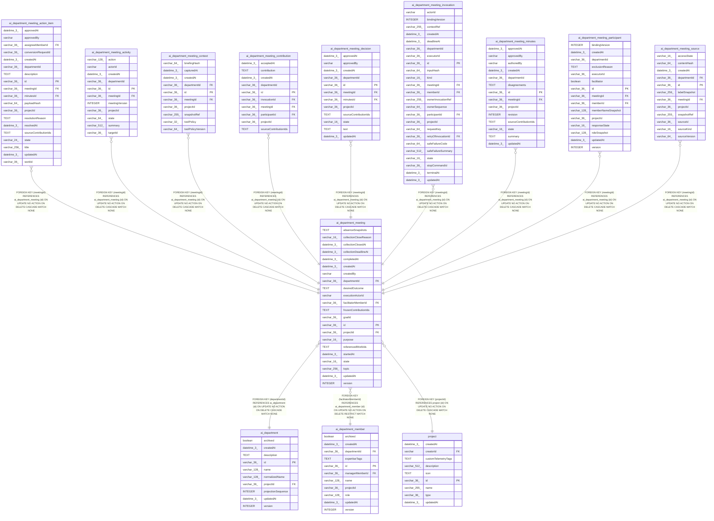

# ai_department_meeting

## Description

<details>
<summary><strong>Table Definition</strong></summary>

```sql
CREATE TABLE "ai_department_meeting" ("id" varchar(36) PRIMARY KEY NOT NULL, "projectId" varchar(36) NOT NULL, "departmentId" varchar(36) NOT NULL, "createdBy" varchar NOT NULL, "executionActorId" varchar NOT NULL, "topic" varchar(256) NOT NULL, "purpose" varchar(16) NOT NULL DEFAULT ('decision'), "desiredOutcome" text NOT NULL, "state" varchar(16) NOT NULL DEFAULT ('draft'), "facilitatorMemberId" varchar(36) NOT NULL, "goalId" varchar(36), "referencedWorkIds" text NOT NULL, "version" integer NOT NULL DEFAULT (1), "startedAt" datetime(3), "collectionDeadlineAt" datetime(3), "frozenContributionIds" text, "collectionClosedAt" datetime(3), "collectionCloseReason" varchar(16), "absenceSnapshots" text, "completedAt" datetime(3), "createdAt" datetime(3) NOT NULL DEFAULT (STRFTIME('%Y-%m-%d %H:%M:%f', 'NOW')), "updatedAt" datetime(3) NOT NULL DEFAULT (STRFTIME('%Y-%m-%d %H:%M:%f', 'NOW')), CONSTRAINT "CHK_ai_department_meeting_purpose" CHECK ("purpose" IN ('decision', 'risk-review', 'ideation')), CONSTRAINT "CHK_ai_department_meeting_state" CHECK ("state" IN ('draft', 'collecting', 'synthesizing', 'review', 'approved', 'completed', 'cancelling', 'cancelled')), CONSTRAINT "CHK_ai_department_meeting_collectionCloseReason" CHECK ("collectionCloseReason" IN ('quorum', 'deadline')), CONSTRAINT "FK_b28238adaf018e5cbe0d08a2906" FOREIGN KEY ("projectId") REFERENCES "project" ("id") ON DELETE CASCADE, CONSTRAINT "FK_d213566e93880cba2656e4ae3a2" FOREIGN KEY ("departmentId") REFERENCES "ai_department" ("id") ON DELETE CASCADE, CONSTRAINT "FK_8a447ace0cb35f0ed190362e861" FOREIGN KEY ("facilitatorMemberId") REFERENCES "ai_department_member" ("id") ON DELETE RESTRICT)
```

</details>

## Columns

| Name | Type | Default | Nullable | Children | Parents | Comment |
| ---- | ---- | ------- | -------- | -------- | ------- | ------- |
| absenceSnapshots | TEXT |  | true |  |  |  |
| collectionCloseReason | varchar(16) |  | true |  |  |  |
| collectionClosedAt | datetime(3) |  | true |  |  |  |
| collectionDeadlineAt | datetime(3) |  | true |  |  |  |
| completedAt | datetime(3) |  | true |  |  |  |
| createdAt | datetime(3) | STRFTIME('%Y-%m-%d %H:%M:%f', 'NOW') | false |  |  |  |
| createdBy | varchar |  | false |  |  |  |
| departmentId | varchar(36) |  | false |  | [ai_department](ai_department.md) |  |
| desiredOutcome | TEXT |  | false |  |  |  |
| executionActorId | varchar |  | false |  |  |  |
| facilitatorMemberId | varchar(36) |  | false |  | [ai_department_member](ai_department_member.md) |  |
| frozenContributionIds | TEXT |  | true |  |  |  |
| goalId | varchar(36) |  | true |  |  |  |
| id | varchar(36) |  | false | [ai_department_meeting_action_item](ai_department_meeting_action_item.md) [ai_department_meeting_activity](ai_department_meeting_activity.md) [ai_department_meeting_context](ai_department_meeting_context.md) [ai_department_meeting_contribution](ai_department_meeting_contribution.md) [ai_department_meeting_decision](ai_department_meeting_decision.md) [ai_department_meeting_invocation](ai_department_meeting_invocation.md) [ai_department_meeting_minutes](ai_department_meeting_minutes.md) [ai_department_meeting_participant](ai_department_meeting_participant.md) [ai_department_meeting_source](ai_department_meeting_source.md) |  |  |
| projectId | varchar(36) |  | false |  | [project](project.md) |  |
| purpose | varchar(16) | 'decision' | false |  |  |  |
| referencedWorkIds | TEXT |  | false |  |  |  |
| startedAt | datetime(3) |  | true |  |  |  |
| state | varchar(16) | 'draft' | false |  |  |  |
| topic | varchar(256) |  | false |  |  |  |
| updatedAt | datetime(3) | STRFTIME('%Y-%m-%d %H:%M:%f', 'NOW') | false |  |  |  |
| version | INTEGER | 1 | false |  |  |  |

## Constraints

| Name | Type | Definition |
| ---- | ---- | ---------- |
| - | CHECK | CHECK ("purpose" IN ('decision', 'risk-review', 'ideation')) |
| - | CHECK | CHECK ("state" IN ('draft', 'collecting', 'synthesizing', 'review', 'approved', 'completed', 'cancelling', 'cancelled')) |
| - | CHECK | CHECK ("collectionCloseReason" IN ('quorum', 'deadline')) |
| - (Foreign key ID: 0) | FOREIGN KEY | FOREIGN KEY (facilitatorMemberId) REFERENCES ai_department_member (id) ON UPDATE NO ACTION ON DELETE RESTRICT MATCH NONE |
| - (Foreign key ID: 1) | FOREIGN KEY | FOREIGN KEY (departmentId) REFERENCES ai_department (id) ON UPDATE NO ACTION ON DELETE CASCADE MATCH NONE |
| - (Foreign key ID: 2) | FOREIGN KEY | FOREIGN KEY (projectId) REFERENCES project (id) ON UPDATE NO ACTION ON DELETE CASCADE MATCH NONE |
| id | PRIMARY KEY | PRIMARY KEY (id) |
| sqlite_autoindex_ai_department_meeting_1 | PRIMARY KEY | PRIMARY KEY (id) |

## Indexes

| Name | Definition |
| ---- | ---------- |
| IDX_b8f5cf8595888d82cd522285a3 | CREATE INDEX "IDX_b8f5cf8595888d82cd522285a3" ON "ai_department_meeting" ("projectId", "departmentId", "state", "updatedAt")  |
| sqlite_autoindex_ai_department_meeting_1 | PRIMARY KEY (id) |

## Relations



---

> Generated by [tbls](https://github.com/k1LoW/tbls)
