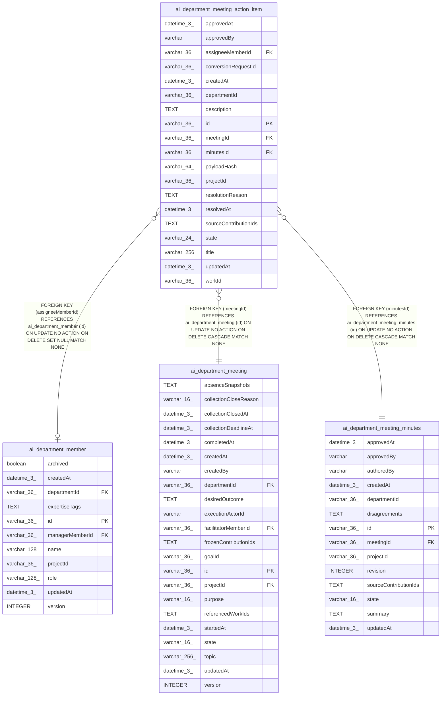

# ai_department_meeting_action_item

## Description

<details>
<summary><strong>Table Definition</strong></summary>

```sql
CREATE TABLE "ai_department_meeting_action_item" ("id" varchar(36) PRIMARY KEY NOT NULL, "projectId" varchar(36) NOT NULL, "departmentId" varchar(36) NOT NULL, "meetingId" varchar(36) NOT NULL, "minutesId" varchar(36) NOT NULL, "title" varchar(256) NOT NULL, "description" text, "assigneeMemberId" varchar(36), "sourceContributionIds" text NOT NULL, "state" varchar(24) NOT NULL DEFAULT ('proposed'), "workId" varchar(36), "conversionRequestId" varchar(36), "payloadHash" varchar(64), "resolutionReason" text, "approvedBy" varchar, "approvedAt" datetime(3), "resolvedAt" datetime(3), "createdAt" datetime(3) NOT NULL DEFAULT (STRFTIME('%Y-%m-%d %H:%M:%f', 'NOW')), "updatedAt" datetime(3) NOT NULL DEFAULT (STRFTIME('%Y-%m-%d %H:%M:%f', 'NOW')), CONSTRAINT "CHK_ai_department_meeting_action_item_state" CHECK ("state" IN ('proposed', 'approved', 'conversion_pending', 'converted', 'declined')), CONSTRAINT "FK_e7c5e9dcfe47bdc427a6920312e" FOREIGN KEY ("meetingId") REFERENCES "ai_department_meeting" ("id") ON DELETE CASCADE, CONSTRAINT "FK_d7dbebdc920ee0b5031e1285da5" FOREIGN KEY ("minutesId") REFERENCES "ai_department_meeting_minutes" ("id") ON DELETE CASCADE, CONSTRAINT "FK_de62a86eb2086db0b0a2e0b8dc4" FOREIGN KEY ("assigneeMemberId") REFERENCES "ai_department_member" ("id") ON DELETE SET NULL)
```

</details>

## Columns

| Name | Type | Default | Nullable | Children | Parents | Comment |
| ---- | ---- | ------- | -------- | -------- | ------- | ------- |
| approvedAt | datetime(3) |  | true |  |  |  |
| approvedBy | varchar |  | true |  |  |  |
| assigneeMemberId | varchar(36) |  | true |  | [ai_department_member](ai_department_member.md) |  |
| conversionRequestId | varchar(36) |  | true |  |  |  |
| createdAt | datetime(3) | STRFTIME('%Y-%m-%d %H:%M:%f', 'NOW') | false |  |  |  |
| departmentId | varchar(36) |  | false |  |  |  |
| description | TEXT |  | true |  |  |  |
| id | varchar(36) |  | false |  |  |  |
| meetingId | varchar(36) |  | false |  | [ai_department_meeting](ai_department_meeting.md) |  |
| minutesId | varchar(36) |  | false |  | [ai_department_meeting_minutes](ai_department_meeting_minutes.md) |  |
| payloadHash | varchar(64) |  | true |  |  |  |
| projectId | varchar(36) |  | false |  |  |  |
| resolutionReason | TEXT |  | true |  |  |  |
| resolvedAt | datetime(3) |  | true |  |  |  |
| sourceContributionIds | TEXT |  | false |  |  |  |
| state | varchar(24) | 'proposed' | false |  |  |  |
| title | varchar(256) |  | false |  |  |  |
| updatedAt | datetime(3) | STRFTIME('%Y-%m-%d %H:%M:%f', 'NOW') | false |  |  |  |
| workId | varchar(36) |  | true |  |  |  |

## Constraints

| Name | Type | Definition |
| ---- | ---- | ---------- |
| - | CHECK | CHECK ("state" IN ('proposed', 'approved', 'conversion_pending', 'converted', 'declined')) |
| - (Foreign key ID: 0) | FOREIGN KEY | FOREIGN KEY (assigneeMemberId) REFERENCES ai_department_member (id) ON UPDATE NO ACTION ON DELETE SET NULL MATCH NONE |
| - (Foreign key ID: 1) | FOREIGN KEY | FOREIGN KEY (minutesId) REFERENCES ai_department_meeting_minutes (id) ON UPDATE NO ACTION ON DELETE CASCADE MATCH NONE |
| - (Foreign key ID: 2) | FOREIGN KEY | FOREIGN KEY (meetingId) REFERENCES ai_department_meeting (id) ON UPDATE NO ACTION ON DELETE CASCADE MATCH NONE |
| id | PRIMARY KEY | PRIMARY KEY (id) |
| sqlite_autoindex_ai_department_meeting_action_item_1 | PRIMARY KEY | PRIMARY KEY (id) |

## Indexes

| Name | Definition |
| ---- | ---------- |
| IDX_ai_department_meeting_action_item_workId | CREATE UNIQUE INDEX "IDX_ai_department_meeting_action_item_workId" ON "ai_department_meeting_action_item" ("workId") WHERE "workId" IS NOT NULL |
| IDX_d7dbebdc920ee0b5031e1285da | CREATE INDEX "IDX_d7dbebdc920ee0b5031e1285da" ON "ai_department_meeting_action_item" ("minutesId")  |
| IDX_f0a9ca85997547e5d8436a72c3 | CREATE INDEX "IDX_f0a9ca85997547e5d8436a72c3" ON "ai_department_meeting_action_item" ("projectId", "meetingId", "state")  |
| sqlite_autoindex_ai_department_meeting_action_item_1 | PRIMARY KEY (id) |

## Relations



---

> Generated by [tbls](https://github.com/k1LoW/tbls)
