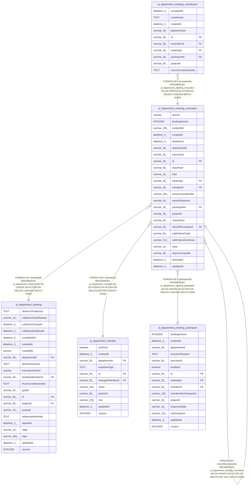

# ai_department_meeting_invocation

## Description

<details>
<summary><strong>Table Definition</strong></summary>

```sql
CREATE TABLE "ai_department_meeting_invocation" ("id" varchar(36) PRIMARY KEY NOT NULL, "projectId" varchar(36) NOT NULL, "departmentId" varchar(36) NOT NULL, "meetingId" varchar(36) NOT NULL, "participantId" varchar(36) NOT NULL, "kind" varchar(16) NOT NULL, "requestKey" varchar(64) NOT NULL, "inputHash" varchar(64) NOT NULL, "contextRef" varchar(255) NOT NULL, "actorId" varchar NOT NULL, "memberId" varchar(36) NOT NULL, "executorId" varchar(36) NOT NULL, "bindingVersion" integer NOT NULL, "ownerInvocationRef" varchar(255), "state" varchar(16) NOT NULL DEFAULT ('reserved'), "ownerSequence" varchar(64), "deadlineAt" datetime(3), "terminalAt" datetime(3), "retryOfInvocationId" varchar(36), "safeFailureCode" varchar(64), "safeFailureSummary" varchar(512), "stopCommandId" varchar(36), "createdAt" datetime(3) NOT NULL DEFAULT (STRFTIME('%Y-%m-%d %H:%M:%f', 'NOW')), "updatedAt" datetime(3) NOT NULL DEFAULT (STRFTIME('%Y-%m-%d %H:%M:%f', 'NOW')), CONSTRAINT "CHK_ai_department_meeting_invocation_kind" CHECK ("kind" IN ('contribution', 'synthesis')), CONSTRAINT "CHK_ai_department_meeting_invocation_state" CHECK ("state" IN ('reserved', 'queued', 'running', 'succeeded', 'failed', 'unavailable', 'stop_pending', 'unknown', 'cancelled')), CONSTRAINT "FK_2c9f4d891bed0e65da0b88a8916" FOREIGN KEY ("meetingId") REFERENCES "ai_department_meeting" ("id") ON DELETE CASCADE, CONSTRAINT "FK_e6b22cfb2a751c3df243472068d" FOREIGN KEY ("participantId") REFERENCES "ai_department_meeting_participant" ("id") ON DELETE CASCADE, CONSTRAINT "FK_d20cad967ce17c86a99e81d1252" FOREIGN KEY ("memberId") REFERENCES "ai_department_member" ("id") ON DELETE RESTRICT, CONSTRAINT "FK_64a80305a7e6474a76e8364452f" FOREIGN KEY ("retryOfInvocationId") REFERENCES "ai_department_meeting_invocation" ("id") ON DELETE SET NULL)
```

</details>

## Columns

| Name | Type | Default | Nullable | Children | Parents | Comment |
| ---- | ---- | ------- | -------- | -------- | ------- | ------- |
| actorId | varchar |  | false |  |  |  |
| bindingVersion | INTEGER |  | false |  |  |  |
| contextRef | varchar(255) |  | false |  |  |  |
| createdAt | datetime(3) | STRFTIME('%Y-%m-%d %H:%M:%f', 'NOW') | false |  |  |  |
| deadlineAt | datetime(3) |  | true |  |  |  |
| departmentId | varchar(36) |  | false |  |  |  |
| executorId | varchar(36) |  | false |  |  |  |
| id | varchar(36) |  | false | [ai_department_meeting_contribution](ai_department_meeting_contribution.md) [ai_department_meeting_invocation](ai_department_meeting_invocation.md) |  |  |
| inputHash | varchar(64) |  | false |  |  |  |
| kind | varchar(16) |  | false |  |  |  |
| meetingId | varchar(36) |  | false |  | [ai_department_meeting](ai_department_meeting.md) |  |
| memberId | varchar(36) |  | false |  | [ai_department_member](ai_department_member.md) |  |
| ownerInvocationRef | varchar(255) |  | true |  |  |  |
| ownerSequence | varchar(64) |  | true |  |  |  |
| participantId | varchar(36) |  | false |  | [ai_department_meeting_participant](ai_department_meeting_participant.md) |  |
| projectId | varchar(36) |  | false |  |  |  |
| requestKey | varchar(64) |  | false |  |  |  |
| retryOfInvocationId | varchar(36) |  | true |  | [ai_department_meeting_invocation](ai_department_meeting_invocation.md) |  |
| safeFailureCode | varchar(64) |  | true |  |  |  |
| safeFailureSummary | varchar(512) |  | true |  |  |  |
| state | varchar(16) | 'reserved' | false |  |  |  |
| stopCommandId | varchar(36) |  | true |  |  |  |
| terminalAt | datetime(3) |  | true |  |  |  |
| updatedAt | datetime(3) | STRFTIME('%Y-%m-%d %H:%M:%f', 'NOW') | false |  |  |  |

## Constraints

| Name | Type | Definition |
| ---- | ---- | ---------- |
| - | CHECK | CHECK ("kind" IN ('contribution', 'synthesis')) |
| - | CHECK | CHECK ("state" IN ('reserved', 'queued', 'running', 'succeeded', 'failed', 'unavailable', 'stop_pending', 'unknown', 'cancelled')) |
| - (Foreign key ID: 0) | FOREIGN KEY | FOREIGN KEY (retryOfInvocationId) REFERENCES ai_department_meeting_invocation (id) ON UPDATE NO ACTION ON DELETE SET NULL MATCH NONE |
| - (Foreign key ID: 1) | FOREIGN KEY | FOREIGN KEY (memberId) REFERENCES ai_department_member (id) ON UPDATE NO ACTION ON DELETE RESTRICT MATCH NONE |
| - (Foreign key ID: 2) | FOREIGN KEY | FOREIGN KEY (participantId) REFERENCES ai_department_meeting_participant (id) ON UPDATE NO ACTION ON DELETE CASCADE MATCH NONE |
| - (Foreign key ID: 3) | FOREIGN KEY | FOREIGN KEY (meetingId) REFERENCES ai_department_meeting (id) ON UPDATE NO ACTION ON DELETE CASCADE MATCH NONE |
| id | PRIMARY KEY | PRIMARY KEY (id) |
| sqlite_autoindex_ai_department_meeting_invocation_1 | PRIMARY KEY | PRIMARY KEY (id) |

## Indexes

| Name | Definition |
| ---- | ---------- |
| IDX_3c3a9cedc16ffb2d6fb67f868d | CREATE INDEX "IDX_3c3a9cedc16ffb2d6fb67f868d" ON "ai_department_meeting_invocation" ("projectId", "meetingId", "kind", "state")  |
| IDX_7135c943ad91118ac9d160f0d9 | CREATE UNIQUE INDEX "IDX_7135c943ad91118ac9d160f0d9" ON "ai_department_meeting_invocation" ("projectId", "requestKey")  |
| IDX_e21e5aa79d96bdaa055cd48a69 | CREATE INDEX "IDX_e21e5aa79d96bdaa055cd48a69" ON "ai_department_meeting_invocation" ("projectId", "ownerInvocationRef")  |
| sqlite_autoindex_ai_department_meeting_invocation_1 | PRIMARY KEY (id) |

## Relations



---

> Generated by [tbls](https://github.com/k1LoW/tbls)
