# ai_department_meeting_participant

## Description

<details>
<summary><strong>Table Definition</strong></summary>

```sql
CREATE TABLE "ai_department_meeting_participant" ("id" varchar(36) PRIMARY KEY NOT NULL, "projectId" varchar(36) NOT NULL, "departmentId" varchar(36) NOT NULL, "meetingId" varchar(36) NOT NULL, "memberId" varchar(36) NOT NULL, "memberNameSnapshot" varchar(128) NOT NULL, "roleSnapshot" varchar(128) NOT NULL, "executorId" varchar(36), "bindingVersion" integer, "facilitator" boolean NOT NULL DEFAULT (false), "responseState" varchar(16) NOT NULL DEFAULT ('pending'), "exclusionReason" text, "version" integer NOT NULL DEFAULT (1), "createdAt" datetime(3) NOT NULL DEFAULT (STRFTIME('%Y-%m-%d %H:%M:%f', 'NOW')), "updatedAt" datetime(3) NOT NULL DEFAULT (STRFTIME('%Y-%m-%d %H:%M:%f', 'NOW')), CONSTRAINT "CHK_ai_department_meeting_participant_responseState" CHECK ("responseState" IN ('pending', 'queued', 'running', 'submitted', 'failed', 'unavailable', 'stop_pending', 'unknown', 'excluded')), CONSTRAINT "FK_0b535f07f412fb11017e4d54e7c" FOREIGN KEY ("meetingId") REFERENCES "ai_department_meeting" ("id") ON DELETE CASCADE, CONSTRAINT "FK_cc4509fb12beb11004df7348379" FOREIGN KEY ("memberId") REFERENCES "ai_department_member" ("id") ON DELETE RESTRICT)
```

</details>

## Columns

| Name | Type | Default | Nullable | Children | Parents | Comment |
| ---- | ---- | ------- | -------- | -------- | ------- | ------- |
| bindingVersion | INTEGER |  | true |  |  |  |
| createdAt | datetime(3) | STRFTIME('%Y-%m-%d %H:%M:%f', 'NOW') | false |  |  |  |
| departmentId | varchar(36) |  | false |  |  |  |
| exclusionReason | TEXT |  | true |  |  |  |
| executorId | varchar(36) |  | true |  |  |  |
| facilitator | boolean | false | false |  |  |  |
| id | varchar(36) |  | false | [ai_department_meeting_contribution](ai_department_meeting_contribution.md) [ai_department_meeting_invocation](ai_department_meeting_invocation.md) |  |  |
| meetingId | varchar(36) |  | false |  | [ai_department_meeting](ai_department_meeting.md) |  |
| memberId | varchar(36) |  | false |  | [ai_department_member](ai_department_member.md) |  |
| memberNameSnapshot | varchar(128) |  | false |  |  |  |
| projectId | varchar(36) |  | false |  |  |  |
| responseState | varchar(16) | 'pending' | false |  |  |  |
| roleSnapshot | varchar(128) |  | false |  |  |  |
| updatedAt | datetime(3) | STRFTIME('%Y-%m-%d %H:%M:%f', 'NOW') | false |  |  |  |
| version | INTEGER | 1 | false |  |  |  |

## Constraints

| Name | Type | Definition |
| ---- | ---- | ---------- |
| - | CHECK | CHECK ("responseState" IN ('pending', 'queued', 'running', 'submitted', 'failed', 'unavailable', 'stop_pending', 'unknown', 'excluded')) |
| - (Foreign key ID: 0) | FOREIGN KEY | FOREIGN KEY (memberId) REFERENCES ai_department_member (id) ON UPDATE NO ACTION ON DELETE RESTRICT MATCH NONE |
| - (Foreign key ID: 1) | FOREIGN KEY | FOREIGN KEY (meetingId) REFERENCES ai_department_meeting (id) ON UPDATE NO ACTION ON DELETE CASCADE MATCH NONE |
| id | PRIMARY KEY | PRIMARY KEY (id) |
| sqlite_autoindex_ai_department_meeting_participant_1 | PRIMARY KEY | PRIMARY KEY (id) |

## Indexes

| Name | Definition |
| ---- | ---------- |
| IDX_b86090d9b77ded810ab05237e8 | CREATE INDEX "IDX_b86090d9b77ded810ab05237e8" ON "ai_department_meeting_participant" ("projectId", "departmentId", "memberId", "meetingId")  |
| IDX_c72bbf9f44830ab23ef2007eb2 | CREATE UNIQUE INDEX "IDX_c72bbf9f44830ab23ef2007eb2" ON "ai_department_meeting_participant" ("meetingId", "memberId")  |
| sqlite_autoindex_ai_department_meeting_participant_1 | PRIMARY KEY (id) |

## Relations

```mermaid
erDiagram

"ai_department_meeting_contribution" }o--|| "ai_department_meeting_participant" : "FOREIGN KEY (participantId) REFERENCES ai_department_meeting_participant (id) ON UPDATE NO ACTION ON DELETE CASCADE MATCH NONE"
"ai_department_meeting_invocation" }o--|| "ai_department_meeting_participant" : "FOREIGN KEY (participantId) REFERENCES ai_department_meeting_participant (id) ON UPDATE NO ACTION ON DELETE CASCADE MATCH NONE"
"ai_department_meeting_participant" }o--|| "ai_department_meeting" : "FOREIGN KEY (meetingId) REFERENCES ai_department_meeting (id) ON UPDATE NO ACTION ON DELETE CASCADE MATCH NONE"
"ai_department_meeting_participant" }o--|| "ai_department_member" : "FOREIGN KEY (memberId) REFERENCES ai_department_member (id) ON UPDATE NO ACTION ON DELETE RESTRICT MATCH NONE"

"ai_department_meeting_participant" {
  INTEGER bindingVersion
  datetime_3_ createdAt
  varchar_36_ departmentId
  TEXT exclusionReason
  varchar_36_ executorId
  boolean facilitator
  varchar_36_ id PK
  varchar_36_ meetingId FK
  varchar_36_ memberId FK
  varchar_128_ memberNameSnapshot
  varchar_36_ projectId
  varchar_16_ responseState
  varchar_128_ roleSnapshot
  datetime_3_ updatedAt
  INTEGER version
}
"ai_department_meeting_contribution" {
  datetime_3_ acceptedAt
  TEXT contribution
  datetime_3_ createdAt
  varchar_36_ departmentId
  varchar_36_ id PK
  varchar_36_ invocationId FK
  varchar_36_ meetingId FK
  varchar_36_ participantId FK
  varchar_36_ projectId
  TEXT sourceContributionIds
}
"ai_department_meeting_invocation" {
  varchar actorId
  INTEGER bindingVersion
  varchar_255_ contextRef
  datetime_3_ createdAt
  datetime_3_ deadlineAt
  varchar_36_ departmentId
  varchar_36_ executorId
  varchar_36_ id PK
  varchar_64_ inputHash
  varchar_16_ kind
  varchar_36_ meetingId FK
  varchar_36_ memberId FK
  varchar_255_ ownerInvocationRef
  varchar_64_ ownerSequence
  varchar_36_ participantId FK
  varchar_36_ projectId
  varchar_64_ requestKey
  varchar_36_ retryOfInvocationId FK
  varchar_64_ safeFailureCode
  varchar_512_ safeFailureSummary
  varchar_16_ state
  varchar_36_ stopCommandId
  datetime_3_ terminalAt
  datetime_3_ updatedAt
}
"ai_department_meeting" {
  TEXT absenceSnapshots
  varchar_16_ collectionCloseReason
  datetime_3_ collectionClosedAt
  datetime_3_ collectionDeadlineAt
  datetime_3_ completedAt
  datetime_3_ createdAt
  varchar createdBy
  varchar_36_ departmentId FK
  TEXT desiredOutcome
  varchar executionActorId
  varchar_36_ facilitatorMemberId FK
  TEXT frozenContributionIds
  varchar_36_ goalId
  varchar_36_ id PK
  varchar_36_ projectId FK
  varchar_16_ purpose
  TEXT referencedWorkIds
  datetime_3_ startedAt
  varchar_16_ state
  varchar_256_ topic
  datetime_3_ updatedAt
  INTEGER version
}
"ai_department_member" {
  boolean archived
  datetime_3_ createdAt
  varchar_36_ departmentId FK
  TEXT expertiseTags
  varchar_36_ id PK
  varchar_36_ managerMemberId FK
  varchar_128_ name
  varchar_36_ projectId
  varchar_128_ role
  datetime_3_ updatedAt
  INTEGER version
}
```



---

> Generated by [tbls](https://github.com/k1LoW/tbls)
