# ai_department_work_attempt

## Description

<details>
<summary><strong>Table Definition</strong></summary>

```sql
CREATE TABLE "ai_department_work_attempt" ("id" varchar(36) PRIMARY KEY NOT NULL, "projectId" varchar(36) NOT NULL, "departmentId" varchar(36) NOT NULL, "workId" varchar(36) NOT NULL, "ordinal" integer NOT NULL, "initiatingUserId" varchar NOT NULL, "memberId" varchar(36) NOT NULL, "bindingVersion" integer NOT NULL, "provider" varchar(64) NOT NULL, "executorId" varchar(36) NOT NULL, "reviewPolicy" varchar(16) NOT NULL, "dispatchKey" varchar(36) NOT NULL, "ownerExecutionRef" varchar(255), "phase" varchar(16) NOT NULL DEFAULT ('dispatching'), "outcome" varchar(16), "resultReference" varchar(255), "safeSummary" text, "startedAt" datetime(3), "finishedAt" datetime(3), "cancelRequestedAt" datetime(3), "createdAt" datetime(3) NOT NULL DEFAULT (STRFTIME('%Y-%m-%d %H:%M:%f', 'NOW')), "updatedAt" datetime(3) NOT NULL DEFAULT (STRFTIME('%Y-%m-%d %H:%M:%f', 'NOW')), "lastOwnerSequence" varchar(20) NOT NULL DEFAULT ('0'), "cancelRequestId" varchar(36), "workflowIdsJson" text NOT NULL DEFAULT ('[]'), "workflowCapabilitiesJson" text NOT NULL DEFAULT ('[]'), "reviewStagesJson" text, "reviewPolicyRevision" integer NOT NULL DEFAULT (1), "reviewRoundStatus" varchar(16), "reviewRoundClosedAt" datetime(3), "reviewPolicyRevisionId" varchar(36), "submittedResultId" varchar(36), "reviewRoundId" varchar(36), CONSTRAINT "CHK_ai_department_work_attempt_reviewRoundStatus" CHECK ("reviewRoundStatus" IN ('open', 'accepted', 'returned', 'reopened')), CONSTRAINT "FK_5309258bca2a1c885c316032c0c" FOREIGN KEY ("workId") REFERENCES "ai_department_work_item" ("id") ON DELETE CASCADE ON UPDATE NO ACTION, CONSTRAINT "FK_b60f947d4504eb8a209ccfde774" FOREIGN KEY ("memberId") REFERENCES "ai_department_member" ("id") ON DELETE RESTRICT ON UPDATE NO ACTION)
```

</details>

## Columns

| Name | Type | Default | Nullable | Children | Parents | Comment |
| ---- | ---- | ------- | -------- | -------- | ------- | ------- |
| bindingVersion | INTEGER |  | false |  |  |  |
| cancelRequestId | varchar(36) |  | true |  |  |  |
| cancelRequestedAt | datetime(3) |  | true |  |  |  |
| createdAt | datetime(3) | STRFTIME('%Y-%m-%d %H:%M:%f', 'NOW') | false |  |  |  |
| departmentId | varchar(36) |  | false |  |  |  |
| dispatchKey | varchar(36) |  | false |  |  |  |
| executorId | varchar(36) |  | false |  |  |  |
| finishedAt | datetime(3) |  | true |  |  |  |
| id | varchar(36) |  | false | [agent_department_consultation_invocation](agent_department_consultation_invocation.md) [ai_department_work_claim](ai_department_work_claim.md) [ai_department_work_dispatch_intent](ai_department_work_dispatch_intent.md) [ai_department_work_help_request](ai_department_work_help_request.md) [ai_department_work_help_response](ai_department_work_help_response.md) [ai_department_work_item](ai_department_work_item.md) [ai_department_work_owner_event_receipt](ai_department_work_owner_event_receipt.md) [ai_department_work_review_decision](ai_department_work_review_decision.md) [ai_department_work_review_round](ai_department_work_review_round.md) [ai_department_work_submitted_result](ai_department_work_submitted_result.md) [ai_department_work_transition](ai_department_work_transition.md) [ai_department_workflow_invocation](ai_department_workflow_invocation.md) |  |  |
| initiatingUserId | varchar |  | false |  |  |  |
| lastOwnerSequence | varchar(20) | '0' | false |  |  |  |
| memberId | varchar(36) |  | false |  | [ai_department_member](ai_department_member.md) |  |
| ordinal | INTEGER |  | false |  |  |  |
| outcome | varchar(16) |  | true |  |  |  |
| ownerExecutionRef | varchar(255) |  | true |  |  |  |
| phase | varchar(16) | 'dispatching' | false |  |  |  |
| projectId | varchar(36) |  | false |  |  |  |
| provider | varchar(64) |  | false |  |  |  |
| resultReference | varchar(255) |  | true |  |  |  |
| reviewPolicy | varchar(16) |  | false |  |  |  |
| reviewPolicyRevision | INTEGER | 1 | false |  |  |  |
| reviewPolicyRevisionId | varchar(36) |  | true |  |  |  |
| reviewRoundClosedAt | datetime(3) |  | true |  |  |  |
| reviewRoundId | varchar(36) |  | true |  |  |  |
| reviewRoundStatus | varchar(16) |  | true |  |  |  |
| reviewStagesJson | TEXT |  | true |  |  |  |
| safeSummary | TEXT |  | true |  |  |  |
| startedAt | datetime(3) |  | true |  |  |  |
| submittedResultId | varchar(36) |  | true |  |  |  |
| updatedAt | datetime(3) | STRFTIME('%Y-%m-%d %H:%M:%f', 'NOW') | false |  |  |  |
| workId | varchar(36) |  | false |  | [ai_department_work_item](ai_department_work_item.md) |  |
| workflowCapabilitiesJson | TEXT | '[]' | false |  |  |  |
| workflowIdsJson | TEXT | '[]' | false |  |  |  |

## Constraints

| Name | Type | Definition |
| ---- | ---- | ---------- |
| - | CHECK | CHECK ("reviewRoundStatus" IN ('open', 'accepted', 'returned', 'reopened')) |
| - (Foreign key ID: 0) | FOREIGN KEY | FOREIGN KEY (memberId) REFERENCES ai_department_member (id) ON UPDATE NO ACTION ON DELETE RESTRICT MATCH NONE |
| - (Foreign key ID: 1) | FOREIGN KEY | FOREIGN KEY (workId) REFERENCES ai_department_work_item (id) ON UPDATE NO ACTION ON DELETE CASCADE MATCH NONE |
| id | PRIMARY KEY | PRIMARY KEY (id) |
| sqlite_autoindex_ai_department_work_attempt_1 | PRIMARY KEY | PRIMARY KEY (id) |

## Indexes

| Name | Definition |
| ---- | ---------- |
| IDX_2d26d020c5e04c2feb6496e220 | CREATE INDEX "IDX_2d26d020c5e04c2feb6496e220" ON "ai_department_work_attempt" ("projectId", "ownerExecutionRef")  |
| IDX_8db4b87f1e4763acda979f491e | CREATE UNIQUE INDEX "IDX_8db4b87f1e4763acda979f491e" ON "ai_department_work_attempt" ("dispatchKey")  |
| IDX_ai_department_work_attempt_projectId_id | CREATE UNIQUE INDEX "IDX_ai_department_work_attempt_projectId_id" ON "ai_department_work_attempt" ("projectId", "id")  |
| IDX_ai_department_work_attempt_projectId_memberId_initiatingUserId_bindingVersion_phase | CREATE INDEX "IDX_ai_department_work_attempt_projectId_memberId_initiatingUserId_bindingVersion_phase" ON "ai_department_work_attempt" ("projectId", "memberId", "initiatingUserId", "bindingVersion", "phase")  |
| IDX_ai_department_work_attempt_workId | CREATE UNIQUE INDEX "IDX_ai_department_work_attempt_workId" ON "ai_department_work_attempt" ("workId") WHERE "phase" IN ('dispatching', 'active', 'suspended') |
| IDX_cd463cb86ef4858e2594a516ed | CREATE UNIQUE INDEX "IDX_cd463cb86ef4858e2594a516ed" ON "ai_department_work_attempt" ("workId", "ordinal")  |
| sqlite_autoindex_ai_department_work_attempt_1 | PRIMARY KEY (id) |

## Relations

```mermaid
erDiagram

"agent_department_consultation_invocation" }o--|| "ai_department_work_attempt" : "FOREIGN KEY (sourceAttemptId) REFERENCES ai_department_work_attempt (id) ON UPDATE NO ACTION ON DELETE CASCADE MATCH NONE"
"ai_department_work_claim" }o--|| "ai_department_work_attempt" : "FOREIGN KEY (attemptId) REFERENCES ai_department_work_attempt (id) ON UPDATE NO ACTION ON DELETE CASCADE MATCH NONE"
"ai_department_work_dispatch_intent" |o--|| "ai_department_work_attempt" : "FOREIGN KEY (attemptId) REFERENCES ai_department_work_attempt (id) ON UPDATE NO ACTION ON DELETE CASCADE MATCH NONE"
"ai_department_work_help_request" }o--|| "ai_department_work_attempt" : "FOREIGN KEY (sourceAttemptId) REFERENCES ai_department_work_attempt (id) ON UPDATE NO ACTION ON DELETE CASCADE MATCH NONE"
"ai_department_work_help_response" }o--o| "ai_department_work_attempt" : "FOREIGN KEY (sourceAttemptId) REFERENCES ai_department_work_attempt (id) ON UPDATE NO ACTION ON DELETE SET NULL MATCH NONE"
"ai_department_work_item" }o--o| "ai_department_work_attempt" : "FOREIGN KEY (currentAttemptId) REFERENCES ai_department_work_attempt (id) ON UPDATE NO ACTION ON DELETE SET NULL MATCH NONE"
"ai_department_work_owner_event_receipt" }o--|| "ai_department_work_attempt" : "FOREIGN KEY (attemptId) REFERENCES ai_department_work_attempt (id) ON UPDATE NO ACTION ON DELETE CASCADE MATCH NONE"
"ai_department_work_review_decision" }o--|| "ai_department_work_attempt" : "FOREIGN KEY (attemptId) REFERENCES ai_department_work_attempt (id) ON UPDATE NO ACTION ON DELETE RESTRICT MATCH NONE"
"ai_department_work_review_round" }o--|| "ai_department_work_attempt" : "FOREIGN KEY (attemptId) REFERENCES ai_department_work_attempt (id) ON UPDATE NO ACTION ON DELETE CASCADE MATCH NONE"
"ai_department_work_submitted_result" }o--|| "ai_department_work_attempt" : "FOREIGN KEY (attemptId) REFERENCES ai_department_work_attempt (id) ON UPDATE NO ACTION ON DELETE CASCADE MATCH NONE"
"ai_department_work_transition" }o--o| "ai_department_work_attempt" : "FOREIGN KEY (attemptId) REFERENCES ai_department_work_attempt (id) ON UPDATE NO ACTION ON DELETE SET NULL MATCH NONE"
"ai_department_workflow_invocation" }o--|| "ai_department_work_attempt" : "FOREIGN KEY (attemptId) REFERENCES ai_department_work_attempt (id) ON UPDATE NO ACTION ON DELETE CASCADE MATCH NONE"
"ai_department_work_attempt" }o--|| "ai_department_member" : "FOREIGN KEY (memberId) REFERENCES ai_department_member (id) ON UPDATE NO ACTION ON DELETE RESTRICT MATCH NONE"
"ai_department_work_attempt" }o--|| "ai_department_work_item" : "FOREIGN KEY (workId) REFERENCES ai_department_work_item (id) ON UPDATE NO ACTION ON DELETE CASCADE MATCH NONE"

"ai_department_work_attempt" {
  INTEGER bindingVersion
  varchar_36_ cancelRequestId
  datetime_3_ cancelRequestedAt
  datetime_3_ createdAt
  varchar_36_ departmentId
  varchar_36_ dispatchKey
  varchar_36_ executorId
  datetime_3_ finishedAt
  varchar_36_ id PK
  varchar initiatingUserId
  varchar_20_ lastOwnerSequence
  varchar_36_ memberId FK
  INTEGER ordinal
  varchar_16_ outcome
  varchar_255_ ownerExecutionRef
  varchar_16_ phase
  varchar_36_ projectId
  varchar_64_ provider
  varchar_255_ resultReference
  varchar_16_ reviewPolicy
  INTEGER reviewPolicyRevision
  varchar_36_ reviewPolicyRevisionId
  datetime_3_ reviewRoundClosedAt
  varchar_36_ reviewRoundId
  varchar_16_ reviewRoundStatus
  TEXT reviewStagesJson
  TEXT safeSummary
  datetime_3_ startedAt
  varchar_36_ submittedResultId
  datetime_3_ updatedAt
  varchar_36_ workId FK
  TEXT workflowCapabilitiesJson
  TEXT workflowIdsJson
}
"agent_department_consultation_invocation" {
  varchar actorId
  INTEGER bindingVersion
  varchar_64_ commandKey
  varchar_64_ contextHash
  varchar_255_ contextRef
  datetime_3_ createdAt
  datetime_3_ deadlineAt
  varchar_36_ departmentId FK
  varchar_36_ executorId FK
  varchar_36_ helpRequestId FK
  varchar_36_ id PK
  varchar_64_ inputHash
  TEXT inputText
  varchar_36_ invocationId
  INTEGER maxOutputChars
  INTEGER maxOutputTokens
  varchar_16_ outcome
  varchar_36_ projectId FK
  varchar_36_ recipientMemberId FK
  varchar_36_ requesterMemberId FK
  varchar_64_ resultHash
  TEXT resultText
  varchar_64_ safeErrorCode
  varchar_64_ sequence
  varchar_36_ sourceAttemptId FK
  varchar_16_ state
  varchar_36_ stopCommandId
  varchar_64_ stopPayloadHash
  datetime_3_ stopRequestedAt
  datetime_3_ terminalAt
  varchar_128_ threadId
  datetime_3_ updatedAt
}
"ai_department_work_claim" {
  varchar_36_ attemptId FK
  INTEGER claimGeneration
  datetime_3_ claimedAt
  datetime_3_ createdAt
  varchar_36_ departmentId
  varchar_36_ executionId
  varchar_36_ id PK
  datetime_3_ leaseUntil
  varchar_36_ memberId
  varchar_36_ projectId
  datetime_3_ releasedAt
  varchar_36_ workId FK
}
"ai_department_work_dispatch_intent" {
  varchar_255_ acknowledgmentReference
  varchar_36_ attemptId PK
  datetime_3_ createdAt
  varchar_64_ inputHash
  datetime_3_ leaseUntil
  varchar_36_ projectId
  varchar_36_ requestId
  varchar_16_ state
  datetime_3_ updatedAt
}
"ai_department_work_help_request" {
  TEXT attemptedStepsJson
  INTEGER bindingVersion
  datetime_3_ createdAt
  datetime_3_ deadlineAt
  varchar_36_ departmentId FK
  TEXT expertiseTagsJson
  varchar_36_ id PK
  varchar initiatingUserId FK
  varchar_64_ inputHash
  varchar_64_ ownerInvocationHash
  varchar_128_ ownerReference
  varchar_36_ projectId FK
  TEXT question
  TEXT reason
  varchar_36_ recipientMemberId FK
  varchar_36_ recipientUserId FK
  TEXT requestChainJson
  varchar_36_ requestId
  varchar_36_ requesterMemberId FK
  varchar_32_ routingState
  varchar_36_ sourceAttemptId FK
  varchar_24_ state
  datetime_3_ updatedAt
  INTEGER version
  varchar_36_ workId FK
}
"ai_department_work_help_response" {
  varchar_36_ activityId FK
  TEXT answer
  varchar_64_ answerHash
  datetime_3_ createdAt
  varchar_36_ departmentId FK
  varchar_36_ helpRequestId FK
  varchar_36_ id PK
  varchar_128_ ownerInvocationRef
  INTEGER ownerSequence
  varchar_36_ projectId FK
  varchar_16_ responderKind
  varchar_36_ responderMemberId FK
  varchar responderUserId FK
  varchar_36_ sourceAttemptId FK
  varchar_36_ workId FK
}
"ai_department_work_item" {
  varchar_36_ assignedByUserId FK
  varchar_36_ assigneeMemberId FK
  datetime_3_ createdAt
  varchar_36_ currentAttemptId FK
  INTEGER currentReviewStageIndex
  varchar_36_ departmentId FK
  datetime_3_ dueAt
  varchar_36_ goalId FK
  varchar_36_ id PK
  TEXT instruction
  varchar_16_ priority
  varchar_36_ projectId
  varchar_16_ reviewPolicy
  INTEGER reviewPolicyRevision
  varchar_36_ reviewPolicyRevisionId
  TEXT reviewStagesJson
  varchar_24_ state
  datetime_3_ updatedAt
  INTEGER version
}
"ai_department_work_owner_event_receipt" {
  varchar_36_ attemptId FK
  datetime_3_ createdAt
  varchar_36_ id PK
  varchar_32_ kind
  datetime_3_ occurredAt
  varchar_255_ ownerEventId
  varchar_36_ projectId
  varchar_64_ provider
  datetime_3_ receivedAt
  TEXT safeSummary
  INTEGER schemaVersion
  varchar_20_ sequence
  datetime_3_ updatedAt
  varchar_36_ workId FK
}
"ai_department_work_review_decision" {
  varchar actorId
  varchar_36_ attemptId FK
  datetime_3_ createdAt
  varchar_16_ decision
  varchar_36_ departmentId
  varchar_36_ id PK
  INTEGER priorVersion
  varchar_36_ projectId
  TEXT reason
  varchar_36_ resultId
  varchar_36_ reviewRoundId
  varchar_64_ stageId
  varchar_36_ workId FK
}
"ai_department_work_review_round" {
  varchar_64_ activeStageId
  varchar_36_ attemptId FK
  datetime_3_ closedAt
  datetime_3_ createdAt
  varchar_36_ departmentId
  varchar_36_ id PK
  INTEGER ordinal
  varchar_36_ policyRevisionId FK
  varchar_36_ projectId
  varchar requesterId
  varchar_16_ requesterKind
  varchar_36_ resultId FK
  varchar_16_ status
  INTEGER version
  varchar_36_ workId FK
}
"ai_department_work_submitted_result" {
  varchar_36_ attemptId FK
  datetime_3_ createdAt
  varchar_36_ departmentId
  varchar_36_ id PK
  varchar_36_ projectId
  varchar_255_ reference
  TEXT safeSummary
  datetime_3_ submittedAt
  varchar submittedByUserId
  datetime_3_ updatedAt
  varchar_36_ workId FK
}
"ai_department_work_transition" {
  varchar_36_ actorId
  varchar_16_ actorKind
  varchar_36_ attemptId FK
  datetime_3_ createdAt
  varchar_36_ departmentId
  varchar_24_ fromState
  varchar_36_ id PK
  varchar_36_ projectId
  TEXT reason
  varchar_24_ toState
  varchar_36_ workId FK
  INTEGER workVersion
}
"ai_department_workflow_invocation" {
  varchar_36_ actualWorkflowVersion
  varchar_36_ attemptId FK
  datetime_3_ cancelRequestedAt
  varchar_36_ capabilityId FK
  INTEGER capabilityVersion
  varchar_16_ childState
  INTEGER claimGeneration
  datetime_3_ createdAt
  varchar_16_ dispatchState
  varchar_36_ expectedWorkflowVersion
  varchar_36_ id PK
  varchar_64_ inputHash
  varchar_255_ inputsRef
  varchar_36_ memberId
  varchar_255_ ownerExecutionRef
  varchar_64_ ownerInvocationKey
  varchar_36_ projectId
  varchar_128_ requestId
  varchar_255_ safeErrorReference
  varchar_255_ safeResultReference
  datetime_3_ updatedAt
  INTEGER version
  varchar_36_ workId FK
}
"ai_department_member" {
  boolean archived
  datetime_3_ createdAt
  varchar_36_ departmentId FK
  TEXT expertiseTags
  varchar_36_ id PK
  varchar_36_ managerMemberId FK
  varchar_128_ name
  varchar_36_ projectId
  varchar_128_ role
  datetime_3_ updatedAt
  INTEGER version
}
```



---

> Generated by [tbls](https://github.com/k1LoW/tbls)
