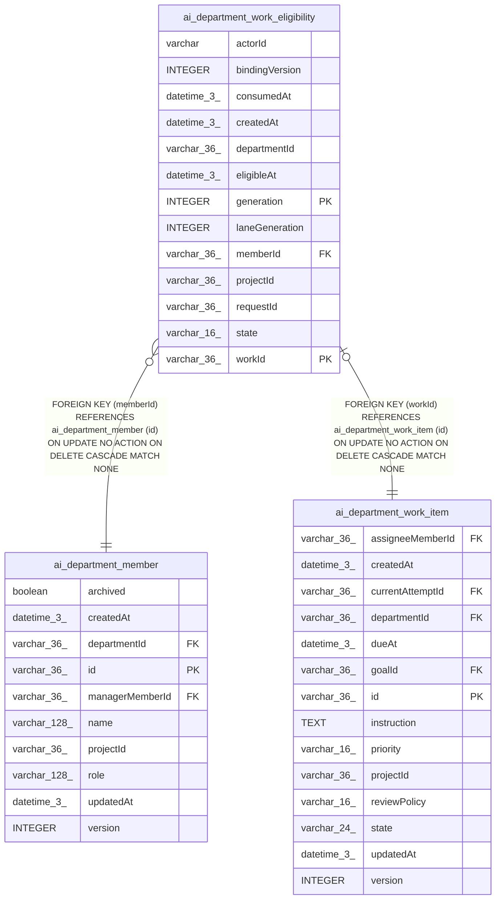

# ai_department_work_eligibility

## Description

<details>
<summary><strong>Table Definition</strong></summary>

```sql
CREATE TABLE "ai_department_work_eligibility" ("workId" varchar(36) NOT NULL, "generation" integer NOT NULL, "projectId" varchar(36) NOT NULL, "departmentId" varchar(36) NOT NULL, "memberId" varchar(36) NOT NULL, "actorId" varchar NOT NULL, "bindingVersion" integer, "laneGeneration" integer NOT NULL, "requestId" varchar(36) NOT NULL, "state" varchar(16) NOT NULL, "eligibleAt" datetime(3) NOT NULL, "consumedAt" datetime(3), "createdAt" datetime(3) NOT NULL DEFAULT (STRFTIME('%Y-%m-%d %H:%M:%f', 'NOW')), CONSTRAINT "CHK_ai_department_work_eligibility_state" CHECK ("state" IN ('pending', 'reserved', 'consumed', 'cancelled')), CONSTRAINT "FK_30464d9c45a497150624ccb5e95" FOREIGN KEY ("workId") REFERENCES "ai_department_work_item" ("id") ON DELETE CASCADE, CONSTRAINT "FK_44acfb40cae17273b8f0cf45c85" FOREIGN KEY ("memberId") REFERENCES "ai_department_member" ("id") ON DELETE CASCADE, PRIMARY KEY ("workId", "generation"))
```

</details>

## Columns

| Name | Type | Default | Nullable | Children | Parents | Comment |
| ---- | ---- | ------- | -------- | -------- | ------- | ------- |
| actorId | varchar |  | false |  |  |  |
| bindingVersion | INTEGER |  | true |  |  |  |
| consumedAt | datetime(3) |  | true |  |  |  |
| createdAt | datetime(3) | STRFTIME('%Y-%m-%d %H:%M:%f', 'NOW') | false |  |  |  |
| departmentId | varchar(36) |  | false |  |  |  |
| eligibleAt | datetime(3) |  | false |  |  |  |
| generation | INTEGER |  | false |  |  |  |
| laneGeneration | INTEGER |  | false |  |  |  |
| memberId | varchar(36) |  | false |  | [ai_department_member](ai_department_member.md) |  |
| projectId | varchar(36) |  | false |  |  |  |
| requestId | varchar(36) |  | false |  |  |  |
| state | varchar(16) |  | false |  |  |  |
| workId | varchar(36) |  | false |  | [ai_department_work_item](ai_department_work_item.md) |  |

## Constraints

| Name | Type | Definition |
| ---- | ---- | ---------- |
| - | CHECK | CHECK ("state" IN ('pending', 'reserved', 'consumed', 'cancelled')) |
| - (Foreign key ID: 0) | FOREIGN KEY | FOREIGN KEY (memberId) REFERENCES ai_department_member (id) ON UPDATE NO ACTION ON DELETE CASCADE MATCH NONE |
| - (Foreign key ID: 1) | FOREIGN KEY | FOREIGN KEY (workId) REFERENCES ai_department_work_item (id) ON UPDATE NO ACTION ON DELETE CASCADE MATCH NONE |
| generation | PRIMARY KEY | PRIMARY KEY (generation) |
| sqlite_autoindex_ai_department_work_eligibility_1 | PRIMARY KEY | PRIMARY KEY (workId, generation) |
| workId | PRIMARY KEY | PRIMARY KEY (workId) |

## Indexes

| Name | Definition |
| ---- | ---------- |
| IDX_ai_department_work_eligibility_projectId_memberId_actorId_bindingVersion_state_eligibleAt_workId | CREATE INDEX "IDX_ai_department_work_eligibility_projectId_memberId_actorId_bindingVersion_state_eligibleAt_workId" ON "ai_department_work_eligibility" ("projectId", "memberId", "actorId", "bindingVersion", "state", "eligibleAt", "workId")  |
| IDX_ai_department_work_eligibility_requestId | CREATE INDEX "IDX_ai_department_work_eligibility_requestId" ON "ai_department_work_eligibility" ("requestId")  |
| sqlite_autoindex_ai_department_work_eligibility_1 | PRIMARY KEY (workId, generation) |

## Relations



---

> Generated by [tbls](https://github.com/k1LoW/tbls)
