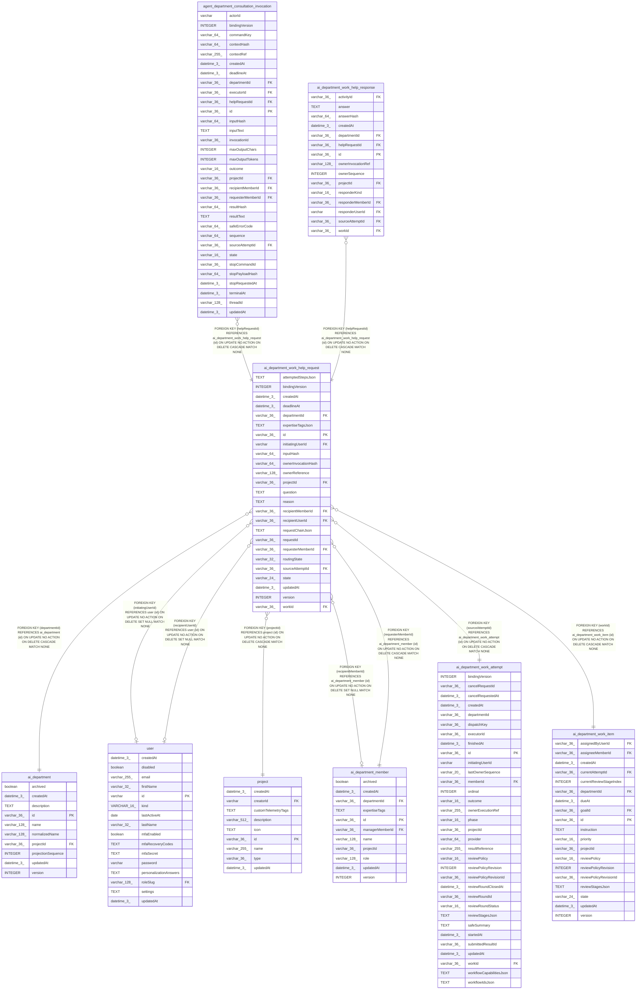

# ai_department_work_help_request

## Description

<details>
<summary><strong>Table Definition</strong></summary>

```sql
CREATE TABLE "ai_department_work_help_request" ("id" varchar(36) PRIMARY KEY NOT NULL, "projectId" varchar(36) NOT NULL, "departmentId" varchar(36) NOT NULL, "workId" varchar(36) NOT NULL, "requesterMemberId" varchar(36) NOT NULL, "sourceAttemptId" varchar(36) NOT NULL, "initiatingUserId" varchar, "requestId" varchar(36) NOT NULL, "question" text NOT NULL, "attemptedStepsJson" text NOT NULL, "reason" text NOT NULL, "expertiseTagsJson" text NOT NULL, "requestChainJson" text NOT NULL, "recipientMemberId" varchar(36), "routingState" varchar(32) NOT NULL, "bindingVersion" integer, "inputHash" varchar(64) NOT NULL, "deadlineAt" datetime(3), "state" varchar(24) NOT NULL DEFAULT ('pending_stop'), "ownerReference" varchar(128), "version" integer NOT NULL DEFAULT (1), "createdAt" datetime(3) NOT NULL DEFAULT (STRFTIME('%Y-%m-%d %H:%M:%f', 'NOW')), "updatedAt" datetime(3) NOT NULL DEFAULT (STRFTIME('%Y-%m-%d %H:%M:%f', 'NOW')), "recipientUserId" varchar(36), "ownerInvocationHash" varchar(64), CONSTRAINT "CHK_ai_department_work_help_request_routingState" CHECK (("routingState" IN ('specialist', 'manager_fallback', 'assignment_actor_fallback', 'unresolved'))), CONSTRAINT "CHK_ai_department_work_help_request_state" CHECK (("state" IN ('pending_stop', 'queued', 'awaiting_answer', 'answered', 'escalating', 'expired', 'failed', 'cancelled'))), CONSTRAINT "FK_4a9ec7855d9d1a848feec1cc7f6" FOREIGN KEY ("recipientMemberId") REFERENCES "ai_department_member" ("id") ON DELETE SET NULL ON UPDATE NO ACTION, CONSTRAINT "FK_5ddfbc0ddd7cdcc59bd6c5d887c" FOREIGN KEY ("initiatingUserId") REFERENCES "user" ("id") ON DELETE SET NULL ON UPDATE NO ACTION, CONSTRAINT "FK_d746422a09ac94b8c2129babb58" FOREIGN KEY ("sourceAttemptId") REFERENCES "ai_department_work_attempt" ("id") ON DELETE CASCADE ON UPDATE NO ACTION, CONSTRAINT "FK_94c0e6a11cbf26dda4a6a9f58c5" FOREIGN KEY ("requesterMemberId") REFERENCES "ai_department_member" ("id") ON DELETE CASCADE ON UPDATE NO ACTION, CONSTRAINT "FK_4df918e1c6ffc1f3e35f450ec75" FOREIGN KEY ("workId") REFERENCES "ai_department_work_item" ("id") ON DELETE CASCADE ON UPDATE NO ACTION, CONSTRAINT "FK_dbacd08ca0466c626113bf49027" FOREIGN KEY ("departmentId") REFERENCES "ai_department" ("id") ON DELETE CASCADE ON UPDATE NO ACTION, CONSTRAINT "FK_41cca1db9e76943cd6f93e9c573" FOREIGN KEY ("projectId") REFERENCES "project" ("id") ON DELETE CASCADE ON UPDATE NO ACTION, CONSTRAINT "FK_c383a78fbfcb374db6fe50b6351" FOREIGN KEY ("recipientUserId") REFERENCES "user" ("id") ON DELETE SET NULL ON UPDATE NO ACTION)
```

</details>

## Columns

| Name | Type | Default | Nullable | Children | Parents | Comment |
| ---- | ---- | ------- | -------- | -------- | ------- | ------- |
| attemptedStepsJson | TEXT |  | false |  |  |  |
| bindingVersion | INTEGER |  | true |  |  |  |
| createdAt | datetime(3) | STRFTIME('%Y-%m-%d %H:%M:%f', 'NOW') | false |  |  |  |
| deadlineAt | datetime(3) |  | true |  |  |  |
| departmentId | varchar(36) |  | false |  | [ai_department](ai_department.md) |  |
| expertiseTagsJson | TEXT |  | false |  |  |  |
| id | varchar(36) |  | false | [agent_department_consultation_invocation](agent_department_consultation_invocation.md) [ai_department_work_help_response](ai_department_work_help_response.md) |  |  |
| initiatingUserId | varchar |  | true |  | [user](user.md) |  |
| inputHash | varchar(64) |  | false |  |  |  |
| ownerInvocationHash | varchar(64) |  | true |  |  |  |
| ownerReference | varchar(128) |  | true |  |  |  |
| projectId | varchar(36) |  | false |  | [project](project.md) |  |
| question | TEXT |  | false |  |  |  |
| reason | TEXT |  | false |  |  |  |
| recipientMemberId | varchar(36) |  | true |  | [ai_department_member](ai_department_member.md) |  |
| recipientUserId | varchar(36) |  | true |  | [user](user.md) |  |
| requestChainJson | TEXT |  | false |  |  |  |
| requestId | varchar(36) |  | false |  |  |  |
| requesterMemberId | varchar(36) |  | false |  | [ai_department_member](ai_department_member.md) |  |
| routingState | varchar(32) |  | false |  |  |  |
| sourceAttemptId | varchar(36) |  | false |  | [ai_department_work_attempt](ai_department_work_attempt.md) |  |
| state | varchar(24) | 'pending_stop' | false |  |  |  |
| updatedAt | datetime(3) | STRFTIME('%Y-%m-%d %H:%M:%f', 'NOW') | false |  |  |  |
| version | INTEGER | 1 | false |  |  |  |
| workId | varchar(36) |  | false |  | [ai_department_work_item](ai_department_work_item.md) |  |

## Constraints

| Name | Type | Definition |
| ---- | ---- | ---------- |
| - | CHECK | CHECK (("routingState" IN ('specialist', 'manager_fallback', 'assignment_actor_fallback', 'unresolved'))) |
| - | CHECK | CHECK (("state" IN ('pending_stop', 'queued', 'awaiting_answer', 'answered', 'escalating', 'expired', 'failed', 'cancelled'))) |
| - (Foreign key ID: 0) | FOREIGN KEY | FOREIGN KEY (recipientUserId) REFERENCES user (id) ON UPDATE NO ACTION ON DELETE SET NULL MATCH NONE |
| - (Foreign key ID: 1) | FOREIGN KEY | FOREIGN KEY (projectId) REFERENCES project (id) ON UPDATE NO ACTION ON DELETE CASCADE MATCH NONE |
| - (Foreign key ID: 2) | FOREIGN KEY | FOREIGN KEY (departmentId) REFERENCES ai_department (id) ON UPDATE NO ACTION ON DELETE CASCADE MATCH NONE |
| - (Foreign key ID: 3) | FOREIGN KEY | FOREIGN KEY (workId) REFERENCES ai_department_work_item (id) ON UPDATE NO ACTION ON DELETE CASCADE MATCH NONE |
| - (Foreign key ID: 4) | FOREIGN KEY | FOREIGN KEY (requesterMemberId) REFERENCES ai_department_member (id) ON UPDATE NO ACTION ON DELETE CASCADE MATCH NONE |
| - (Foreign key ID: 5) | FOREIGN KEY | FOREIGN KEY (sourceAttemptId) REFERENCES ai_department_work_attempt (id) ON UPDATE NO ACTION ON DELETE CASCADE MATCH NONE |
| - (Foreign key ID: 6) | FOREIGN KEY | FOREIGN KEY (initiatingUserId) REFERENCES user (id) ON UPDATE NO ACTION ON DELETE SET NULL MATCH NONE |
| - (Foreign key ID: 7) | FOREIGN KEY | FOREIGN KEY (recipientMemberId) REFERENCES ai_department_member (id) ON UPDATE NO ACTION ON DELETE SET NULL MATCH NONE |
| id | PRIMARY KEY | PRIMARY KEY (id) |
| sqlite_autoindex_ai_department_work_help_request_1 | PRIMARY KEY | PRIMARY KEY (id) |

## Indexes

| Name | Definition |
| ---- | ---------- |
| IDX_63eb193a370876c6b357d5a51f | CREATE INDEX "IDX_63eb193a370876c6b357d5a51f" ON "ai_department_work_help_request" ("projectId", "departmentId", "workId", "createdAt")  |
| IDX_763f82fe1b9e605925747d52bf | CREATE UNIQUE INDEX "IDX_763f82fe1b9e605925747d52bf" ON "ai_department_work_help_request" ("projectId", "initiatingUserId", "requestId")  |
| IDX_f3a13473c2e6d7fd4b0cf63928 | CREATE INDEX "IDX_f3a13473c2e6d7fd4b0cf63928" ON "ai_department_work_help_request" ("projectId", "departmentId", "state", "deadlineAt")  |
| sqlite_autoindex_ai_department_work_help_request_1 | PRIMARY KEY (id) |

## Relations



---

> Generated by [tbls](https://github.com/k1LoW/tbls)
