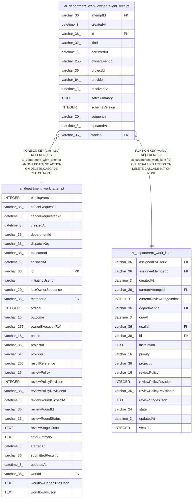

# ai_department_work_owner_event_receipt

## Description

<details>
<summary><strong>Table Definition</strong></summary>

```sql
CREATE TABLE "ai_department_work_owner_event_receipt" ("id" varchar(36) PRIMARY KEY NOT NULL, "provider" varchar(64) NOT NULL, "ownerEventId" varchar(255) NOT NULL, "projectId" varchar(36) NOT NULL, "workId" varchar(36) NOT NULL, "attemptId" varchar(36) NOT NULL, "sequence" varchar(20) NOT NULL, "schemaVersion" integer NOT NULL, "kind" varchar(32) NOT NULL, "safeSummary" text, "occurredAt" datetime(3) NOT NULL, "receivedAt" datetime(3) NOT NULL, "createdAt" datetime(3) NOT NULL DEFAULT (STRFTIME('%Y-%m-%d %H:%M:%f', 'NOW')), "updatedAt" datetime(3) NOT NULL DEFAULT (STRFTIME('%Y-%m-%d %H:%M:%f', 'NOW')), CONSTRAINT "FK_154cb04a1b1b1f6a5c6cefc8c42" FOREIGN KEY ("attemptId") REFERENCES "ai_department_work_attempt" ("id") ON DELETE CASCADE, CONSTRAINT "FK_7e78b6903b1c94c1454f2a12510" FOREIGN KEY ("workId") REFERENCES "ai_department_work_item" ("id") ON DELETE CASCADE)
```

</details>

## Columns

| Name | Type | Default | Nullable | Children | Parents | Comment |
| ---- | ---- | ------- | -------- | -------- | ------- | ------- |
| attemptId | varchar(36) |  | false |  | [ai_department_work_attempt](ai_department_work_attempt.md) |  |
| createdAt | datetime(3) | STRFTIME('%Y-%m-%d %H:%M:%f', 'NOW') | false |  |  |  |
| id | varchar(36) |  | false |  |  |  |
| kind | varchar(32) |  | false |  |  |  |
| occurredAt | datetime(3) |  | false |  |  |  |
| ownerEventId | varchar(255) |  | false |  |  |  |
| projectId | varchar(36) |  | false |  |  |  |
| provider | varchar(64) |  | false |  |  |  |
| receivedAt | datetime(3) |  | false |  |  |  |
| safeSummary | TEXT |  | true |  |  |  |
| schemaVersion | INTEGER |  | false |  |  |  |
| sequence | varchar(20) |  | false |  |  |  |
| updatedAt | datetime(3) | STRFTIME('%Y-%m-%d %H:%M:%f', 'NOW') | false |  |  |  |
| workId | varchar(36) |  | false |  | [ai_department_work_item](ai_department_work_item.md) |  |

## Constraints

| Name | Type | Definition |
| ---- | ---- | ---------- |
| - (Foreign key ID: 0) | FOREIGN KEY | FOREIGN KEY (workId) REFERENCES ai_department_work_item (id) ON UPDATE NO ACTION ON DELETE CASCADE MATCH NONE |
| - (Foreign key ID: 1) | FOREIGN KEY | FOREIGN KEY (attemptId) REFERENCES ai_department_work_attempt (id) ON UPDATE NO ACTION ON DELETE CASCADE MATCH NONE |
| id | PRIMARY KEY | PRIMARY KEY (id) |
| sqlite_autoindex_ai_department_work_owner_event_receipt_1 | PRIMARY KEY | PRIMARY KEY (id) |

## Indexes

| Name | Definition |
| ---- | ---------- |
| IDX_82da34d3bf25cb50f08d68f027 | CREATE UNIQUE INDEX "IDX_82da34d3bf25cb50f08d68f027" ON "ai_department_work_owner_event_receipt" ("attemptId", "sequence")  |
| IDX_df048bb1d2ab29f9c32edcf368 | CREATE UNIQUE INDEX "IDX_df048bb1d2ab29f9c32edcf368" ON "ai_department_work_owner_event_receipt" ("provider", "ownerEventId")  |
| sqlite_autoindex_ai_department_work_owner_event_receipt_1 | PRIMARY KEY (id) |

## Relations



---

> Generated by [tbls](https://github.com/k1LoW/tbls)
