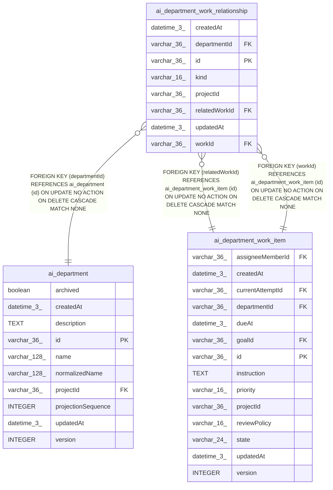

# ai_department_work_relationship

## Description

<details>
<summary><strong>Table Definition</strong></summary>

```sql
CREATE TABLE "ai_department_work_relationship" ("id" varchar(36) PRIMARY KEY NOT NULL, "projectId" varchar(36) NOT NULL, "departmentId" varchar(36) NOT NULL, "workId" varchar(36) NOT NULL, "relatedWorkId" varchar(36) NOT NULL, "kind" varchar(16) NOT NULL, "createdAt" datetime(3) NOT NULL DEFAULT (STRFTIME('%Y-%m-%d %H:%M:%f', 'NOW')), "updatedAt" datetime(3) NOT NULL DEFAULT (STRFTIME('%Y-%m-%d %H:%M:%f', 'NOW')), CONSTRAINT "CHK_ai_department_work_relationship_kind" CHECK ("kind" IN ('parent', 'blocks')), CONSTRAINT "FK_66b4c27b8ccfb1a6106fc39f339" FOREIGN KEY ("departmentId") REFERENCES "ai_department" ("id") ON DELETE CASCADE, CONSTRAINT "FK_f12521432d0605cb54dcfbe17d5" FOREIGN KEY ("workId") REFERENCES "ai_department_work_item" ("id") ON DELETE CASCADE, CONSTRAINT "FK_bd6ba681fb8cb280adb017ac131" FOREIGN KEY ("relatedWorkId") REFERENCES "ai_department_work_item" ("id") ON DELETE CASCADE)
```

</details>

## Columns

| Name | Type | Default | Nullable | Children | Parents | Comment |
| ---- | ---- | ------- | -------- | -------- | ------- | ------- |
| createdAt | datetime(3) | STRFTIME('%Y-%m-%d %H:%M:%f', 'NOW') | false |  |  |  |
| departmentId | varchar(36) |  | false |  | [ai_department](ai_department.md) |  |
| id | varchar(36) |  | false |  |  |  |
| kind | varchar(16) |  | false |  |  |  |
| projectId | varchar(36) |  | false |  |  |  |
| relatedWorkId | varchar(36) |  | false |  | [ai_department_work_item](ai_department_work_item.md) |  |
| updatedAt | datetime(3) | STRFTIME('%Y-%m-%d %H:%M:%f', 'NOW') | false |  |  |  |
| workId | varchar(36) |  | false |  | [ai_department_work_item](ai_department_work_item.md) |  |

## Constraints

| Name | Type | Definition |
| ---- | ---- | ---------- |
| - | CHECK | CHECK ("kind" IN ('parent', 'blocks')) |
| - (Foreign key ID: 0) | FOREIGN KEY | FOREIGN KEY (relatedWorkId) REFERENCES ai_department_work_item (id) ON UPDATE NO ACTION ON DELETE CASCADE MATCH NONE |
| - (Foreign key ID: 1) | FOREIGN KEY | FOREIGN KEY (workId) REFERENCES ai_department_work_item (id) ON UPDATE NO ACTION ON DELETE CASCADE MATCH NONE |
| - (Foreign key ID: 2) | FOREIGN KEY | FOREIGN KEY (departmentId) REFERENCES ai_department (id) ON UPDATE NO ACTION ON DELETE CASCADE MATCH NONE |
| id | PRIMARY KEY | PRIMARY KEY (id) |
| sqlite_autoindex_ai_department_work_relationship_1 | PRIMARY KEY | PRIMARY KEY (id) |

## Indexes

| Name | Definition |
| ---- | ---------- |
| IDX_ai_dept_work_rel_project_related_kind | CREATE INDEX "IDX_ai_dept_work_rel_project_related_kind" ON "ai_department_work_relationship" ("projectId", "departmentId", "relatedWorkId", "kind")  |
| IDX_ai_dept_work_rel_project_work_kind | CREATE INDEX "IDX_ai_dept_work_rel_project_work_kind" ON "ai_department_work_relationship" ("projectId", "departmentId", "workId", "kind")  |
| IDX_ai_dept_work_rel_work_related_kind | CREATE UNIQUE INDEX "IDX_ai_dept_work_rel_work_related_kind" ON "ai_department_work_relationship" ("workId", "relatedWorkId", "kind")  |
| sqlite_autoindex_ai_department_work_relationship_1 | PRIMARY KEY (id) |

## Relations



---

> Generated by [tbls](https://github.com/k1LoW/tbls)
