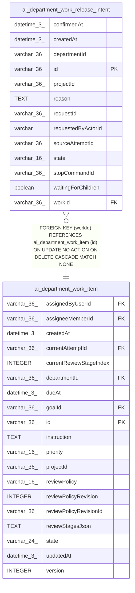

# ai_department_work_release_intent

## Description

<details>
<summary><strong>Table Definition</strong></summary>

```sql
CREATE TABLE "ai_department_work_release_intent" ("id" varchar(36) PRIMARY KEY NOT NULL, "projectId" varchar(36) NOT NULL, "departmentId" varchar(36) NOT NULL, "workId" varchar(36) NOT NULL, "sourceAttemptId" varchar(36) NOT NULL, "requestedByActorId" varchar NOT NULL, "reason" text NOT NULL, "requestId" varchar(36) NOT NULL, "stopCommandId" varchar(36) NOT NULL, "state" varchar(16) NOT NULL, "createdAt" datetime(3) NOT NULL, "confirmedAt" datetime(3), "waitingForChildren" boolean NOT NULL DEFAULT (false), CONSTRAINT "CHK_ai_department_work_release_intent_state" CHECK (("state" IN ('awaiting_stop', 'confirmed'))), CONSTRAINT "FK_229d8fd9c0ce0c374c17f85a230" FOREIGN KEY ("workId") REFERENCES "ai_department_work_item" ("id") ON DELETE CASCADE ON UPDATE NO ACTION)
```

</details>

## Columns

| Name | Type | Default | Nullable | Children | Parents | Comment |
| ---- | ---- | ------- | -------- | -------- | ------- | ------- |
| confirmedAt | datetime(3) |  | true |  |  |  |
| createdAt | datetime(3) |  | false |  |  |  |
| departmentId | varchar(36) |  | false |  |  |  |
| id | varchar(36) |  | false |  |  |  |
| projectId | varchar(36) |  | false |  |  |  |
| reason | TEXT |  | false |  |  |  |
| requestId | varchar(36) |  | false |  |  |  |
| requestedByActorId | varchar |  | false |  |  |  |
| sourceAttemptId | varchar(36) |  | false |  |  |  |
| state | varchar(16) |  | false |  |  |  |
| stopCommandId | varchar(36) |  | false |  |  |  |
| waitingForChildren | boolean | false | false |  |  |  |
| workId | varchar(36) |  | false |  | [ai_department_work_item](ai_department_work_item.md) |  |

## Constraints

| Name | Type | Definition |
| ---- | ---- | ---------- |
| - | CHECK | CHECK (("state" IN ('awaiting_stop', 'confirmed'))) |
| - (Foreign key ID: 0) | FOREIGN KEY | FOREIGN KEY (workId) REFERENCES ai_department_work_item (id) ON UPDATE NO ACTION ON DELETE CASCADE MATCH NONE |
| id | PRIMARY KEY | PRIMARY KEY (id) |
| sqlite_autoindex_ai_department_work_release_intent_1 | PRIMARY KEY | PRIMARY KEY (id) |

## Indexes

| Name | Definition |
| ---- | ---------- |
| IDX_ai_department_work_release_intent_projectId_sourceAttemptId_state | CREATE INDEX "IDX_ai_department_work_release_intent_projectId_sourceAttemptId_state" ON "ai_department_work_release_intent" ("projectId", "sourceAttemptId", "state")  |
| IDX_ai_department_work_release_intent_projectId_workId_state | CREATE INDEX "IDX_ai_department_work_release_intent_projectId_workId_state" ON "ai_department_work_release_intent" ("projectId", "workId", "state")  |
| sqlite_autoindex_ai_department_work_release_intent_1 | PRIMARY KEY (id) |

## Relations



---

> Generated by [tbls](https://github.com/k1LoW/tbls)
