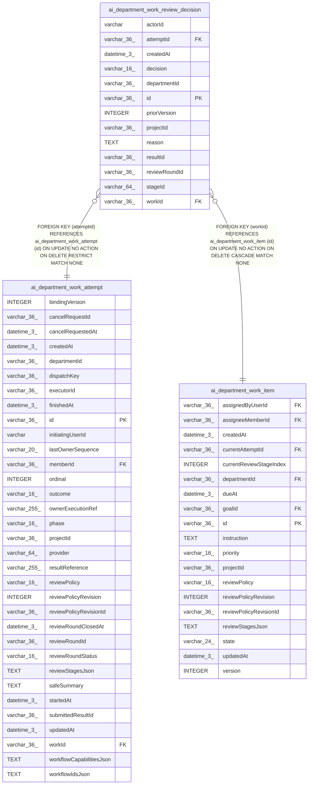

# ai_department_work_review_decision

## Description

<details>
<summary><strong>Table Definition</strong></summary>

```sql
CREATE TABLE "ai_department_work_review_decision" ("id" varchar(36) PRIMARY KEY NOT NULL, "projectId" varchar(36) NOT NULL, "departmentId" varchar(36) NOT NULL, "workId" varchar(36) NOT NULL, "attemptId" varchar(36) NOT NULL, "actorId" varchar NOT NULL, "decision" varchar(16) NOT NULL, "reason" text, "priorVersion" integer NOT NULL, "createdAt" datetime(3) NOT NULL, "reviewRoundId" varchar(36), "stageId" varchar(64), "resultId" varchar(36), CONSTRAINT "FK_2ae54882867478e2e1e63c94348" FOREIGN KEY ("attemptId") REFERENCES "ai_department_work_attempt" ("id") ON DELETE RESTRICT ON UPDATE NO ACTION, CONSTRAINT "FK_10ed63817d599a4f4e4c9a4514f" FOREIGN KEY ("workId") REFERENCES "ai_department_work_item" ("id") ON DELETE CASCADE ON UPDATE NO ACTION)
```

</details>

## Columns

| Name | Type | Default | Nullable | Children | Parents | Comment |
| ---- | ---- | ------- | -------- | -------- | ------- | ------- |
| actorId | varchar |  | false |  |  |  |
| attemptId | varchar(36) |  | false |  | [ai_department_work_attempt](ai_department_work_attempt.md) |  |
| createdAt | datetime(3) |  | false |  |  |  |
| decision | varchar(16) |  | false |  |  |  |
| departmentId | varchar(36) |  | false |  |  |  |
| id | varchar(36) |  | false |  |  |  |
| priorVersion | INTEGER |  | false |  |  |  |
| projectId | varchar(36) |  | false |  |  |  |
| reason | TEXT |  | true |  |  |  |
| resultId | varchar(36) |  | true |  |  |  |
| reviewRoundId | varchar(36) |  | true |  |  |  |
| stageId | varchar(64) |  | true |  |  |  |
| workId | varchar(36) |  | false |  | [ai_department_work_item](ai_department_work_item.md) |  |

## Constraints

| Name | Type | Definition |
| ---- | ---- | ---------- |
| - (Foreign key ID: 0) | FOREIGN KEY | FOREIGN KEY (workId) REFERENCES ai_department_work_item (id) ON UPDATE NO ACTION ON DELETE CASCADE MATCH NONE |
| - (Foreign key ID: 1) | FOREIGN KEY | FOREIGN KEY (attemptId) REFERENCES ai_department_work_attempt (id) ON UPDATE NO ACTION ON DELETE RESTRICT MATCH NONE |
| id | PRIMARY KEY | PRIMARY KEY (id) |
| sqlite_autoindex_ai_department_work_review_decision_1 | PRIMARY KEY | PRIMARY KEY (id) |

## Indexes

| Name | Definition |
| ---- | ---------- |
| IDX_c4fbe39d433757e56eac83943e | CREATE UNIQUE INDEX "IDX_c4fbe39d433757e56eac83943e" ON "ai_department_work_review_decision" ("workId", "priorVersion")  |
| sqlite_autoindex_ai_department_work_review_decision_1 | PRIMARY KEY (id) |

## Relations



---

> Generated by [tbls](https://github.com/k1LoW/tbls)
