# ai_department_work_review_policy_revision

## Description

<details>
<summary><strong>Table Definition</strong></summary>

```sql
CREATE TABLE "ai_department_work_review_policy_revision" ("id" varchar(36) PRIMARY KEY NOT NULL, "projectId" varchar(36) NOT NULL, "departmentId" varchar(36) NOT NULL, "workId" varchar(36) NOT NULL, "revision" integer NOT NULL, "mode" varchar(16) NOT NULL, "stagesJson" text NOT NULL, "createdByUserId" varchar NOT NULL, "createdAt" datetime(3) NOT NULL, CONSTRAINT "CHK_ai_department_work_review_policy_revision_mode" CHECK ("mode" IN ('required', 'automatic')), CONSTRAINT "FK_07c8d764f095f70e8d018fb6ab0" FOREIGN KEY ("workId") REFERENCES "ai_department_work_item" ("id") ON DELETE CASCADE)
```

</details>

## Columns

| Name | Type | Default | Nullable | Children | Parents | Comment |
| ---- | ---- | ------- | -------- | -------- | ------- | ------- |
| createdAt | datetime(3) |  | false |  |  |  |
| createdByUserId | varchar |  | false |  |  |  |
| departmentId | varchar(36) |  | false |  |  |  |
| id | varchar(36) |  | false | [ai_department_work_review_round](ai_department_work_review_round.md) |  |  |
| mode | varchar(16) |  | false |  |  |  |
| projectId | varchar(36) |  | false |  |  |  |
| revision | INTEGER |  | false |  |  |  |
| stagesJson | TEXT |  | false |  |  |  |
| workId | varchar(36) |  | false |  | [ai_department_work_item](ai_department_work_item.md) |  |

## Constraints

| Name | Type | Definition |
| ---- | ---- | ---------- |
| - | CHECK | CHECK ("mode" IN ('required', 'automatic')) |
| - (Foreign key ID: 0) | FOREIGN KEY | FOREIGN KEY (workId) REFERENCES ai_department_work_item (id) ON UPDATE NO ACTION ON DELETE CASCADE MATCH NONE |
| id | PRIMARY KEY | PRIMARY KEY (id) |
| sqlite_autoindex_ai_department_work_review_policy_revision_1 | PRIMARY KEY | PRIMARY KEY (id) |

## Indexes

| Name | Definition |
| ---- | ---------- |
| IDX_ai_department_work_review_policy_revision_projectId_workId_revision | CREATE UNIQUE INDEX "IDX_ai_department_work_review_policy_revision_projectId_workId_revision" ON "ai_department_work_review_policy_revision" ("projectId", "workId", "revision")  |
| sqlite_autoindex_ai_department_work_review_policy_revision_1 | PRIMARY KEY (id) |

## Relations

```mermaid
erDiagram

"ai_department_work_review_round" }o--o| "ai_department_work_review_policy_revision" : "FOREIGN KEY (policyRevisionId) REFERENCES ai_department_work_review_policy_revision (id) ON UPDATE NO ACTION ON DELETE SET NULL MATCH NONE"
"ai_department_work_review_policy_revision" }o--|| "ai_department_work_item" : "FOREIGN KEY (workId) REFERENCES ai_department_work_item (id) ON UPDATE NO ACTION ON DELETE CASCADE MATCH NONE"

"ai_department_work_review_policy_revision" {
  datetime_3_ createdAt
  varchar createdByUserId
  varchar_36_ departmentId
  varchar_36_ id PK
  varchar_16_ mode
  varchar_36_ projectId
  INTEGER revision
  TEXT stagesJson
  varchar_36_ workId FK
}
"ai_department_work_review_round" {
  varchar_64_ activeStageId
  varchar_36_ attemptId FK
  datetime_3_ closedAt
  datetime_3_ createdAt
  varchar_36_ departmentId
  varchar_36_ id PK
  INTEGER ordinal
  varchar_36_ policyRevisionId FK
  varchar_36_ projectId
  varchar requesterId
  varchar_16_ requesterKind
  varchar_36_ resultId FK
  varchar_16_ status
  INTEGER version
  varchar_36_ workId FK
}
"ai_department_work_item" {
  varchar_36_ assignedByUserId FK
  varchar_36_ assigneeMemberId FK
  datetime_3_ createdAt
  varchar_36_ currentAttemptId FK
  INTEGER currentReviewStageIndex
  varchar_36_ departmentId FK
  datetime_3_ dueAt
  varchar_36_ goalId FK
  varchar_36_ id PK
  TEXT instruction
  varchar_16_ priority
  varchar_36_ projectId
  varchar_16_ reviewPolicy
  INTEGER reviewPolicyRevision
  varchar_36_ reviewPolicyRevisionId
  TEXT reviewStagesJson
  varchar_24_ state
  datetime_3_ updatedAt
  INTEGER version
}
```



---

> Generated by [tbls](https://github.com/k1LoW/tbls)
