# ai_department_work_submitted_result

## Description

<details>
<summary><strong>Table Definition</strong></summary>

```sql
CREATE TABLE "ai_department_work_submitted_result" ("id" varchar(36) PRIMARY KEY NOT NULL, "projectId" varchar(36) NOT NULL, "departmentId" varchar(36) NOT NULL, "workId" varchar(36) NOT NULL, "attemptId" varchar(36) NOT NULL, "reference" varchar(255), "safeSummary" text, "submittedByUserId" varchar NOT NULL, "submittedAt" datetime(3) NOT NULL, "createdAt" datetime(3), "updatedAt" datetime(3), CONSTRAINT "FK_138e1010f7611413e5c1ea414b9" FOREIGN KEY ("attemptId") REFERENCES "ai_department_work_attempt" ("id") ON DELETE CASCADE ON UPDATE NO ACTION, CONSTRAINT "FK_abf7dec02d5d6bc0c0f3d522c7a" FOREIGN KEY ("workId") REFERENCES "ai_department_work_item" ("id") ON DELETE CASCADE ON UPDATE NO ACTION)
```

</details>

## Columns

| Name | Type | Default | Nullable | Children | Parents | Comment |
| ---- | ---- | ------- | -------- | -------- | ------- | ------- |
| attemptId | varchar(36) |  | false |  | [ai_department_work_attempt](ai_department_work_attempt.md) |  |
| createdAt | datetime(3) |  | true |  |  |  |
| departmentId | varchar(36) |  | false |  |  |  |
| id | varchar(36) |  | false | [ai_department_work_review_round](ai_department_work_review_round.md) [ai_department_work_review_stage_decision](ai_department_work_review_stage_decision.md) |  |  |
| projectId | varchar(36) |  | false |  |  |  |
| reference | varchar(255) |  | true |  |  |  |
| safeSummary | TEXT |  | true |  |  |  |
| submittedAt | datetime(3) |  | false |  |  |  |
| submittedByUserId | varchar |  | false |  |  |  |
| updatedAt | datetime(3) |  | true |  |  |  |
| workId | varchar(36) |  | false |  | [ai_department_work_item](ai_department_work_item.md) |  |

## Constraints

| Name | Type | Definition |
| ---- | ---- | ---------- |
| - (Foreign key ID: 0) | FOREIGN KEY | FOREIGN KEY (workId) REFERENCES ai_department_work_item (id) ON UPDATE NO ACTION ON DELETE CASCADE MATCH NONE |
| - (Foreign key ID: 1) | FOREIGN KEY | FOREIGN KEY (attemptId) REFERENCES ai_department_work_attempt (id) ON UPDATE NO ACTION ON DELETE CASCADE MATCH NONE |
| id | PRIMARY KEY | PRIMARY KEY (id) |
| sqlite_autoindex_ai_department_work_submitted_result_1 | PRIMARY KEY | PRIMARY KEY (id) |

## Indexes

| Name | Definition |
| ---- | ---------- |
| IDX_ai_department_work_submitted_result_attemptId | CREATE UNIQUE INDEX "IDX_ai_department_work_submitted_result_attemptId" ON "ai_department_work_submitted_result" ("attemptId")  |
| IDX_ai_department_work_submitted_result_projectId_workId_submittedAt | CREATE INDEX "IDX_ai_department_work_submitted_result_projectId_workId_submittedAt" ON "ai_department_work_submitted_result" ("projectId", "workId", "submittedAt")  |
| sqlite_autoindex_ai_department_work_submitted_result_1 | PRIMARY KEY (id) |

## Relations

```mermaid
erDiagram

"ai_department_work_submitted_result" }o--|| "ai_department_work_attempt" : "FOREIGN KEY (attemptId) REFERENCES ai_department_work_attempt (id) ON UPDATE NO ACTION ON DELETE CASCADE MATCH NONE"
"ai_department_work_review_round" }o--|| "ai_department_work_submitted_result" : "FOREIGN KEY (resultId) REFERENCES ai_department_work_submitted_result (id) ON UPDATE NO ACTION ON DELETE CASCADE MATCH NONE"
"ai_department_work_review_stage_decision" }o--|| "ai_department_work_submitted_result" : "FOREIGN KEY (resultId) REFERENCES ai_department_work_submitted_result (id) ON UPDATE NO ACTION ON DELETE CASCADE MATCH NONE"
"ai_department_work_submitted_result" }o--|| "ai_department_work_item" : "FOREIGN KEY (workId) REFERENCES ai_department_work_item (id) ON UPDATE NO ACTION ON DELETE CASCADE MATCH NONE"

"ai_department_work_submitted_result" {
  varchar_36_ attemptId FK
  datetime_3_ createdAt
  varchar_36_ departmentId
  varchar_36_ id PK
  varchar_36_ projectId
  varchar_255_ reference
  TEXT safeSummary
  datetime_3_ submittedAt
  varchar submittedByUserId
  datetime_3_ updatedAt
  varchar_36_ workId FK
}
"ai_department_work_attempt" {
  INTEGER bindingVersion
  varchar_36_ cancelRequestId
  datetime_3_ cancelRequestedAt
  datetime_3_ createdAt
  varchar_36_ departmentId
  varchar_36_ dispatchKey
  varchar_36_ executorId
  datetime_3_ finishedAt
  varchar_36_ id PK
  varchar initiatingUserId
  varchar_20_ lastOwnerSequence
  varchar_36_ memberId FK
  INTEGER ordinal
  varchar_16_ outcome
  varchar_255_ ownerExecutionRef
  varchar_16_ phase
  varchar_36_ projectId
  varchar_64_ provider
  varchar_255_ resultReference
  varchar_16_ reviewPolicy
  INTEGER reviewPolicyRevision
  varchar_36_ reviewPolicyRevisionId
  datetime_3_ reviewRoundClosedAt
  varchar_36_ reviewRoundId
  varchar_16_ reviewRoundStatus
  TEXT reviewStagesJson
  TEXT safeSummary
  datetime_3_ startedAt
  varchar_36_ submittedResultId
  datetime_3_ updatedAt
  varchar_36_ workId FK
  TEXT workflowCapabilitiesJson
  TEXT workflowIdsJson
}
"ai_department_work_review_round" {
  varchar_64_ activeStageId
  varchar_36_ attemptId FK
  datetime_3_ closedAt
  datetime_3_ createdAt
  varchar_36_ departmentId
  varchar_36_ id PK
  INTEGER ordinal
  varchar_36_ policyRevisionId FK
  varchar_36_ projectId
  varchar requesterId
  varchar_16_ requesterKind
  varchar_36_ resultId FK
  varchar_16_ status
  INTEGER version
  varchar_36_ workId FK
}
"ai_department_work_review_stage_decision" {
  varchar actorId
  varchar_16_ actorKind
  varchar_36_ commandId
  datetime_3_ createdAt
  varchar_16_ decision
  varchar_36_ departmentId
  varchar_36_ id PK
  INTEGER priorVersion
  varchar_36_ projectId
  TEXT reason
  varchar_36_ resultId FK
  varchar_36_ roundId FK
  varchar_64_ stageId
  varchar_36_ workId
}
"ai_department_work_item" {
  varchar_36_ assignedByUserId FK
  varchar_36_ assigneeMemberId FK
  datetime_3_ createdAt
  varchar_36_ currentAttemptId FK
  INTEGER currentReviewStageIndex
  varchar_36_ departmentId FK
  datetime_3_ dueAt
  varchar_36_ goalId FK
  varchar_36_ id PK
  TEXT instruction
  varchar_16_ priority
  varchar_36_ projectId
  varchar_16_ reviewPolicy
  INTEGER reviewPolicyRevision
  varchar_36_ reviewPolicyRevisionId
  TEXT reviewStagesJson
  varchar_24_ state
  datetime_3_ updatedAt
  INTEGER version
}
```



---

> Generated by [tbls](https://github.com/k1LoW/tbls)
