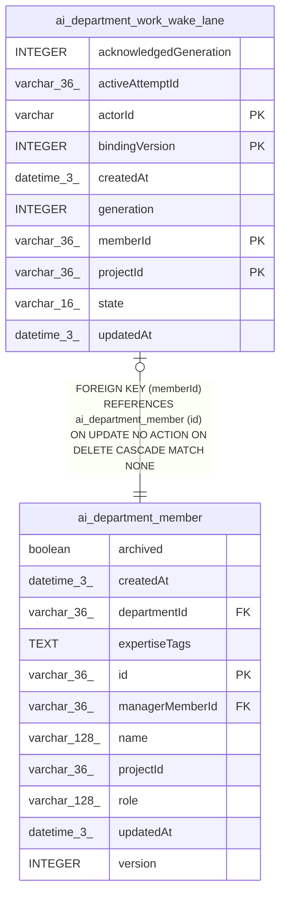

# ai_department_work_wake_lane

## Description

<details>
<summary><strong>Table Definition</strong></summary>

```sql
CREATE TABLE "ai_department_work_wake_lane" ("projectId" varchar(36) NOT NULL, "memberId" varchar(36) NOT NULL, "actorId" varchar NOT NULL, "bindingVersion" integer NOT NULL, "generation" integer NOT NULL, "acknowledgedGeneration" integer NOT NULL, "state" varchar(16) NOT NULL, "updatedAt" datetime(3) NOT NULL, "createdAt" datetime(3) NOT NULL DEFAULT (STRFTIME('%Y-%m-%d %H:%M:%f', 'NOW')), "activeAttemptId" varchar(36), CONSTRAINT "CHK_ai_department_work_wake_lane_state" CHECK (("state" IN ('pending', 'accepted', 'coalesced', 'unknown', 'delivered', 'rejected'))), CONSTRAINT "FK_246d2f6a6def9540f1e4dc9b823" FOREIGN KEY ("memberId") REFERENCES "ai_department_member" ("id") ON DELETE CASCADE ON UPDATE NO ACTION, PRIMARY KEY ("projectId", "memberId", "actorId", "bindingVersion"))
```

</details>

## Columns

| Name | Type | Default | Nullable | Children | Parents | Comment |
| ---- | ---- | ------- | -------- | -------- | ------- | ------- |
| acknowledgedGeneration | INTEGER |  | false |  |  |  |
| activeAttemptId | varchar(36) |  | true |  |  |  |
| actorId | varchar |  | false |  |  |  |
| bindingVersion | INTEGER |  | false |  |  |  |
| createdAt | datetime(3) | STRFTIME('%Y-%m-%d %H:%M:%f', 'NOW') | false |  |  |  |
| generation | INTEGER |  | false |  |  |  |
| memberId | varchar(36) |  | false |  | [ai_department_member](ai_department_member.md) |  |
| projectId | varchar(36) |  | false |  |  |  |
| state | varchar(16) |  | false |  |  |  |
| updatedAt | datetime(3) |  | false |  |  |  |

## Constraints

| Name | Type | Definition |
| ---- | ---- | ---------- |
| - | CHECK | CHECK (("state" IN ('pending', 'accepted', 'coalesced', 'unknown', 'delivered', 'rejected'))) |
| - (Foreign key ID: 0) | FOREIGN KEY | FOREIGN KEY (memberId) REFERENCES ai_department_member (id) ON UPDATE NO ACTION ON DELETE CASCADE MATCH NONE |
| actorId | PRIMARY KEY | PRIMARY KEY (actorId) |
| bindingVersion | PRIMARY KEY | PRIMARY KEY (bindingVersion) |
| memberId | PRIMARY KEY | PRIMARY KEY (memberId) |
| projectId | PRIMARY KEY | PRIMARY KEY (projectId) |
| sqlite_autoindex_ai_department_work_wake_lane_1 | PRIMARY KEY | PRIMARY KEY (projectId, memberId, actorId, bindingVersion) |

## Indexes

| Name | Definition |
| ---- | ---------- |
| IDX_ai_department_work_wake_lane_state_updatedAt | CREATE INDEX "IDX_ai_department_work_wake_lane_state_updatedAt" ON "ai_department_work_wake_lane" ("state", "updatedAt")  |
| sqlite_autoindex_ai_department_work_wake_lane_1 | PRIMARY KEY (projectId, memberId, actorId, bindingVersion) |

## Relations



---

> Generated by [tbls](https://github.com/k1LoW/tbls)
