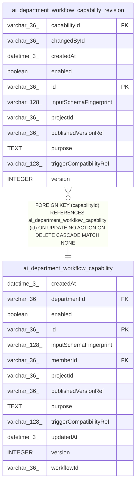

# ai_department_workflow_capability_revision

## Description

<details>
<summary><strong>Table Definition</strong></summary>

```sql
CREATE TABLE "ai_department_workflow_capability_revision" ("id" varchar(36) PRIMARY KEY NOT NULL, "projectId" varchar(36) NOT NULL, "capabilityId" varchar(36) NOT NULL, "version" integer NOT NULL, "purpose" text NOT NULL, "publishedVersionRef" varchar(36) NOT NULL, "triggerCompatibilityRef" varchar(128) NOT NULL, "inputSchemaFingerprint" varchar(128) NOT NULL, "enabled" boolean NOT NULL, "changedById" varchar(36) NOT NULL, "createdAt" datetime(3) NOT NULL, CONSTRAINT "FK_d8bd43de8d11965fbfa172742c3" FOREIGN KEY ("capabilityId") REFERENCES "ai_department_workflow_capability" ("id") ON DELETE CASCADE)
```

</details>

## Columns

| Name | Type | Default | Nullable | Children | Parents | Comment |
| ---- | ---- | ------- | -------- | -------- | ------- | ------- |
| capabilityId | varchar(36) |  | false |  | [ai_department_workflow_capability](ai_department_workflow_capability.md) |  |
| changedById | varchar(36) |  | false |  |  |  |
| createdAt | datetime(3) |  | false |  |  |  |
| enabled | boolean |  | false |  |  |  |
| id | varchar(36) |  | false |  |  |  |
| inputSchemaFingerprint | varchar(128) |  | false |  |  |  |
| projectId | varchar(36) |  | false |  |  |  |
| publishedVersionRef | varchar(36) |  | false |  |  |  |
| purpose | TEXT |  | false |  |  |  |
| triggerCompatibilityRef | varchar(128) |  | false |  |  |  |
| version | INTEGER |  | false |  |  |  |

## Constraints

| Name | Type | Definition |
| ---- | ---- | ---------- |
| - (Foreign key ID: 0) | FOREIGN KEY | FOREIGN KEY (capabilityId) REFERENCES ai_department_workflow_capability (id) ON UPDATE NO ACTION ON DELETE CASCADE MATCH NONE |
| id | PRIMARY KEY | PRIMARY KEY (id) |
| sqlite_autoindex_ai_department_workflow_capability_revision_1 | PRIMARY KEY | PRIMARY KEY (id) |

## Indexes

| Name | Definition |
| ---- | ---------- |
| IDX_ai_department_workflow_capability_revision_capabilityId_version | CREATE UNIQUE INDEX "IDX_ai_department_workflow_capability_revision_capabilityId_version" ON "ai_department_workflow_capability_revision" ("capabilityId", "version")  |
| sqlite_autoindex_ai_department_workflow_capability_revision_1 | PRIMARY KEY (id) |

## Relations



---

> Generated by [tbls](https://github.com/k1LoW/tbls)
