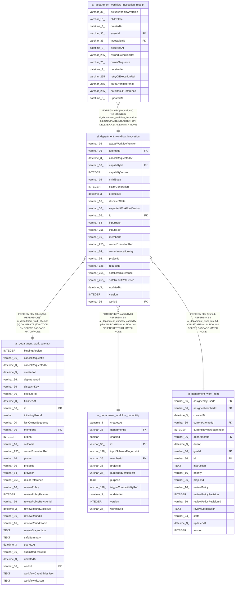

# ai_department_workflow_invocation

## Description

<details>
<summary><strong>Table Definition</strong></summary>

```sql
CREATE TABLE "ai_department_workflow_invocation" ("id" varchar(36) PRIMARY KEY NOT NULL, "projectId" varchar(36) NOT NULL, "workId" varchar(36) NOT NULL, "attemptId" varchar(36) NOT NULL, "memberId" varchar(36) NOT NULL, "capabilityId" varchar(36) NOT NULL, "capabilityVersion" integer NOT NULL, "claimGeneration" integer NOT NULL, "requestId" varchar(128) NOT NULL, "ownerInvocationKey" varchar(64) NOT NULL, "inputHash" varchar(64) NOT NULL, "inputsRef" varchar(255) NOT NULL, "expectedWorkflowVersion" varchar(36), "actualWorkflowVersion" varchar(36), "ownerExecutionRef" varchar(255), "dispatchState" varchar(16) NOT NULL DEFAULT ('pending'), "childState" varchar(16) NOT NULL DEFAULT ('pending'), "safeResultReference" varchar(255), "safeErrorReference" varchar(255), "version" integer NOT NULL DEFAULT (1), "cancelRequestedAt" datetime(3), "createdAt" datetime(3) NOT NULL, "updatedAt" datetime(3) NOT NULL, CONSTRAINT "CHK_ai_department_workflow_invocation_dispatchState" CHECK ("dispatchState" IN ('pending', 'acknowledged', 'unknown', 'rejected')), CONSTRAINT "CHK_ai_department_workflow_invocation_childState" CHECK ("childState" IN ('pending', 'running', 'waiting', 'retrying', 'succeeded', 'failed', 'cancelled', 'unknown')), CONSTRAINT "FK_9ebffaf5c2d64057b365e864699" FOREIGN KEY ("workId") REFERENCES "ai_department_work_item" ("id") ON DELETE CASCADE, CONSTRAINT "FK_045e2d67a4ff4be04d60a492bb6" FOREIGN KEY ("attemptId") REFERENCES "ai_department_work_attempt" ("id") ON DELETE CASCADE, CONSTRAINT "FK_b32b1a743970b5fc5b2dcaeb284" FOREIGN KEY ("capabilityId") REFERENCES "ai_department_workflow_capability" ("id") ON DELETE RESTRICT)
```

</details>

## Columns

| Name | Type | Default | Nullable | Children | Parents | Comment |
| ---- | ---- | ------- | -------- | -------- | ------- | ------- |
| actualWorkflowVersion | varchar(36) |  | true |  |  |  |
| attemptId | varchar(36) |  | false |  | [ai_department_work_attempt](ai_department_work_attempt.md) |  |
| cancelRequestedAt | datetime(3) |  | true |  |  |  |
| capabilityId | varchar(36) |  | false |  | [ai_department_workflow_capability](ai_department_workflow_capability.md) |  |
| capabilityVersion | INTEGER |  | false |  |  |  |
| childState | varchar(16) | 'pending' | false |  |  |  |
| claimGeneration | INTEGER |  | false |  |  |  |
| createdAt | datetime(3) |  | false |  |  |  |
| dispatchState | varchar(16) | 'pending' | false |  |  |  |
| expectedWorkflowVersion | varchar(36) |  | true |  |  |  |
| id | varchar(36) |  | false | [ai_department_workflow_invocation_receipt](ai_department_workflow_invocation_receipt.md) |  |  |
| inputHash | varchar(64) |  | false |  |  |  |
| inputsRef | varchar(255) |  | false |  |  |  |
| memberId | varchar(36) |  | false |  |  |  |
| ownerExecutionRef | varchar(255) |  | true |  |  |  |
| ownerInvocationKey | varchar(64) |  | false |  |  |  |
| projectId | varchar(36) |  | false |  |  |  |
| requestId | varchar(128) |  | false |  |  |  |
| safeErrorReference | varchar(255) |  | true |  |  |  |
| safeResultReference | varchar(255) |  | true |  |  |  |
| updatedAt | datetime(3) |  | false |  |  |  |
| version | INTEGER | 1 | false |  |  |  |
| workId | varchar(36) |  | false |  | [ai_department_work_item](ai_department_work_item.md) |  |

## Constraints

| Name | Type | Definition |
| ---- | ---- | ---------- |
| - | CHECK | CHECK ("dispatchState" IN ('pending', 'acknowledged', 'unknown', 'rejected')) |
| - | CHECK | CHECK ("childState" IN ('pending', 'running', 'waiting', 'retrying', 'succeeded', 'failed', 'cancelled', 'unknown')) |
| - (Foreign key ID: 0) | FOREIGN KEY | FOREIGN KEY (capabilityId) REFERENCES ai_department_workflow_capability (id) ON UPDATE NO ACTION ON DELETE RESTRICT MATCH NONE |
| - (Foreign key ID: 1) | FOREIGN KEY | FOREIGN KEY (attemptId) REFERENCES ai_department_work_attempt (id) ON UPDATE NO ACTION ON DELETE CASCADE MATCH NONE |
| - (Foreign key ID: 2) | FOREIGN KEY | FOREIGN KEY (workId) REFERENCES ai_department_work_item (id) ON UPDATE NO ACTION ON DELETE CASCADE MATCH NONE |
| id | PRIMARY KEY | PRIMARY KEY (id) |
| sqlite_autoindex_ai_department_workflow_invocation_1 | PRIMARY KEY | PRIMARY KEY (id) |

## Indexes

| Name | Definition |
| ---- | ---------- |
| IDX_ai_department_workflow_invocation_attemptId_requestId | CREATE UNIQUE INDEX "IDX_ai_department_workflow_invocation_attemptId_requestId" ON "ai_department_workflow_invocation" ("attemptId", "requestId")  |
| IDX_ai_department_workflow_invocation_projectId_ownerExecutionRef | CREATE INDEX "IDX_ai_department_workflow_invocation_projectId_ownerExecutionRef" ON "ai_department_workflow_invocation" ("projectId", "ownerExecutionRef")  |
| IDX_ai_department_workflow_invocation_projectId_workId_attemptId_createdAt | CREATE INDEX "IDX_ai_department_workflow_invocation_projectId_workId_attemptId_createdAt" ON "ai_department_workflow_invocation" ("projectId", "workId", "attemptId", "createdAt")  |
| sqlite_autoindex_ai_department_workflow_invocation_1 | PRIMARY KEY (id) |

## Relations



---

> Generated by [tbls](https://github.com/k1LoW/tbls)
