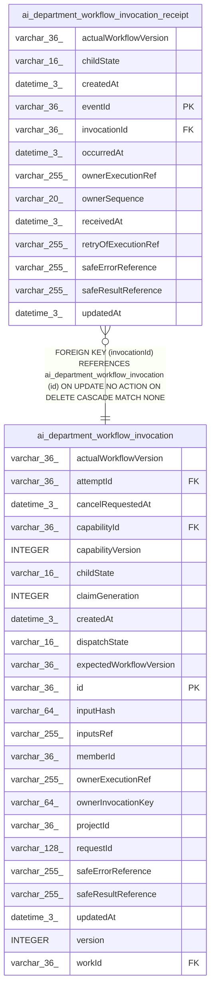

# ai_department_workflow_invocation_receipt

## Description

<details>
<summary><strong>Table Definition</strong></summary>

```sql
CREATE TABLE "ai_department_workflow_invocation_receipt" ("eventId" varchar(36) PRIMARY KEY NOT NULL, "invocationId" varchar(36) NOT NULL, "ownerSequence" varchar(20) NOT NULL, "childState" varchar(16) NOT NULL, "ownerExecutionRef" varchar(255), "actualWorkflowVersion" varchar(36), "safeResultReference" varchar(255), "safeErrorReference" varchar(255), "occurredAt" datetime(3) NOT NULL, "receivedAt" datetime(3) NOT NULL, "createdAt" datetime(3) NOT NULL, "updatedAt" datetime(3) NOT NULL, "retryOfExecutionRef" varchar(255), CONSTRAINT "CHK_ai_department_workflow_invocation_receipt_childState" CHECK (("childState" IN ('pending', 'running', 'waiting', 'retrying', 'succeeded', 'failed', 'cancelled', 'unknown'))), CONSTRAINT "FK_c7d50579bb238ff2c5e6fcfd38c" FOREIGN KEY ("invocationId") REFERENCES "ai_department_workflow_invocation" ("id") ON DELETE CASCADE ON UPDATE NO ACTION)
```

</details>

## Columns

| Name | Type | Default | Nullable | Children | Parents | Comment |
| ---- | ---- | ------- | -------- | -------- | ------- | ------- |
| actualWorkflowVersion | varchar(36) |  | true |  |  |  |
| childState | varchar(16) |  | false |  |  |  |
| createdAt | datetime(3) |  | false |  |  |  |
| eventId | varchar(36) |  | false |  |  |  |
| invocationId | varchar(36) |  | false |  | [ai_department_workflow_invocation](ai_department_workflow_invocation.md) |  |
| occurredAt | datetime(3) |  | false |  |  |  |
| ownerExecutionRef | varchar(255) |  | true |  |  |  |
| ownerSequence | varchar(20) |  | false |  |  |  |
| receivedAt | datetime(3) |  | false |  |  |  |
| retryOfExecutionRef | varchar(255) |  | true |  |  |  |
| safeErrorReference | varchar(255) |  | true |  |  |  |
| safeResultReference | varchar(255) |  | true |  |  |  |
| updatedAt | datetime(3) |  | false |  |  |  |

## Constraints

| Name | Type | Definition |
| ---- | ---- | ---------- |
| - | CHECK | CHECK (("childState" IN ('pending', 'running', 'waiting', 'retrying', 'succeeded', 'failed', 'cancelled', 'unknown'))) |
| - (Foreign key ID: 0) | FOREIGN KEY | FOREIGN KEY (invocationId) REFERENCES ai_department_workflow_invocation (id) ON UPDATE NO ACTION ON DELETE CASCADE MATCH NONE |
| eventId | PRIMARY KEY | PRIMARY KEY (eventId) |
| sqlite_autoindex_ai_department_workflow_invocation_receipt_1 | PRIMARY KEY | PRIMARY KEY (eventId) |

## Indexes

| Name | Definition |
| ---- | ---------- |
| IDX_ai_department_workflow_invocation_receipt_invocationId_ownerSequence | CREATE UNIQUE INDEX "IDX_ai_department_workflow_invocation_receipt_invocationId_ownerSequence" ON "ai_department_workflow_invocation_receipt" ("invocationId", "ownerSequence")  |
| sqlite_autoindex_ai_department_workflow_invocation_receipt_1 | PRIMARY KEY (eventId) |

## Relations



---

> Generated by [tbls](https://github.com/k1LoW/tbls)
