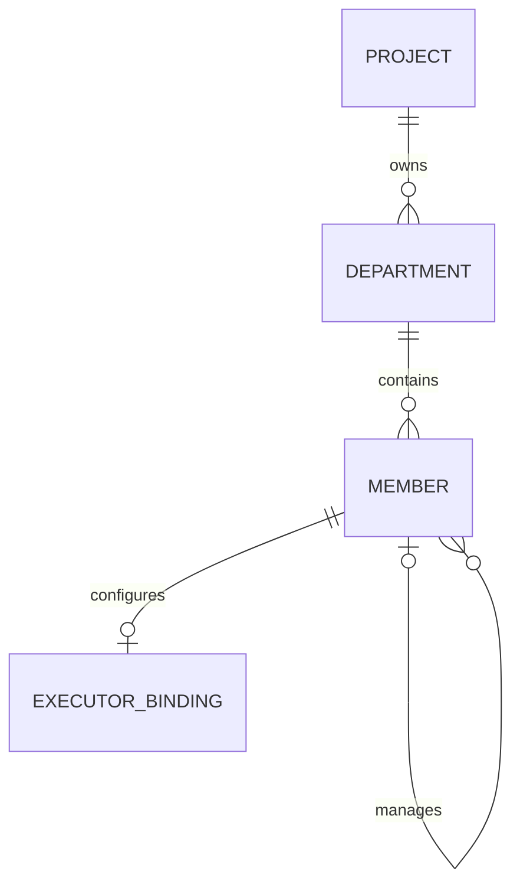

# Data Model: AI Department Directory

## Department

Project-owned organizational unit.

| Field | Type | Rules |
|---|---|---|
| `id` | UUID | Stable primary key. |
| `projectId` | Project ID | Required. Immutable after creation. |
| `name` | string | Required, trimmed, non-empty. Unique among active departments in the same project after case folding. |
| `description` | string or null | Optional. Trimmed. |
| `archived` | boolean | False means active. Archive preserves the row. |
| `projectionSequence` | integer | Starts at 0. Directory and work changes increment it in the owning transaction for operations snapshots. |
| `version` | integer | Starts at 1. Increments on each successful mutation. |
| `createdAt`, `updatedAt` | timestamp | Required audit timestamps. |

## Member

Stable AI worker identity. A member can exist without an executor.

| Field | Type | Rules |
|---|---|---|
| `id` | UUID | Stable primary key and work-history reference. |
| `projectId` | Project ID | Required. Immutable after creation. |
| `departmentId` | Department ID | Required. Must belong to `projectId`. |
| `managerMemberId` | Member ID or null | Must be a different active member in the same department. Must not create a reporting cycle. |
| `name` | string | Required, trimmed, non-empty. |
| `role` | string | Required, trimmed, non-empty. Describes department responsibility. It grants no platform permissions. |
| `archivedAt` | timestamp or null | Null means active. Archive preserves the member and its history. |
| `version` | integer | Starts at 1. Increments on each successful mutation. |
| `createdAt`, `updatedAt` | timestamp | Required audit timestamps. |

## ExecutorBinding

Optional link from a stable member to a configuration owned by a runtime provider.

| Field | Type | Rules |
|---|---|---|
| `id` | UUID | Stable primary key. |
| `memberId` | Member ID | Unique. One current binding per member. |
| `provider` | enum/string | Required. Names an owning runtime provider. |
| `executorId` | string | Required opaque reference. No copied prompt, credential, or runtime configuration. |
| `version` | integer | Increments on replace or clear. |
| `clearedAt` | timestamp or null | A clear marker makes the retained binding unconfigured. |
| `createdAt`, `updatedAt` | timestamp | Required audit timestamps. |

Binding replacement preserves `Member.id`. Previous work attempts keep the executor reference captured by the work record in feature 003. The member's current binding controls future attempts only.

Maintain append-only binding revisions with binding ID, version, provider/executor reference, clear marker, actor, and time. Clearing a binding retains a versioned tombstone; it does not erase prior references. A member without a binding row or with a clear marker is unconfigured.

Append-only DirectoryChange records carry project/department ID, target ID, actor, change kind, target version, time, and a safe summary. Feature 006 projects these records into activity; raw execution data is never included.

Command receipts record project ID, initiating user, request ID, payload hash, outcome reference, and timestamps. Duplicate commands reuse the stored outcome only after current authorization checks. Work/operations features reuse this command identity convention.

## Relationships and invariants

- Every department, member, and binding mutation is project-scoped.
- A member's `projectId` must equal its department's project.
- A manager must be active and belong to the same non-archived department as the reporting member.
- Hierarchy validation applies to active edits. Archiving a whole department retains its historical hierarchy without making its members eligible for new work.
- Manager updates reject self-reference and cycles in the same transaction.
- An archived member cannot receive new work or manage active members.
- Active department names are unique per project after trimming and case folding. Archived names do not block reuse.
- Optimistic concurrency compares the submitted `version` before writing.
- Archiving and new work assignment use the same admission fence and persistence transaction through `ActiveDepartmentWorkGuard`. Archive fails closed if the guard is unavailable. The guard blocks nonterminal work and an attempt in dispatching, active, or suspended phase, including work whose business state is already terminal.
- Reject manager archive while active reports reference it. Department transfer requires the same project, active source/target, no nonterminal work, no active reports, and explicit manager reassignment or clearing in one transaction.
- Database entities and transaction APIs stay inside persistence boundaries.

## C1 Directory — Approved 2026-11-03

### Approved C1 model amendments

The current source uses `archived: boolean` and `projectionSequence: number` on Department. Directory writes increment that sequence in the same transaction. Keep stable member IDs and binding revisions. A binding change does not rewrite an attempt snapshot. The 003 guard checks both nonterminal work and active runtime phases.

C1 model decisions are approved. No new table is required for C1.
