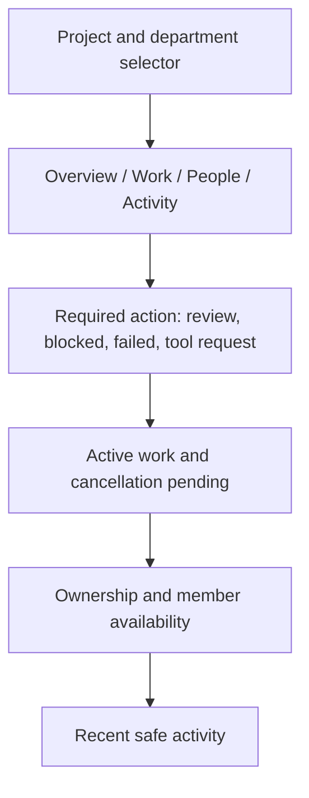

# Design: AI Department Operations

**Status**: Proposed interface contract for 006A and 006B.
**Authority**: [Shared design](../AI-DEPARTMENT-DESIGN.md). This document supplies screen-level detail.

**Behavior reference**: [Paperclip parity review](../AI-DEPARTMENT-PAPERCLIP-PARITY-REVIEW.md). The target covers department coordination only. A run status must never stand in for the business work status.

## Overview

The department is the primary work surface. The project header provides the department selector and Overview, Work, People, and Activity tabs. Office is optional. The overview answers which work needs a person, who owns it, and what changed.

006A contains directory, queue, work/member detail, and business review. 006B adds verified attempt controls, workflow outcomes, tool requests, and reconnect behavior in the same screens.

## Color and Typography

Reuse the current n8n theme in light and dark modes. Use semantic text, surface, border, success, warning, and danger tokens from the design system. The source includes `--background--surface`, `--color--text`, and `--color--primary`. Check each token in the current source before implementation. Use text and icons alongside state colors.

Use existing n8n font and heading styles. Page title, section heading, item title, body, and secondary timestamp form the text hierarchy. Do not add a reference-project font or palette. Status and controls use readable text; secondary metadata never replaces an item's title or owner.

## Layout

Wide layouts may place active work and ownership side by side after Attention. At narrow widths, stack sections in the same reading order. At 360 CSS pixels, reduce queue columns and wrap filters without horizontal page scrolling. Preserve title, status, assignee, and available action. Use CSS spacing/size tokens, not a new fixed pixel scale.

## Screen Specifications

| Screen | Primary content | Main actions |
|---|---|---|
| Overview | Attention first; active work; ownership; recent activity | Open item; create permitted work |
| Work | Filter summary, queue rows, paging, selected detail; parent/child and blocker indicators | Create, assign, mark ready, claim/release, start/retry/cancel when permitted |
| Work detail | Instruction, goal, parent/children, blockers, owner, current claim, business state, runtime attempts, result, comments/activity, review history | Assign, claim/release, report progress/block/result, resolve blocker, request review, review result, and supported executor controls |
| People | Department hierarchy and member roster | Add/update/archive member; configure permitted binding |
| Member detail | Name, role, manager, assigned work, claim/run presence, binding availability | Edit organization or open authorized runtime owner detail |
| Activity | Safe actor/change/target/time entries | Filter and open authorized detail |

Empty directory offers Create department or Add member only to coordinators. Readers receive a readable explanation. Empty filtered queues keep the filter visible and offer Clear filters.

## Components

Reuse current design-system buttons, fields, selects, tables/list patterns, and `N8nDialog`. Use destructive button treatment for archive and explicit confirmation where the action is consequential. An archive rejection lists authorized blocking work and preserves the form/detail.

Member and work forms keep input on validation or version conflict. Show errors at the affected field and place focus on the first relevant error. Dialog close returns focus to its trigger. Icon controls require accessible names.

## Separate Reviews and Permissions

| Panel | Meaning | Controls |
|---|---|---|
| Business review | Accept or return this result under the work review policy | Accept result; Return with reason |
| Tool permission | Permit one proposed action under the executor policy | Inspect action; Grant once; Deny |

Never reuse one approval button or modal for both meanings. Native tool detail and decisions stay with the supported Agents UI/API contract; an unavailable owner action provides an authorized link or readable reason.

## States and Recovery

| State | Treatment |
|---|---|
| Loading | Preserve section structure and label what is loading |
| Partial failure | Keep safe independent sections and retry only the failed read |
| Pending command | Show acknowledgment state and suppress duplicate submit |
| Unknown command result | Explain uncertainty; reconcile the same request before another action |
| Stale edit | Refresh the record and preserve unsaved input for deliberate reapplication |
| Disconnected/stale | Show last successful update time and explicit Refresh |
| Cancellation pending | Explain that stop is requested and not confirmed |
| Executor unavailable | Keep planning/review usable and show the unavailable reason |
| Permission loss | Clear protected content and stop its updates immediately when detected |

Background updates do not move focus. Do not queue offline mutations. Keep member availability, claim state, business work state, attempt phase/outcome, review state, and view freshness separate in labels and data. A successful runtime badge must not render as completed work unless an explicit result report or review decision advanced the work.

## Accessibility and Localization

Use semantic headings, links, forms, visible focus, and meaningful status announcements. Do not announce every token/progress update. Reduced motion uses existing motion mixins and static states. Validate all core flows using only the keyboard.

All product text uses the existing Vietnamese/English i18n system. Verify wrapping, dates, errors, review labels, and narrow layouts in both locales. Follow `n8n:content-design` when implementing copy.

## Design Review Fixture

Review an empty department, two members including one unconfigured, pending business review, a distinct tool request, blocked work after attempt failure, pending cancellation, lost updates, partial failure, version conflict, and access loss. The next attention item must be discoverable within one minute in the roadmap fixture. Timing and usability remain acceptance measurements, not current results.
