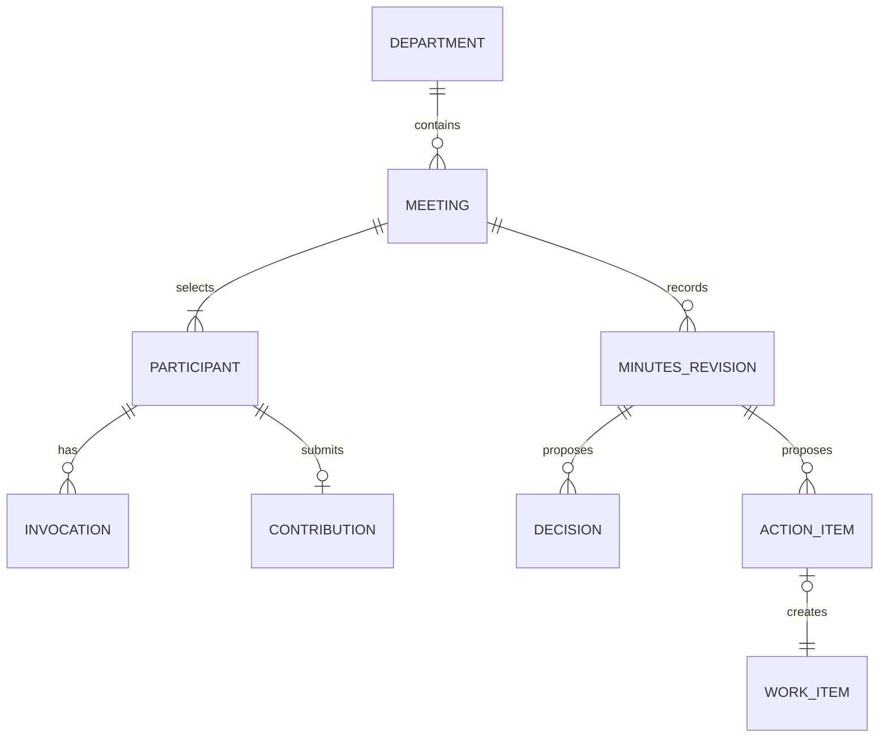

# Data Model: AI Department Meetings

**Status**: Proposed design, implemented in the T002 persistence slice. Confirm external
owner transaction and access boundaries before enabling meeting operations.

All department-owned rows carry `projectId` and `departmentId`; repositories scope every
read and write by both. Runtime prompts, credentials, checkpoints, raw tool arguments,
and execution logs remain with Agents. Meeting records store safe business content and
opaque owner references only.

## Meeting

| Field | Type | Rules |
|---|---|---|
| `id` | UUID | Stable meeting identity. |
| `projectId`, `departmentId` | ID | Immutable scope. |
| `createdBy`, `executionActorId` | user ID | Creator and current invocation authority. Changes require an explicit takeover command. |
| `topic`, `desiredOutcome` | text | Required. Frozen on start. |
| `state` | enum | `draft`, `collecting`, `synthesizing`, `review`, `approved`, `completed`, `cancelling`, `cancelled`. |
| `facilitatorMemberId` | member ID | Must be a participant. |
| `version` | integer | Optimistic concurrency for commands and body revisions. |
| `briefingSnapshotRef`, `briefingHash` | opaque reference/hash | Points to authorized, immutable source snapshot; content access remains owner mediated. |
| `startedAt`, `completedAt`, timestamps | time | Nullable lifecycle times plus audit times. |

## Participant and invocation

Participant is unique by `(meetingId, memberId)` and stores role text snapshot, binding
revision, active-member identity snapshot, response state, absence outcome, exclusion
reason and version. The meeting stores the closed accepted-contribution set and its
closure reason (`quorum` or `deadline`) so late results cannot change synthesis input.
At the deadline, the set may be empty; synthesis still requires at least one accepted
contribution.
It does not store executor prompts or tool payloads.

Each initial/retry call is a separate `MeetingInvocation`:

| Field | Type | Rules |
|---|---|---|
| `id` | UUID | Department correlation ID, created before owner enqueue. |
| `meetingId`, `participantId` | ID | Required parents. One round; retry links to prior invocation. |
| `kind` | enum | `contribution` or `synthesis`. |
| `requestKey` | UUID/string | Stable idempotency key, unique per project and invocation. |
| `actorId`, `executorId`, `bindingVersion` | reference/version | Frozen authority and binding snapshot. |
| `ownerInvocationRef` | opaque string or null | Set only after owner acceptance. |
| `state` | enum | `reserved`, `queued`, `running`, `succeeded`, `failed`, `unavailable`, `stop_pending`, `unknown`, `cancelled`. |
| `ownerSequence` | string or null | Monotonic owner sequence for stale-event rejection. |
| `deadlineAt`, `terminalAt` | time | Deadline is proposed; terminal time requires owner proof. |
| `safeFailureCode`, `safeFailureSummary` | safe values | No raw provider payload or prompt. |

`Contribution` stores one accepted attributed response per participant and round as a
structured object: stance, up to three key points, bounded risks, and a proposed action.
Its serialized form is limited to 4,000 Unicode characters, and the owner requests at
most 1,000 output tokens. Failed, malformed, and late outputs remain invocation evidence
and never replace the accepted contribution.

## Context and source snapshots

`MeetingContextSnapshot` stores one opaque source-reader reference, a hash of the frozen
briefing, the enforced tool policy and capture time for each meeting. It does not store
source bodies, prompts, credentials, or runtime payloads.

`MeetingSource` stores one row for each referenced goal or work item. It records the
owner-provided version, opaque snapshot reference, content hash, safe label snapshot, and
current access state. Source IDs remain owner references; the meeting repository does not
read source tables.

## Minutes, decision, and action item

`MinutesRevision` stores a revision number, safe summary, source contribution IDs, explicit
disagreement entries with attributed positions, author (facilitator or coordinator),
current state, and optional approving user/time. Approval freezes the revision. Later
corrections create a new linked meeting.

`MeetingDecision` stores proposed or approved text, source contribution references,
approving actor/time, and minutes revision. Agent output cannot set approved fields.

`MeetingActionItem` stores proposed task title/description, optional member assignee,
source contribution references, approval and resolution state, work reference, and
conversion request key. Its unique key prevents duplicate work links.

## Commands, audit, and directory admission

Reuse the existing AI Department command receipt table with the shared command identity
`(projectId, actorId, requestId)` and payload hash for create, start, takeover, retry,
exclude, edit, approve, convert, decline, and cancel. Meeting receipt responses contain
only safe identifiers and state; they do not contain source bodies or runtime payloads.
Every mutation appends safe meeting activity in the same transaction as its state change.

The `draft` to `collecting` transition acquires the same department admission fence used
by directory archive. It validates active department and participants, freezes their
current identities and bindings, and commits the meeting before any Agents call. Never
hold the database transaction while contacting Agents or source owners.

The Directory archive guard reports typed work and meeting blockers for department or
member archive. Draft, completed, and cancelled meetings do not block. `collecting`,
`synthesizing`, `review`, `approved`, and `cancelling` block. A cancelling meeting
remains active until every accepted invocation is confirmed terminal. The guard and
directory mutation share the existing directory admission fence and transaction context.
Current source has one work-only guard registration; composite guard composition remains
a Directory/Work owner decision.

## Relations and invariants

- A started meeting has 2–10 unique active members from one department and one facilitator participant.
- The briefing, source revisions, participants, roles, actor and binding revisions are immutable after start.
- The frozen briefing may include only selected coordinator-approved decisions from prior meetings, with source version and approver. It excludes prior minutes and contributions.
- One accepted contribution per participant is allowed. Retry invocation history is retained.
- Only coordinator commands approve minutes, decisions, and action items.
- A converted action item links to one backlog work item. Meeting completion does not wait for that work to finish.
- Project and source access is checked before returning protected bodies. Revoked access prevents result publication and clears protected client cache.
- Late owner events are recorded against the original invocation and cannot change an accepted contribution or terminal meeting.
