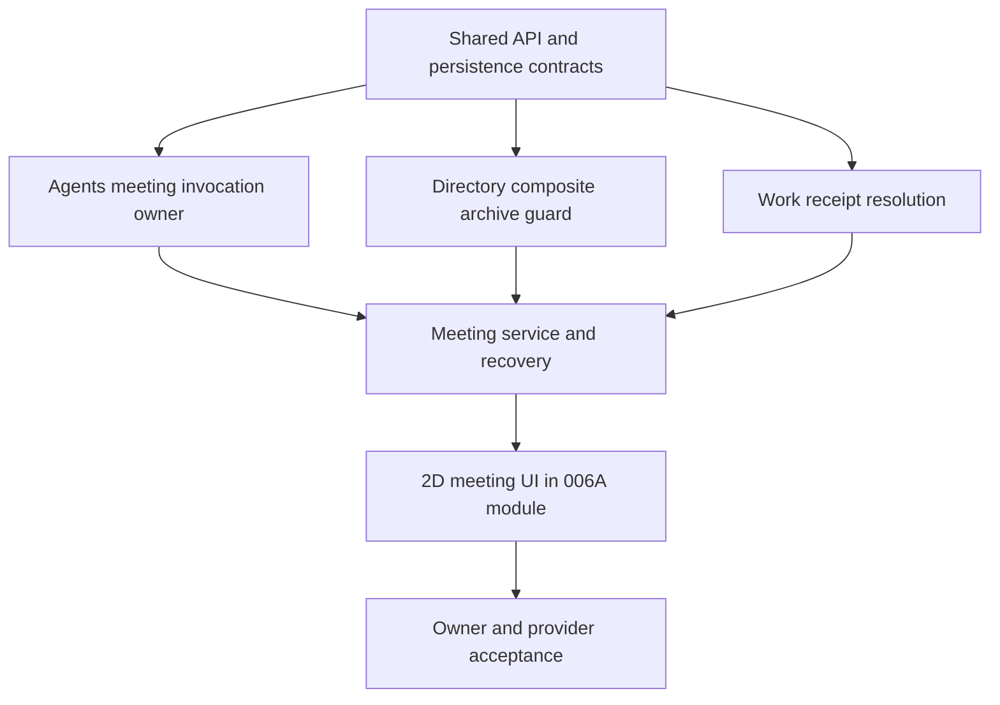

# AI Department Meetings — Implementation Tasks

**Status**: Implementation and acceptance tasks remain open unless checked below.
Keep v1 to one contribution round and one synthesis. Defer exactly one bounded,
coordinator-triggered second round for disagreeing participants until after v1 passes
runtime acceptance. Runtime enablement stays gated on real Agents owner acceptance.
Do not enable meeting dispatch from controlled tests alone.

## Dependency order

## Foundation and persistence

- [x] T001 Add meeting API schemas and DTOs for meeting, participant, invocation state,
  contribution, minutes, decisions, action items, safe activity, command results, and
  paged list queries. Validate identifier lengths, list bounds, and enum states. Domain
  services enforce cross-field membership rules. (FR-001–FR-017)
- [x] T002 Add meeting, participant, invocation, accepted contribution, minutes revision,
  decision, action item, source/context snapshot, and activity persistence. Reuse the
  existing AI Department command receipt table for meeting command idempotency.
  Add unique constraints for participant identity, accepted contribution, command
  identity, and one work link per action item. Keep owner execution payloads out of these
  tables. Add SQLite/Postgres migrations and schema documentation. (FR-004–FR-016)
- [x] T003 Add composed repository methods for meeting reads and writes. Keep TypeORM in
  persistence. Pass `OperationContext` through transactions. Add the command replay and
  payload-hash conflict rules. (FR-009, FR-016)
- [x] T004 Add a project-scoped meeting controller and service shell with current
  `agent:*` scopes. Reauthorize before returning command replay results or protected
  bodies. Return 404 for absent and inaccessible cross-project records. (FR-010, FR-017)

## Agents owner invocation

- [x] T005 Add an Agents-owned `DepartmentMeetingInvocationOwner` contract and proxy.
  Bind actor, project, department, meeting, participant, invocation, executor, binding
  revision, request key, input hash, tool policy, and deadline. Keep the API independent
  of work and attempt IDs. (FR-004, FR-005, FR-014, FR-015)
- [x] T006 Add a durable owner invocation record or an equivalent owner receipt that
  binds the stable invocation key to its input hash and dedicated thread. Same key and
  hash returns the same owner reference. Same key with a different hash conflicts.
  Support accepted, absent, and unknown lookup outcomes. (FR-004, FR-009, FR-015)
- [x] T007 Extend the Agent queue with a meeting source and stable message identity.
  Hash meeting input and reject key reuse with changed content. Create one fresh owner
  thread per invocation. Do not use a fake work or attempt identifier. (FR-004, FR-009)
- [x] T008 Add a meeting runtime profile. Remove saved tools, integrations, workflows,
  workspace and knowledge tools, plan tools, `department_work`, delegation, and
  background tools. Verify the effective tool registry is empty before model execution.
  Do not reuse the `departmentWork` runtime flag. (FR-011, FR-014)
- [ ] T009 Add bounded single-turn execution and safe result retrieval. Record owner
  sequence and terminal outcome. Return result text only after terminal success and
  current access checks. Do not expose prompts, credentials, raw provider errors, or tool
  payloads to the department. (FR-005, FR-006, FR-011, FR-015)
  Current work adds the bounded execution path, durable terminal result, and hash-checked
  read. The Agents owner asks an AI Department binding verifier to confirm the active
  member, executor, project, department, and frozen binding version. The AI Department
  registers a fail-closed supplied-material context reader. Start now reserves each
  configured participant invocation in the meeting transaction and dispatches after commit.
  The recovery task reconciles reserved and unknown dispatches. Meeting detail returns safe
  invocation status. Controlled lifecycle and owner tests pass. Keep this task open until
  provider/native owner acceptance is complete. The current queue-consumer regression suite
  verifies one bounded turn, a 4,000-character output cap, safe failure projection, and
  deadline cancellation without recording a second queue failure. The deadline case exposed
  and fixed a duplicate terminal/failure projection. The focused suite passes 28/28, CLI
  typecheck passes, and Biome plus `git diff --check` pass. Provider/native acceptance remains
  open.
- [x] T010 Add idempotent owner stop commands and terminal snapshots for meeting calls.
  Persist the command receipt on the owner invocation with the meeting invocation and
  thread identity. Reuse the Agent stop service only with the meeting queue source.
  Acknowledgment does not confirm termination. Reconcile pending stops after restart.
  Unknown enqueue stops remain pending until T011 resolves the stable queue receipt.
  The focused owner suite passes 17/17 tests. It covers idempotent acknowledgment
  without terminal proof, confirmation after a terminal execution, persisted stop
  retry, and an unknown enqueue that stays pending until its queue receipt resolves.
  Native restart acceptance remains in T030. (FR-005, FR-015)
- [ ] T011 Add the meeting invocation reconciler. Resolve unknown enqueue results by
  stable request key by checking both the queued/claimed message and the execution linked
  to its deterministic input message ID. A missing queue row alone is not proof of
  absence. Keep the result unknown until an owner receipt resolves it. Apply only newer
  owner sequences. Fence late results after cancel, exclusion, or access loss. Never start
  a replacement while the prior call is unknown or stopping. (FR-004, FR-005, FR-015)
  Owner-side queue/execution lookup and periodic unknown-enqueue reconciliation are
  implemented. Meeting reconciliation now applies only newer sequences and fences results
  after collection closure. It accepts terminal success even when no running snapshot was
  observed. Keep T011 open until cancellation, exclusion, access-loss, and native restart
  fences have focused acceptance. New owner regressions cover lost enqueue acknowledgements
  recovered from either a durable queued message or a claimed execution after its queue row
  disappears. The scheduled reconciler test confirms it resolves the persisted reservation
  without enqueueing a replacement. Owner, parser, and queue-consumer suites pass 48/48;
  CLI typecheck, Biome, and `git diff --check` pass. Native process restart acceptance remains
  open.

## Directory and Work owner contracts

- [x] T012 Replace the work-only directory archive boundary with a fail-closed composite
  guard. Return typed work and meeting blockers for department and member archive. Keep
  the existing admission fence and transaction context. Include safe blocker IDs in 409
  responses. Verified with mixed work and meeting blockers for both archive paths, missing
  guard fail-closed policy coverage, CLI typecheck, Biome, and `git diff --check`.
  Meeting-start/archive race coverage belongs to T013 because start is not implemented
  in T012. (FR-016)
- [x] T013 Make meeting start acquire the shared department admission fence. Recheck the
  department and all participants, freeze their roles and binding revisions, and commit
  the meeting before any owner call. Do not hold a transaction open during external owner
  calls. Verified with the start/archive race and frozen-participant replay integration
  tests. The start command makes no owner call inside its transaction. (FR-003, FR-014, FR-016)
- [x] T014 Add a narrow Work-owned command lookup for work creation by project, actor,
  and request ID. Return found, absent, or conflict with an authorized work reference.
  Do not expose command receipt entities or generic persistence methods. The lookup
  returns a verified work reference and payload hash only for a completed work-create
  receipt. A focused integration test covers found, absent, and conflict outcomes.
  CLI typecheck and Biome pass. (FR-008, FR-009)
- [x] T015 Add action-item conversion reservation and reconciliation. Persist the stable
  Work request ID and payload hash before calling Work. On unknown outcome, resolve or
  replay the same command. Link one existing backlog work item exactly once. Keep work
  start separate. The command reserves the action item and version in one meeting
  transaction. It derives the Work request ID from the persisted project, actor, and
  command ID. Retries resolve the Work receipt or replay the same create command. Receipt
  conflicts move the action item to `recovery_required`. Focused recovery and route-scope
  tests, API-types build, CLI typecheck, Biome, and `git diff --check` pass. (FR-008, FR-009)

## Meeting domain behavior

- [x] T016 Implement draft creation and edit. Validate 2–10 distinct active members from
  one department, one facilitator participant, optional goal/work references, and current
  project access. Drafts may change until start. Goal, work, and approved-decision sources
  are checked against the same project and department on create, edit, and replay. Decision
  sources require approved minutes and an approved or completed source meeting. Persist
  only owner versions and hashes. Recheck source access and content before start and before
  the invocation reader supplies source text. Focused tests cover approved-only carry-forward,
  same-department references, cross-department rejection, active participants, facilitator
  membership, draft edits, and the start boundary. CLI typecheck and Biome pass.
  (FR-001–FR-003, FR-014)
- [ ] T017 Implement start and participant dispatch. Freeze topic, outcome, supplied
  material, authorized source snapshots, actor, members, roles, bindings, and tool policy.
  Use supplied-material-only until Agents proves a read-only tool registry. Record every
  owner result as pending, rejected, failed, unavailable, or unknown as applicable.
  (FR-004, FR-005, FR-010, FR-014, FR-015)
  Context-reader progress: AI Department resolves only the frozen topic, outcome, purpose,
  and participant role for an authorized active meeting. The Agents owner now replaces
  caller-supplied text with this resolved material before reservation and queue delivery.
  The canonical request hash excludes caller text and binds the immutable context reference.
  The queue consumer checks the queued text against the owner-persisted text. The owner
  rejects missing or stale context before reservation. Start stores stable invocation IDs,
  request keys, hashes, bindings, and context references before any owner call. It calls the
  owner after commit. The periodic task recovers reserved and unknown calls. The context
  reader resolves current goal/work sources and approved decisions. Carried decision
  material includes source meeting, approved minutes revision, and approver. T017 remains
  open until provider/native owner acceptance and complete source lifecycle coverage pass.
- [ ] T018 Implement participant result acceptance and explicit exclusions. Accept one
  attributed contribution per participant. Keep retries as separate invocation rows.
  Require structured stance, up to three key points, risks, and a proposed action. Enforce
  per-field bounds and the overall 1,000-token/4,000-character caps; reject malformed
  responses before they count toward quorum.
  Freeze the accepted set at `ceil(2N/3)` quorum, or close it at the deadline even when
  the set is empty. Synthesis requires at least one accepted contribution. Record each
  absent participant and last known outcome; do not require manual exclusion first.
  (FR-004–FR-006, FR-015, FR-018, FR-019)
  Current work adds strict structured owner-result parsing, bounded Unicode fields,
  structured contribution persistence, sequence-aware owner snapshot reconciliation,
  late-result checks, and a periodic reconciliation task. Protected meetings now omit
  contribution bodies from detail responses. A successful owner call with an invalid or
  mismatched structured result does not count as a submission. The service now freezes
  contribution IDs at `ceil(2N/3)` or closes the accepted set at the ten-minute collection
  deadline, including an empty set when no contribution exists.
  It records each absent participant and last known response state. The periodic
  reconciler checks expired collection deadlines. Tests cover quorum, partial and empty
  deadline closure, absence records, idempotent closure, and late-result rejection after
  an empty set closes. Synthesis dispatch and minutes
  generation remain open in T019. The result-parser test now verifies the 500-code-point
  per-field boundary, three-key-point maximum, and Unicode counting. The queue consumer
  tests cover output truncation, safe provider-error projection, and deadline terminal
  state. Both focused files pass 31/31 tests; CLI typecheck, Biome, and `git diff --check`
  pass. Local contribution and synthesis acceptance is recorded under T031; output boundary
  and provider failure acceptance remain open.
- [ ] T019 Implement one synthesis invocation and coordinator-authored minutes fallback.
  Pass only the frozen bounded contributions and recorded absences. Preserve contribution
  citations and disagreements. Attribute opposing positions and reject unsupported
  consensus in draft minutes. Keep generated decisions and action items in draft until
  coordinator approval. (FR-006, FR-007, FR-018, FR-019)
  Current progress: the owner passes the invocation round to the authorized context reader.
  The reader accepts synthesis context only for the facilitator after collection closes and
  only when a non-empty frozen contribution set exists. It supplies only frozen structured
  contributions, attributed by participant, plus recorded absences, within a 48,000-character
  total context bound. The meeting service reserves one synthesis invocation when quorum or
  deadline closure has contributions and the facilitator has a binding. It dispatches after
  commit, validates strict output and frozen citations, checks cross-participant attribution
  for disagreements, and persists draft minutes with proposed decisions and action items.
  Invalid output returns the meeting to review without publishing content. Coordinators can
  save a draft from review with citations limited to the frozen set. The current integration
  file passes 35/35 tests, including one controlled synthesis dispatch and persistence test
  that checks frozen citations and participant-attributed disagreement positions. Current
  context-reader and owner tests pass 21/21. Migration coverage passes 1/1, and CLI typecheck
  and schema checks pass. A local Ollama run also produced accepted cited draft minutes.
  T019 remains open for synthesis retry and recovery acceptance.
- [ ] T020 Implement minutes revision, approval, decisions, and action-item resolution.
  Approval freezes the revision. Require each action item to be converted or declined.
  Complete the meeting only after all action items resolve and all accepted invocations
  are terminal. (FR-006–FR-009, FR-015)
  Current progress: coordinator minutes save creates a new cited draft revision. Approval
  freezes the revision, approves its proposed decisions, and records the coordinator.
  Action items have explicit approve and decline routes. The meeting completes only when
  every item on the approved minutes revision is resolved and every invocation is terminal
  or unavailable. Reconciliation
  can record terminal results after the frozen contribution set moves the meeting to review
  or approval. Save, approval, and item resolution use command receipts. Replaying the same
  command returns the original result. Reusing its request ID with changed content conflicts.
  The meeting integration file passes 39/39 tests. Route policy tests pass 1/1. CLI
  typecheck, ESLint, and Biome pass. An integration case saves minutes revision 2, keeps
  revision 1 as a draft, approves revision 2, and completes the meeting after revision 2
  action items resolve. Unresolved items from the old draft do not block completion.
  The isolated SQLite integration case now creates Work, loses the response, then
  retries the same conversion command. It confirms that the Work receipt resolves the
  uncertain result, one Work item exists, the meeting links it, and command replay is
  stable. Decline replay is also covered. T020 remains open for provider/native
  terminal-state acceptance.
- [ ] T021 Implement explicit retries, takeover, deadlines, and cancellation. Enforce one
  retry per eligible failure. Require terminal proof before retry. Fence new operations
  during cancellation and keep cancellation pending until every accepted invocation is
  terminal. Cancellation must fence stable invocation keys before owner acceptance. The
  Agents owner must persist a cancellation tombstone and check it before reservation and
  queue claim. A queue item that races with cancellation must be discarded before model
  execution. An absent lookup is not terminal proof while dispatch can still reserve the
  key. Partial progress: cancellation state, owner tombstone requests, late dispatch
  fencing, and terminal snapshot reconciliation are implemented. One participant retry
  is now available after a terminal failed or unavailable result. It creates a separate
  invocation, keeps the original execution actor, and uses a stable command receipt.
  The service rejects a second retry and requires terminal proof. Integration coverage
  verifies dispatch count, replay, and the one-retry limit. UI exposes retry only for an
  eligible failed or unavailable participant and hides it after the retry exists.
  Synthesis now also has one explicit retry after a terminal failure or unavailable
  result. It creates a separate invocation linked to the original, reuses command
  receipts, restores the meeting to synthesizing, and rejects another retry. Integration
  coverage checks dispatch, replay, and the retry cap. Exclusion now records a bounded
  coordinator reason before collection closes, fences new work for the participant, and
  requests owner stop with the stable invocation identity. Late successful results do not
  enter the accepted set. Integration coverage checks receipt replay, stop request, and
  late-result rejection. Takeover now changes execution authority only for future calls,
  records the old and new actors, and leaves accepted invocation actors unchanged.
  Integration coverage verifies receipt replay and a retry under the new actor. Complete
  deadline behavior and owner/native acceptance remain open.
  (FR-005, FR-009, FR-015)
- [ ] T022 Implement current-access source reads and result publication. Reauthorize
  project, source, member binding, and execution actor at start, invocation, result
  delivery, approval, conversion, and protected body reads. Clear protected client cache
  on access loss. (FR-010, FR-011)
- [ ] T023 Implement safe meeting activity and project invalidations. Include actor,
  timestamp, target IDs, state, and safe summary only. Reauthorize event recipients before
  detail reads. (FR-011, FR-017)

## 2D user interface

- [x] T024 Add meeting API and store support to the AI Department frontend module created
  by 006A. Preserve request IDs across retries and resolve uncertain commands before new
  commands. (FR-009, FR-017)
  Current progress: the API client supports meeting detail/update/start, minutes save/approval,
  action-item approve/decline, and conversion. The store loads and clears protected detail,
  refreshes after commands, and reuses command IDs for identical retries after uncertain
  responses. A scoped status endpoint resolves receipts for the current actor. The store checks
  older receipts before it sends a new command. It blocks new commands while a receipt is
  pending or unknown. It stores request IDs and target IDs in session storage without command
  bodies, so it can restore pending commands after a page reload. Store tests cover retry IDs
  for every mutation, the pending-command block, and reload recovery. The frontend module suite
  passes 98/98 tests. Meeting integration tests pass 38/38; route policy tests pass 1/1; API
  type tests pass 5/5. API types build, CLI typecheck, module typecheck, Stylelint, Biome, and
  `git diff --check` pass. ESLint has no flat config. Oxlint cannot load `@stylistic/eslint-plugin`.
  The view calls every store command method. T024 is complete. Browser acceptance remains open
  under T032.
- [ ] T025 Add meeting list, draft creation/edit, and participant selection in the 006A
  module. Show member roles, facilitator choice, unconfigured executors, quorum, and an
  estimate of up to `N + 1` model calls before start. Exclude explicit retries and label
  the estimate as call count, not price. Add purpose templates and selection of authorized
  prior approved decisions only. (FR-001–FR-003, FR-019, FR-020, FR-023, FR-024)
  Current UI work adds Decision, Risk review, and Ideation templates, participant and
  facilitator selection, a pre-creation estimate of up to `N + 1` calls, and a draft list.
  Retry calls are excluded and the estimate is labeled as not a price. Draft editing now
  reuses the create form for topic, purpose, desired outcome, participants, and facilitator.
  The form fills the selected template on first open and resets it after a successful create.
  It sends the current expected version through the store command receipt path and leaves
  existing approved-decision references unchanged. The create form can select up to 20 approved decisions
  from a chosen approved or completed meeting in the same department. It loads that source
  detail on demand, filters to approved minutes and decisions with readable text, and sends
  the selected decision IDs to the existing create API. The backend rechecks source state and
  current access. Store tests cover filtering and request replay. Frontend typecheck, all 77
  module tests, all 10,962 i18n tests, Biome, Stylelint, and `git diff --check` pass. Vietnamese
  copy now covers all 295 AI Department strings and its locale test checks interpolation and
  fallback. T025 remains open for browser acceptance.
  The call-estimate note now states that quorum reduces the count only when pending calls
  stop before dispatch, and that active calls may still incur cost. English and Vietnamese
  locale assertions plus estimate tests pass 17/17. Biome and `git diff --check` pass.
  Purpose-template outcome guidance now asks for positions, supporting points, risks, and
  proposed actions. It tells participants to attribute different assessments and avoid
  unsupported consensus. The template and locale suites pass 17/17; Biome and diff checks pass.
- [x] T026 Add meeting detail with participant state, source snapshot, minutes revisions,
  decisions, side-by-side structured contribution comparison, action items, and safe
  activity. Distinguish meeting state from owner invocation state and linked work state.
  Highlight attributed disagreements. (FR-004–FR-012, FR-021, FR-022, FR-024)
  Current progress: the 2D module opens project-scoped meeting detail and clears cached detail
  when access fails or the user changes department. It shows participant contributions,
  invocation states, sources, absences, minutes, attributed disagreements, decisions, action
  items, linked work references, and safe activity summaries. It supports coordinator draft
  minutes from frozen contribution citations. Structured contributions now use a responsive
  participant-card grid for side-by-side review. The open detail refreshes during visible
  polling when no command is being saved. Frontend typecheck, all 48 module tests, Stylelint,
  and `git diff --check` pass. Browser acceptance loads deterministic structured contributions
  through the meeting detail route. It verifies participant attribution, key points, risks,
  and proposed actions. The cards use one column at 360 CSS pixels and multiple columns on
  a wide viewport. The scoped Axe scan reports no violations. The same flow uses keyboard
  section navigation, checks visible focus, and verifies reduced-motion behavior. The
  focused isolated browser test passes 1/1. Playwright package typecheck, ESLint, Biome,
  and `git diff --check` pass. Provider and native owner behavior remain separate gates
  under T029–T031.
- [ ] T027 Add review, approve, retry, exclude, convert, decline, takeover, and cancel
  controls. Show pending stop and unknown states. Do not expose retry while an owner call
  is unknown or active. (FR-005–FR-009, FR-015)
  Current progress: the detail view exposes start, minutes approval, action-item approval,
  decline, work conversion, confirmed cancellation, eligible participant retry, and
  eligible synthesis retry, participant exclusion, and takeover with permission checks.
  Pending stop and unknown states remain visible; retry stays hidden while a call is
  unknown or active.
- [ ] T028 Add English and Vietnamese i18n. Verify keyboard navigation, visible focus,
  reduced motion, 360 CSS pixel layout, loading, empty, disconnected, stale, denied,
  partial-failure, and pending states. (FR-013, FR-017)
  Progress: English and Vietnamese meeting strings are available in the AI Department
  module. The store tracks list loading, transient failure, and access loss. A transient
  failure keeps the last list and offers Retry. Access loss clears meeting data and offers
  Retry. Browser checks verify loading, denied access, transient failure, and recovery in
  English and Vietnamese. Store tests cover stale response ordering, department changes,
  transient failure, and recovery.
  Visible focus, empty state, and 360 CSS pixel layout also pass in both locales. The tests
  confirm the reduced-motion media preference but do not prove animation behavior. The
  browser verifies loading for a delayed list request. Both locale flows also switch offline
  after loading a meeting, confirm the cached row remains with localized stale-list messaging,
  then reconnect and verify Retry clears the message. The store suite verifies offline
  classification. Scoped axe scans report no violations across all seven primary 2D
  sections and the meeting form, offline cached-list state, and draft detail in English and
  Vietnamese. The scans cover the AI Department surface, not the global application shell.
  Partial failure across meeting detail, pending state, and full accessibility acceptance
  remain open. The reduced-motion preference sets descendant transition and animation
  durations to 0.01ms. English and Vietnamese browser checks measure navigation transition
  duration under that preference. An English browser scenario also simulates a meeting
  create request that the server accepts before the response is lost in English and
  Vietnamese. The retry reuses the same request ID and leaves one meeting in the list.
  Pending and command-recovery coverage still needs the remaining browser states. A full-
  document axe probe found existing application-shell violations in popover ARIA attributes,
  tablist roles, landmarks, button names, and region coverage; scoped AI Department scans
  remain clean. Replacing the nested `PageViewLayout` main landmark with a content container
  removed one duplicate-main finding in the rebuilt browser app. Full application-shell
  accessibility acceptance remains open.

## Acceptance and enablement gates

- [ ] T029 Complete controlled acceptance for full and partial participation, failed
  synthesis, quota failure, timeout, duplicate dispatch, restart after unknown enqueue,
  pending stop, late output, duplicate conversion, binding change, project/source access
  loss, and archive races. Measure SC-001 from opening draft creation to a successful
  start for four members in a guided session, and record the result separately from
  setup time. Keep controlled evidence distinct from native owner evidence.
  (SC-001–SC-006)
  Current controlled evidence: the meeting integration file passes 39/39 tests, Agents
  owner/result tests pass 16/16, context-reader/binding/controller tests pass 11/11, the
  work-attempt integration file passes 33/33, and frontend purpose-template/N+1 estimate
  tests pass 16/16. These focused suites do not cover the full provider quota/timeout matrix,
  native restart after unknown enqueue, or guided four-member timing. No shared provider API
  key is configured; local Ollama evidence is recorded under T031.
- [ ] T030 Complete Agents owner acceptance for tool stripping, context isolation,
  idempotency, lookup, result delivery, stop across restart, access revocation, and
  sequence ordering. Include cancellation racing owner reservation and queue claim.
  Keep dispatch disabled until this gate passes. (SC-005)
  Current controlled rerun: the owner suite passes 17/17 tests. The result and context
  reader suites pass 8/8. The work service integration suite passes 38/38. One stale fixed
  deadline in the owner test fixture was moved to 2099 after it expired on the current date.
  These controlled tests do not prove revocation during a live call or provider execution.
  Added a queue-consumer regression for cancellation racing the transition from the owner
  check to `markRunning`. When the owner update affects no accepted row, model execution
  does not start. The focused queue-consumer suite passes 30/30 tests; Biome and
  `git diff --check` pass.
  Live acceptance on the isolated n8n instance at port 5789 exposed that the queue consumer
  compared the meeting actor with absent recording telemetry. It now checks the durable
  thread owner. A later provider run exposed a multi-state terminal update that did not
  update the owner receipt; the repository now uses TypeORM `In(...)`. The live owner receipt
  reached `terminal/succeeded` with sequence 5 after the fix. A live cancellation exposed a
  null stop-command predicate that did not match SQLite; the repository now uses `IsNull()`.
  Its focused repository test passes 1/1. A live cancellation then left
  two provider executions and owner invocations running at sequence 3 when the isolated
  process was stopped. After restart, the durable cancellation was retried, the executions
  became `interrupted`, the owner receipts became `terminal/cancelled` at sequence 5, and the
  meeting reached `cancelled`. This proves stop recovery across this main-process restart.
  Live binding revocation was verified on the isolated single-process SQLite/Ollama
  path. During facilitator synthesis, clearing the current binding moved the meeting
  through `stop_pending` to `review`; the domain invocation became `cancelled` at
  sequence 5 with safe failure code `cancelled`. The owner receipt reached
  `terminal/cancelled` at sequence 5, and the correlated native Agent execution status
  became `cancelled`. Reconciliation now checks the current member and binding before
  accepting a nonterminal invocation snapshot, and requests durable owner stop when
  that authority is lost. Regression coverage passes: work service integration 39/39,
  work-attempt integration 35/35, and queue-consumer tests 31/31. CLI typecheck, CLI
  build, Biome on changed files, and `git diff --check` pass. Clearing then restoring
  the binding also exposed revision reuse after tombstone; binding versions now advance
  from the latest revision and the integration test passes. Other access-loss modes,
  execution modes, and restart scenarios remain unverified.
- [ ] T031 Complete provider acceptance for output limits, deadlines, quota behavior, and
  real participant/synthesis results. Do not claim success from a provider error. (SC-005)
  Current live progress: with Ollama `qwen2.5:3b`, two participant calls returned JSON that
  passed the bounded contribution schema. The collection closed at quorum 2/2, and one
  facilitator synthesis produced draft minutes revision 1 with contribution citations,
  proposed decisions/actions, and attributed disagreement positions. Owner results were
  terminal and hash-checked. The prompt now names the strict JSON fields for contributions
  and minutes. This does not cover output-limit boundaries, deadlines, quota failures, or
  provider diversity. The generated draft still needs human quality review.
- [x] T032 Complete 2D browser acceptance in English and Vietnamese with keyboard-only
  controls, reduced motion, and a 360 CSS pixel viewport. Record measured results before
  enabling the feature. (SC-006)
  Current progress: isolated Playwright browser runs cover localized navigation and meeting
  preparation. The English flow creates a department, adds two members, checks all purpose
  templates and the N+1 estimate, then creates and opens a draft. The Vietnamese flow now
  covers the same preparation and draft path. Both flows use keyboard navigation to enter
  People and Meetings. The English section smoke checks a 360 CSS pixel viewport and sets
  reduced motion. The English and Vietnamese meeting preparation flows also run at 360 CSS
  pixels, assert no horizontal overflow in the form and draft detail, assert the reduced-
  motion media preference, and verify `:focus-visible` on Meetings after keyboard activation.
  Both locales also verify loading, a simulated 403, a simulated 503, retry recovery, and the
  localized empty-meeting state before draft creation. After draft detail, both flows go
  offline, confirm the cached meeting row and localized stale-list message, then reconnect
  and retry successfully. Scoped axe scans report no violations across the seven primary
  2D sections, meeting form, offline list, or draft detail in either locale. Browser checks
  also confirm a navigation transition duration at or below 0.001 seconds when reduced
  motion is active. Pending state and full application-shell accessibility are accepted below.
  The localized 2D acceptance paths also create a goal, add a member, assign work to both,
  and inspect the work detail. Each English and Vietnamese action journey passes 1/1 with
  no scoped axe violations. Live Agent/provider acceptance remains open in T019 and T031.
  Latest isolated browser acceptance after shared-shell fixes: the Vietnamese suite passed
  4/4 with `N8N_DEFAULT_LOCALE=vi`; the English suite passed 4/4 with
  `N8N_DEFAULT_LOCALE=en`.
  Each suite used one worker and the isolated local runner. Both cover navigation, meeting
  preparation, templates, the N+1 estimate, 360 CSS pixel layout, reduced motion, and the
  goal/member/work path. Both also cover a lost create response and retry with the same
  request ID. The tests now use the server locale that matches their asserted copy and select
  newly created participants by unique names. The English browser test also opens a persisted
  meeting detail with an owner `stop_pending` snapshot, verifies the meeting and participant
  pending labels, and confirms that participant retry is hidden. A full-document axe run on
  the pending detail reports no violations. The run used the static frontend bundle and an
  isolated SQLite runner. Route tabs use group semantics when they contain route links, and
  selectable tabs keep tablist semantics. Popover triggers have button semantics, focus, and
  accessible names. Icon-only dropdown actions have labels. Complementary landmarks have
  unique names, and the app exposes one top-level main landmark. The E2E marker sits inside
  the page landmark while its outline stays fixed to the viewport. Shared component tests
  pass 125/125. The design-system and editor UI builds pass. T032 is complete. T026 browser
  acceptance now passes for the participant comparison view. T029–T031 remain open for
  controlled failure coverage, native owner behavior, and provider acceptance.
- [ ] T033 Update roadmap, requirements evidence, and handoff with verified outcomes.
  Keep the feature pointer at Spec 004 unless the user selects a new active feature.
  Current progress: the roadmap and handoff record the isolated provider-backed meeting
  result, stop recovery evidence, and the owner/runtime defects found during acceptance.
  T030 and T031 remain open, so this task stays open until all required acceptance evidence
  is recorded.

### T011 stop-proof regression — 2026-11-05

- The dispatch/cancel race test exposed that `cancelInvocation()` treated an owner acknowledgment as terminal proof when the owner invocation reference was not yet available. It now marks an invocation cancelled only when the owner returns `confirmedTerminal`; acknowledgment without terminal confirmation keeps the invocation at `stop_pending` and the meeting at `cancelling`.
- Updated the SQLite integration case for an accepted dispatch that returns after cancellation begins. The case now verifies that the late acceptance cannot report cancellation as complete.
- The work-service integration suite passes 39/39, CLI typecheck passes, and Biome passes for the changed files. This covers one controlled race. T011 remains open for native restart, exclusion, access-loss, and provider-backed owner acceptance.

### T031 quota failure regression — 2026-11-05

- Added a queue-consumer case for a provider HTTP 429 response. It verifies one terminal failure, no automatic retry, and no provider detail in the result. The bounded output case still verifies that a 4,100-code-point stream stores only 4,000 code points. The parser suite covers the field and total-result bounds.
- The queue-consumer and result-parser suites pass 35/35. Biome passes for the changed test. These are controlled provider-error and output-boundary cases; T031 remains open for live quota/deadline behavior and provider diversity.

### T011 cancellation tombstone reconciliation — 2026-11-05

- A cancellation can commit its owner tombstone before the owner invocation exists. When the in-flight dispatch later returns `rejected/cancelled`, the domain now treats that explicit owner result as terminal proof that the queued call cannot start. It records `cancelled_before_enqueue` and completes the meeting if all invocations are terminal. Unknown and late-accepted results remain pending until owner proof arrives.
- The SQLite work-service integration suite passes 40/40, including both late acceptance and tombstone rejection races. CLI typecheck, Biome, and `git diff --check` pass. T011 remains open for native restart, exclusion, access-loss, and provider-backed owner acceptance.
