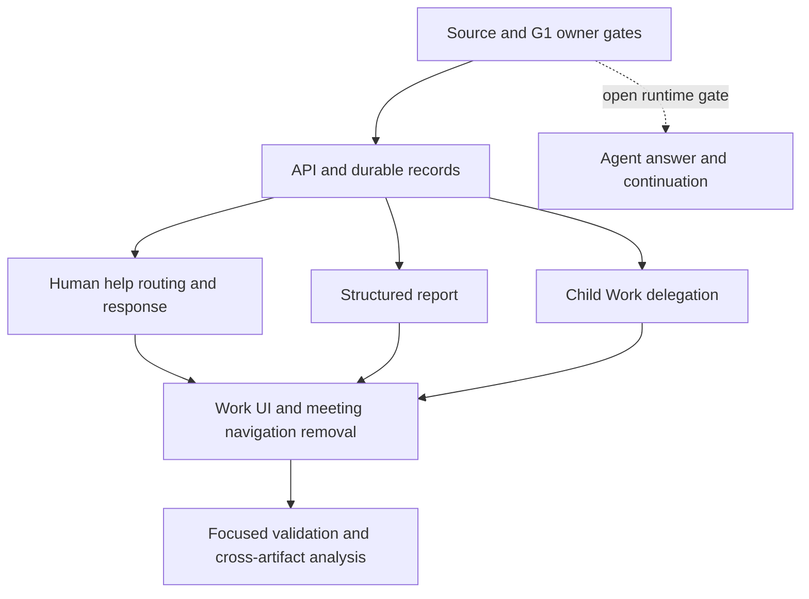

# Tasks: AI Department Work Coordination

**Status**: Implementation in progress. The consultation owner bridge is implemented behind a disabled gate. G1 blocks Agent answers and requester continuation.
Meeting table retirement remains blocked by data disposition review.

**Input**: [spec.md](spec.md), [plan.md](plan.md), [research.md](research.md),
[data-model.md](data-model.md), [contracts/](contracts/), and [quickstart.md](quickstart.md).

**Tests**: Follow the root and package instructions. Use focused tests with a dedicated
test-owned database. Do not use the owner's working instance. Do not mark a runtime gate
as passed from unit tests or source review alone.

## Phase 1: Setup and design gates

**Purpose**: Confirm the current owner lifecycle before changing continuation behavior.

- [x] T001 Record current G1 wake, coalescing, lost-wake, restart, and access-loss acceptance against the current Agents owner revision in `specs/feature-contracts/ai-department/evidence.md`. Full G1 acceptance remains open.
- [x] T002 Verify blocked-to-ready continuation after a terminal attempt and no remaining blockers. The retry path preserves the assignee and creates eligibility; the contract now specifies the same invariant for help responses.
- [x] T003 Record shared coordination count and character caps in `packages/@n8n/api-types/src/ai-department/work.ts`. T004 will consume these values in the DTO schemas.

**Gate**: Do not implement or enable Agent-to-Agent answers or requester continuation
until T001 and T002 pass on the current owner revision. Human responses and other stories
can proceed independently.

## Phase 2: Foundational persistence and API types

**Purpose**: Add bounded shared contracts and durable department-owned records.

- [x] T004 [P] Add structured completion report, ask, delegate, help request, help response, expertise, and routing state DTOs to `packages/@n8n/api-types/src/ai-department/work.ts`. `@n8n/api-types` build passed.
- [x] T005 Add normalized expertise tags to `packages/cli/src/modules/ai-department/database/entities/member.entity.ts` and directory repository methods, with count, length, duplicate, and normalization rules. Directory API integration coverage passed 6/6.
- [x] T006 Add durable help request and response entities in `packages/cli/src/modules/ai-department/database/entities/` with scoped indexes, unique response constraints, request-chain state, deadline, owner reference, and version; add `assignedByUserId` to `packages/cli/src/modules/ai-department/database/entities/work-item.entity.ts`. Registered the entities in the module; `n8n` build passed.
- [x] T007 Set `assignedByUserId` on Work creation and assignee changes in `packages/cli/src/modules/ai-department/work/work.service.ts`; do not use `WorkAttempt.initiatingUserId` as the assignment actor. The focused assignment-actor integration test passed.
- [x] T008 Add SQLite and PostgreSQL migrations for expertise, assignment actor, and help records in `packages/@n8n/db/src/migrations/common/`; preserve all existing meeting tables and records. All three migration up/down checks passed on SQLite and PostgreSQL test containers.
- [x] T009 Add named repository methods for expertise and help lifecycle in `packages/cli/src/modules/ai-department/database/repositories/`; keep TypeORM inside persistence, and add focused API schema and repository integration coverage in `packages/cli/src/modules/ai-department/__tests__/` for bounds, scope, duplicate tags, assignment actor, request idempotency, and one accepted response. Expertise and assignment coverage passed earlier; help repository scope/replay/unique-response integration passed on SQLite.

## Phase 3: User Story 1 - Review a structured completion report (Priority: P1)

**Goal**: An Agent submits a useful, validated completion report in its existing work turn.

**Independent Test**: Submit a complete report under a current claim. Verify all fields
appear in authorized Work detail and existing review policy remains in force.

### Validation for User Story 1

- [x] T010 [P] [US1] Add API schema coverage for empty results, unknown fields, list bounds, character bounds, and invalid evidence references in `packages/cli/src/modules/ai-department/__tests__/work-agent-actions.test.ts`. Schema tests cover required result, unknown fields, list and character caps, and empty or oversized references; service integration rejects an out-of-scope attempt reference without changing Work state.
- [x] T011 [P] [US1] Add service integration coverage for valid report, rejected report without mutation, duplicate command replay, required versus automatic review, no extra manager Agent call for a clean report, and attention for open issues in `packages/cli/src/modules/ai-department/__tests__/work/work-coordination.integration.test.ts`. Coverage lives in the existing `work-attempts.integration.test.ts`: valid/invalid evidence, replay, required and automatic review, and no second dispatch passed on SQLite. The Work detail component test confirms open issues render.

### Implementation for User Story 1

- [x] T012 [US1] Replace the free-form `submit.body` contract with a structured report and shared limits in `packages/@n8n/api-types/src/ai-department/work.ts`. Schema tests reject free text, misplaced reports, and unknown fields; `@n8n/api-types` build passed.
- [x] T013 [US1] Persist the validated report as one attributed Work activity and safe attempt summary under the current claim in `packages/cli/src/modules/ai-department/work/work-coordination.service.ts`. SQLite integration replay test passed and verified the safe summary and full activity report.
- [x] T014 [US1] Return the structured report in authorized Work detail and activity projections in `packages/cli/src/modules/ai-department/work/work.service.ts` and `packages/@n8n/api-types/src/ai-department/work.ts`. Authorized activity projection parses and validates the stored report; SQLite integration verifies the projected report.
- [x] T015 [US1] Render report sections and empty states in the existing Work detail activity in `packages/modules/ai-department/frontend/src/views/AiDepartmentHomeView.vue` and `packages/modules/ai-department/frontend/src/components/WorkCompletionReport.vue`, with English and Vietnamese i18n. Component test passed.

## Phase 4: User Story 2 - Ask for help and continue the same Work (Priority: P1)

**Goal**: Keep Work ownership while routing a durable question to a qualified responder.

**Independent Test**: Ask a question and answer it as a person. Verify the current turn
ends safely, the Work assignee stays unchanged, activity records the response, and the
requester continuation is queued only after answer persistence. Agent recipient execution
is excluded until the G1 gate passes.

### Validation for User Story 2

- [x] T016 [P] [US2] Add pure routing tests for matching expertise tags, deterministic tie-break, self exclusion, request-chain exclusion, department scope, binding state, manager fallback, and assignment-actor fallback in `packages/cli/src/modules/ai-department/__tests__/work-help-routing.test.ts`. Six routing tests passed. The selector is deterministic and independent of runtime availability lookup.
- [x] T017 [P] [US2] Add service integration coverage for ask admission, current claim and version checks, request limit across continuations, stop uncertainty, blocked-to-ready continuation only after answer and blocker checks, answer race, expiry, duplicate response, and access loss. Focused SQLite coverage verifies claim/version admission, idempotent ask replay, the two-request cap, uncertain stop, expired-answer rejection, one persisted response in a concurrent human-answer race, duplicate response rejection, and 403 after project access loss. Controlled owner-response integration proves one ready retry and delivered wake when blockers are clear, and no retry when a blocker remains. The test enables the response gate directly; production runtime acceptance remains G1 T042.
- [x] T018 [US2] Add controlled Agents owner tests for terminal stop before awaiting an answer and coalesced requester wake after answer commit. The Agents owner unit test proves a queued consultation becomes terminal before the owner confirms stop. SQLite Work integration verifies that two restarted reconcilers persist one attributed answer and produce one ready retry for the unchanged assignee. G1 runtime acceptance remains open.

### Implementation for User Story 2

- [x] T019 [US2] Implement deterministic expertise routing and fixed manager/assignment-actor fallbacks in `packages/cli/src/modules/ai-department/work/work-help-routing.service.ts`. The service checks current executor availability and the assignment actor's project `agent:update` scope; selector and service tests passed.
- [x] T020 [US2] Add the `ask` action and transactionally record the request, blocked transition, activity, and owner stop intent in `packages/cli/src/modules/ai-department/work/work-coordination.service.ts` and `packages/cli/src/modules/ai-department/work/work-help.service.ts`. SQLite tests pass for idempotent request replay, pending state when stop proof is absent, and answerable state only after confirmed terminal stop. Requester continuation remains disabled under G1.
- [ ] T021 [US2] Human answer persistence, authorization, terminal-stop checks, activity, and idempotent replay are implemented and integration-tested. On 2026-11-07, the focused SQLite integration case `stores one authorized human answer after terminal stop proof without waking the requester` passed using the test-owned folder `/tmp/nexora-009-t021-human-answer-20261107`. Live Agent answer and same-Work continuation now pass in the normal-access case under T042, but the production G1 gate remains closed until full runtime acceptance passes; do not mark this combined task complete before then.
- [x] T022 [US2] Add request, response, recipient, and status projections to Work detail and attention queries. Work detail and a bounded, project/department-scoped attention endpoint expose these fields. SQLite lifecycle coverage verifies pending requests appear and answered requests leave attention.
- [x] T023 [US2] Add localized help request and human answer UI states to the Work detail panel and overview. English and Vietnamese copy is present. Component tests verify answer submission and read-only users cannot answer.

**Agent response enablement gate**: Keep the Agents consultation invocation and automatic
requester continuation disabled until the owner contract is accepted and T001, T002, and
T042 pass. A requested tool policy field does not prove that the effective tool registry
is empty.

### Agent response implementation after source gate

- [x] T039 Add durable Agents-owned consultation invocation and cancellation-gate records, owner-resolved context and binding checks, a capability-free runtime profile, bounded result storage, and queue recovery. Persist the exact owner input hash on the help request for strict recovery lookup. Both SQLite migration up/down tests passed. Owner service and repository tests passed 6/6. Queue consumer tests passed 33/33. The runtime gate remains disabled.
- [x] T040 Connect confirmed help requests to idempotent consultation dispatch and reconcile terminal owner results into one attributed response. Preserve the release owner reference. The Agents owner unit test verifies a repeated accepted invocation does not enqueue a second Agent turn. Focused service tests cover inaccessible and stale-context results returning to the human answer path, including expiry. SQLite Work integration covers loss of owner result after success, terminal owner failure, and terminal failure after expiry; it confirms no false response and preserves the Work assignee. A restart simulation runs two reconcilers against the same terminal result and verifies one attributed response is persisted.
- [x] T041 Continue the same Work only after a durable answer, terminal source attempt, unchanged assignee, and clear blockers. Use the existing retry and wake path. SQLite Work integration verifies one attributed answer and one ready retry for the same assignee under concurrent restarted reconcilers, then confirms the durable wake is delivered. A paired case keeps Work blocked and creates no new attempt while a blocker remains. The integration test `recovers a persisted wake after the owner confirms no dispatch was accepted` covers lost dispatch recovery. The resumed requester's `inspect` action returns only answered help requests for that same member, so the next turn can use the stored answer. Consultation owner tests withhold a completed result after project access or recipient binding changes. G1 runtime acceptance remains separate and open.
- [ ] T042 Run current-owner G1 runtime acceptance against the isolated test copy. On 2026-11-07, opt-in Ollama tests with `qwen2.5:3b` passed for published Agent pickup with a structured result, stopping a live provider request, a no-tools help consultation, and live requester continuation using the stored answer. The resumed Agent inspected the persisted answer, claimed the same Work, and submitted the answer token as a structured result. A separate-process test with `qwen2.5:7b` also passes: process one persists an answered help request and exits; process two recovers it, starts exactly one requester attempt, reads the stored answer, submits the answer token, reaches business review, and records terminal success. The joined answer/wake/restart case runs two reconcilers against one stored answer before process exit, confirms one accepted lane generation and queue message, then recovers that message in a fresh process and completes one live requester attempt with `qwen2.5:7b`; both phases passed against `/tmp/nexora-009-g1-help-restart-coalesced-d-20261107`. The live same-lane restart case passed with `qwen2.5:7b`: process one accepted a queue message and made two more Work items eligible; process two recovered it, then added another eligible Work while the first live run was active. The owner completed all four in sequence, every execution reached success and every attempt reached terminal/succeeded, the lane drained to generation 5/acknowledged generation 5, and no more than one attempt was active at a time. Both phases passed against `/tmp/nexora-009-g1-lane-live-f-20261107`. The opt-in hierarchy test passed: CEO delegated to a manager, manager delegated to staff, staff submitted a structured report, and accepted child reports were submitted at each parent level. The live consultation matrix covers normal access, responder binding removal, initiating-user project access loss, duplicate reconciliation, member reporting-line reassignment during generation, and executor binding revision replacement during generation. Reporting-line reassignment preserved valid responder authority and the answer continued; replacing the executor binding revision withheld the result. The six-case matrix passed in `/tmp/nexora-009-g1-live-matrix-6-20261107`; focused consultation owner tests passed 10/10. Live authority separation across competing users, members, and binding revisions, plus PostgreSQL live drain, remain unverified. Review these G1 criteria before closing T042. See `specs/feature-contracts/ai-department/evidence.md`. Keep Agent answers and requester continuation disabled until every required case passes.

## Phase 5: User Story 3 - Delegate a child Work item (Priority: P2)

**Goal**: Create a separate child item while retaining parent ownership and completion
responsibility.

**Independent Test**: Delegate and replay a child command. Verify one child, one parent
link, one blocker, and a rejected parent submit until the child is resolved.

### Validation for User Story 3

- [x] T024 [P] [US3] Add integration coverage for child creation, duplicate replay, conflicting payload, atomic relationships, wrong department, and unresolved blocker checks. Coverage is in `work-attempts.integration.test.ts`; generic relationship integration coverage rejects cycles. Delegation always creates a new child ID, so a cycle cannot already include that child.

### Implementation for User Story 3

- [x] T025 [US3] Add the bounded `delegate` action schema and recipient requirements. API schema tests and API-types build passed.
- [x] T026 [US3] Create child Work and parent/blocker relationships with a command receipt in the coordination transaction. SQLite integration verifies one child, replay, conflicting payload rejection, and parent submit blocked by the child.
- [x] T027 [US3] Wire the authenticated `delegate` action into work coordination and the Agent tool. Focused work-action integration passed.
- [x] T028 [US3] Show child ownership, state, and parent blocker status in Work detail and relationship projection. Existing Work detail renders relationship state; focused component and lifecycle checks passed. Dedicated visual acceptance remains in T036.

## Phase 6: User Story 4 - Replace meeting creation with work support (Priority: P2)

**Goal**: Remove manual meeting creation from the active product flow while retaining
historical records.

**Independent Test**: Verify the department UI has no meeting creation or navigation
action. Verify existing meeting rows remain accessible under current authorization.

### Validation for User Story 4

- [x] T029 [P] [US4] Add frontend coverage that meeting navigation is absent and Work help actions remain available. Navigation and WorkHelpPanel tests pass. Playwright also verifies meeting navigation is absent in English and Vietnamese.
- [x] T030 [US4] Add a persistence integration check that the UI removal release leaves existing meeting records unchanged. SQLite integration confirms meeting rows remain queryable after Work and goal views are read.

### Implementation for User Story 4

- [x] T031 [US4] Remove meeting navigation, creation, and meeting-only actions from the active department view. Meeting tables, APIs, history, and their stored records remain intact. Historical strings and store contracts remain for the retained records.
- [x] T032 [US4] Mark Spec 008 as superseded by Spec 009 while preserving its research, acceptance evidence, and implementation history.
- [x] T033 [US4] Update the dependency order and supersession record in the roadmap without changing unrelated gate evidence.
- [x] T034 [US4] Record a separate meeting data disposition and rollback proposal in research. Approval remains open; no retirement migration is authorized.

**Blocked retirement slice**: Do not drop meeting tables or delete meeting rows in this
feature until retention, export, backup, rollback, and authorized access requirements are
approved and a preserving migration is specified.

## Phase 7: Polish and cross-cutting validation

- [x] T035 [P] Review project access on help reads, replies, Agent dispatch, owner results, activity, and wake delivery. Help reads are project/department scoped and use `agent:read`; replies use `agent:update`, recipient checks, and terminal-stop proof. Ask/delegate require a current attempt, binding, executor authorization, and claim. Agent consultation owner results and requester wake remain behind the disabled G1 gate.
- [x] T036 Verify English and Vietnamese copy, keyboard operation, narrow layout, focus, and reduced motion. Isolated Playwright E2E passed 3/3 in English and 3/3 in Vietnamese, with 360px viewport, keyboard navigation, reduced-motion settings, and accessibility scans.
- [x] T037 Run focused tests and format/lint checks from `AGENTS.md`; use a test-owned database and record exact results. Earlier work-attempts and meeting-retention SQLite integration passed 50/50; the Phase 8 work-attempts integration suite now passes 55/55 on SQLite and PostgreSQL. Frontend module Vitest passed 122/122 across 19 files. WorkController policy passed 1/1. API-types and CLI builds passed. The current editor UI bundle built successfully in 6.41 seconds. Biome checks passed. Targeted ESLint for Work detail, help/report components, and navigation passed. Full frontend module ESLint currently reports one `prefer-optional-chain` error in `src/office/scene/layout.ts`; whole-module ESLint was attempted but reached the 4 GB Node heap limit. Backend oxlint could not load `@stylistic/eslint-plugin`; ESLint passed on changed backend files with existing warnings. Isolated Playwright E2E passed 6/6.
- [x] T038 Run Spec Kit cross-artifact analysis after all unblocked tasks and mappings are represented; record deliberate G1 and data-retention gaps without marking them as acceptance in [analysis.md](analysis.md). The report maps all 18 FRs and 6 SCs to tasks and records current evidence limits.

## Phase 8: Hierarchical assignment and authorized workflow use

**Design amendment**: [plan.md](plan.md#hierarchical-delegation-and-workflow-access-design-amendment-2026-11-07).
This extends the original same-department delegation flow. The service now rejects
non-direct reports and writes child eligibility, lane generation, and a durable wake
intent in the delegate transaction. These source changes are not accepted until the
focused tests and owner-backed wake checks below pass.

- [x] T043 Add service integration coverage for direct-report authorization, archived or
  unbound recipients, stale manager links, project/department boundaries, child goal
  inheritance, and unchanged parent ownership in `work-attempts.integration.test.ts`.
  The focused SQLite integration suite passed 54/54.
- [x] T044 Add persistence and dispatch coverage proving child creation, parent/blocker
  links, command receipt, eligibility, lane generation, and wake intent commit atomically.
  A simulated wake-intent write failure rolls back the child, relationships, eligibility,
  lane, wake, receipt, and parent claim changes. Replay creates no second eligibility.
  Existing lane tests cover current binding and blocker checks before dispatch.
- [ ] T045 Verify the campaign path can invoke only a separately enabled member
  `WorkflowCapability`, using its exact published workflow revision and current C5 owner
  checks. Keep invocation disabled while C5 G4–G5 remain open. Test publication change,
  revocation, and side-effect approval before enabling. The workflow invocation service
  suite passed 27/27, including separate member and executor IDs, exact published-version,
  and revoked-authority cases. A 2026-11-07 rerun passed 36/36 across the invocation and
  capability suites, and revocation integration passed 2/2 in a fresh test-owned SQLite
  folder. Capability
  configuration now has regression coverage that rejects a changed publication unless a
  coordinator explicitly refreshes it; its focused suite passed 9/9. Revocation integration
  passed 2/2. The separate-process owner restart test passed its prepare and recover phases
  against a test-owned SQLite folder and dedicated Redis. It proves recovery of one reserved
  native child and one Bull job; it does not execute the workflow. Owner approval/wait-resume,
  child stop/revocation, and side-effect approval acceptance remain open. Member workflow
  invocation remains disabled because C5 G4–G5 are still open. On 2026-11-07, focused tests
  passed for the closed owner gate at execution, filtering inherited workflow tools from
  primary and delegated Department runtimes, and withholding unselected tools. Source review
  confirms the restart test recovers a native trigger child and one Bull job but does not
  execute the workflow body or pass an approval node. T045 still needs an owner-backed run
  through a real approval wait and resume, plus revocation and side-effect approval coverage.
- [x] T046 Run the hierarchical campaign quickstart on a dedicated test-owned database
  with controlled Agents owner execution. Verify manager-to-staff delegation, reports,
  parent blockers, human business review, restart recovery, and no duplicate wake. Keep
  the user's owner database unchanged. `work-owner.integration.test.ts` now admits
  production Agents queue turns and drives a three-level CEO, manager, and staff campaign.
  It verifies each parent stays blocked while a child is unresolved, each resumed parent
  reads the accepted child report, business review at each level, and exactly one new
  attempt for each resumed parent. The dedicated owner database is not used. Existing
  `work-attempts.integration.test.ts` and separate-process owner recovery tests cover
  release reconciliation after restart and duplicate wake admission. The focused three-level
  owner test passed. A separate opt-in Ollama run with `qwen2.5:3b` did not pass: the model
  stopped before delegation or sent invalid version fields. Do not treat that model run as
  acceptance evidence. A later isolated run with Ollama `qwen2.5:7b` completed CEO-to-manager-
  to-staff delegation, structured reporting, human review at all three levels, and parent
  wakes after accepted child reports. The live run passed 1/1. Its test-owned database and
  trace are recorded in `specs/feature-contracts/ai-department/evidence.md`.
- [x] T047 Expose authorized child reports from the parent Work view. When a child reaches
  `done`, recheck the parent blocker graph and create one parent eligibility and wake only
  after the parent attempt is terminal. Add a durable `waiting_for_children` release marker.
  Re-evaluate after owner terminal confirmation. Keep cancelled children blocking and use
  the stored parent assignment actor. The parent detail API projects child status and only
  accepted structured reports. The parent wake is tested when child review or parent stop
  proof completes first. Both paths use the admission fence and current parent binding.
- [x] T048 Add persistence tests for child completion before and after parent stop proof,
  multiple children, duplicate completion, parent reassignment, access loss, cancellation,
  and restart. Verify the parent never gets a second active attempt. SQLite coverage now
  includes both completion orders, sequential children across two parent attempts, and
  duplicate review replay without a second pending parent eligibility. Cancellation also
  remains blocking and does not wake the parent. A cleared parent binding prevents the
  wake; reconciliation resumes it after a current binding is restored. Repeated
  reconciliation does not create another pending eligibility, and release scanning
  paginates beyond 100 records. The recovery test reassigns the parent before its attempt,
  restores its current binding, then reconstructs the release service and resumes from
  persisted state. Both the focused SQLite and PostgreSQL suites passed 55/55.
- [x] T049 Verify parent wake and child report visibility with a controlled Agents owner
  on a test-owned database. Keep the parent blocked while an owner outcome is unknown.
  The controlled three-level owner test verifies parent wake and accepted child report
  visibility. The unknown-snapshot integration case verifies the parent stays blocked with
  no pending eligibility until stop proof exists. Focused owner and SQLite integration tests
  passed. The tool keeps the owner turn open after inspect when no claim exists, and action
  parsing normalizes null optional fields from provider tool calls.

## Dependencies and Execution Order

### Phase Dependencies

- Phase 1 closes design and acceptance questions before owner-dependent work.
- Phase 2 provides DTO and persistence foundations for all implementation stories.
- US1, human-response portions of US2, and US3 can proceed after Phase 2.
- Agent answers and automatic requester continuation remain gated by G1 and the owner
  contract. Their implementation tasks are intentionally absent from this task set.
- US4 can remove meeting UI after replacement Work views are available. Table retirement
  remains separate and blocked by data review.
- Polish depends on the unblocked stories selected for the MVP.

### Parallel Opportunities

- T004, T005, and the source-level acceptance review can proceed in parallel.
- After Phase 2, report schema/UI tasks and routing/delegation service tasks can proceed in
  separate files, subject to the shared Work DTO merge order.
- UI copy and test-fixture preparation can proceed while backend service slices are built.

### MVP

Deliver US1 structured reports and the human-response path of US2. This gives coordinators
structured results and lets Agents ask a person without a meeting. Enable Agent responders
only after the owner and G1 runtime gates pass. Add child delegation in the next increment.

## Requirement Coverage

| Requirement | Story or gate | Tasks |
|---|---|---|
| FR-001–FR-003 | US1 | T011–T016 |
| FR-004–FR-007 | US2 | T001–T003, T016–T024 |
| FR-008 | Agent response gate | T001, T002, T018; invocation implementation tasks are withheld until the owner contract and G1 pass |
| FR-009–FR-012 | Human response in US2; Agent continuation gate | T001, T002, T016–T024; live wake remains gated by G1 |
| FR-013–FR-014 | US3 | T025–T029 |
| FR-015 | US1, US2, US3 | T013–T016, T022–T024, T029 |
| FR-016–FR-017 | US4 | T029–T035 |
| FR-018 | All command paths | T001–T003, T009–T029, T036 |
| FR-019 | Hierarchical delegation | T043, T046 |
| FR-020 | Durable child eligibility and wake | T044, T046 |
| FR-021 | Workflow capability gate | T045, C5 G4–G5 |
| FR-022 | Child reporting and parent continuation | T047–T049 |
| SC-001 | US1 | T011–T016 |
| SC-002–SC-005 | US2 and owner gate | T001–T003, T016–T024, T040–T044; Agent runtime evidence remains open |
| SC-006 | US4 | T030–T035 |
| SC-007 | Hierarchical delegation | T043, T044, T046 |
| SC-008 | Workflow capability gate | T045, C5 G4–G5 |
| SC-009 | Parent wake after child review | T047–T049 |
