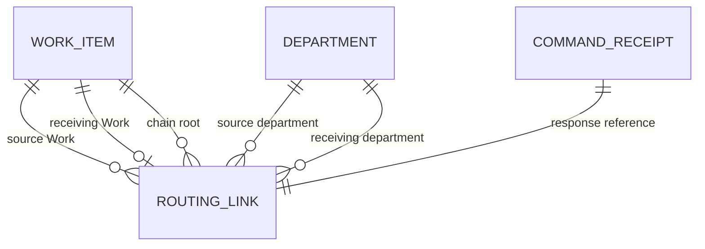

# Data Model: AI Department Cross-Department Routing

**Status**: Proposed for Draft v6. No migration exists.

## Entities

### RoutingLink (new, project-owned)

| Field | Type | Rules |
|---|---|---|
| `id` | UUID/string ID | Primary key. |
| `projectId` | ID | Required. Use the same project as both Work items and departments. |
| `sourceDepartmentId` | ID | Required. Snapshot source name at creation. |
| `sourceWorkId` | ID | Required. The item that referred the request. |
| `receivingDepartmentId` | ID | Required. Must differ from source department and be active at creation. |
| `receivingWorkId` | ID | Required and unique. The item created by referral. |
| `chainRootWorkId` | ID | Required. The first source Work item in the chain. |
| `state` | `open` / `done` / `cancelled` | Tracks only the direct receiving Work state. |
| `sourceTitleSnapshot` | string | First 120 characters of the source instruction. |
| `sourceGoalTitleSnapshot` | string/null | Source goal title at creation. |
| `sourceDepartmentNameSnapshot` | string | Source department name at creation. |
| `receivingDepartmentNameSnapshot` | string | Receiving department name at creation. |
| `createdByUserId` | ID | Person who committed the referral. |
| `createdAt` | timestamp | Referral commit time. |
| `closedAt` | timestamp/null | Set when direct receiving Work becomes `done` or `cancelled`. |

**Constraints**: Unique `receivingWorkId`. All IDs in a row must belong to `projectId`. The table is included in the ownership-transfer manifest as project-owned. Work items are not deleted by this feature.

### Existing WorkItem

The existing entity remains the source for state, version, department, instruction, priority, due date, review policy, and current attempt. Referral creates a new receiving Work item in `backlog` with no goal, assignee, attempt, child relationship, or eligibility. It copies instruction, priority, and due date. The receiver's current default review policy applies.

### Existing CommandReceipt

The existing receipt row remains the idempotency record. The key stays `(projectId, actorId, requestId)`. The new operation value is `work.refer`. A replay must match operation and canonical payload hash. Do not create a second receipt table.

### Derived chain fence

The proposed durable source of truth is the routing-link graph. A Work item is fenced when it is a source in a link whose direct receiving item is nonterminal, or when it is an ancestor in a chain with any nonterminal downstream item. The source Work state does not change. Source cancellation remains permitted. The fence clears only when no applicable downstream item remains nonterminal.

The link table stores chain identity. It does not add a mutable fence flag. This avoids a second record that could disagree with link state. The implementation must still prove that all fence checks and link/state transitions share one serialized transaction boundary. If derivation cannot meet the required latency or race guarantees, revise this model before tasks.

## Relationships

The command receipt may reference the created Work and link in its response JSON. It is not a relational parent and does not define chain membership.

## Validation and transaction rules

1. Require `agent:update`, a person actor, `expectedVersion`, and an unused or matching command receipt.
2. Resolve the stable chain root. Lock the root department admission fence first, then lock the remaining participant department IDs in ascending order. For archive, acquire all affected chain root fences in ascending order, then the archived department fence. A chain operation must never acquire a local department fence and then request a root fence.
3. Re-read source, receiving department, current attempts, pending result/review, child Work, links, chain root, and all chain members after locks are held.
4. Permit source states `backlog` or `ready` only. Reject an active attempt, pending result/review, open child Work, open referral, or stale source version.
5. Enforce at most one nonterminal Work item per department in the chain. Reject A → B → A while the root item in A is nonterminal.
6. Write the receipt, receiving Work item, routing link, both activity entries, source eligibility cancellation, and pending wake delivery changes in one transaction.
7. Bump `projectionSequence` for both departments and every ancestor department whose derived fence changes, in the same transaction. Send invalidations after commit. Never copy descendant reports upstream.
8. On a direct receiving terminal transition, update only its link. Keep ancestor fences while any downstream Work item remains nonterminal.
9. On archive, reject any department present in any link of a chain that still has at least one open link, even if that department occurs only in closed links.
10. Fence release does not dispatch. A coordinator explicitly uses ready for a backlog source or explicit start for a ready source. These operations create a new eligibility generation.

## State behavior

| Event | Link state | Source fence | Source Work state |
|---|---|---|---|
| Referral commits | `open` | Set for the source and unresolved ancestors | Unchanged |
| Direct receiving Work changes to nonterminal state | `open` | Remains set | Unchanged |
| Direct receiving Work becomes `done` | `done` | Clear only if no downstream nonterminal item remains | Unchanged |
| Direct receiving Work becomes `cancelled` | `cancelled` | Clear only if no downstream nonterminal item remains | Unchanged |
| Intermediate Work is cancelled while a descendant is active | Its direct link becomes `cancelled` | Ancestors remain fenced | Unchanged |
| Last downstream Work becomes terminal | Direct link closes | Clear affected ancestor fences | Unchanged |
| Coordinator resumes a source | Unchanged | Must already be clear | Ready action or explicit start controls state/eligibility |

## Migration and retention

Add one routing-link table with SQLite and PostgreSQL migrations. Add indexes for project/source, project/receiver, chain root, and unique receiving Work ID. Add the table to the project ownership-transfer manifest. Regenerate schema documentation. A rollback may drop this new table only before referral data exists; deployment rollback policy must account for retained user data. No existing table shape changes are planned.
