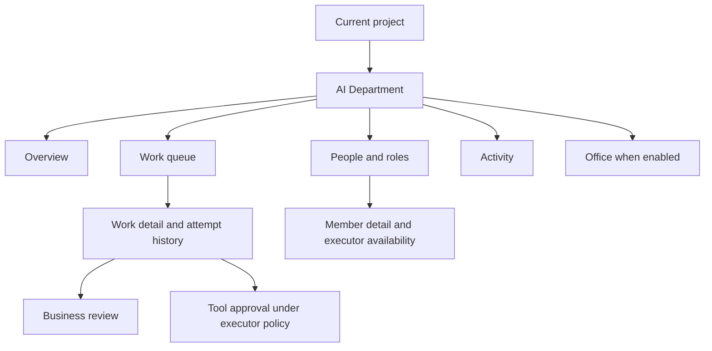

# AI Department Interface Design

**Status**: Draft shared design baseline
**Date**: 2026-11-02
**Scope**: Specs 002-007; design review precedes source integration.
**Authority**: [Constitution](../.specify/memory/constitution.md) and applicable n8n instructions.

## 1. Product Intent

The interface is the operating space for an AI department. A user sees who owns work,
what is running, what needs a decision, and what result was produced. A member has its
own identity and role. An executor supplies runtime capability. n8n workflows are tools
that a member can call through an authorized executor.

The current hosting proposal uses the n8n project shell. The department has its own
navigation and details. Opening the workflow canvas is not required to manage work.

## 2. Information Architecture



| Navigation | Purpose | Primary action |
|---|---|---|
| Overview | Attention first, then active work, ownership, recent activity | Open the next required action |
| Work | Filter and page department work | Create work; open authorized detail |
| People | Departments, roles, manager relationships, executor availability | Maintain department or member |
| Activity | Safe state and decision history | Inspect the related authorized record |
| Office | Optional spatial view of the same records | Select a member or return to 2D |

Use consistent names in every view. Office is absent or disabled when unavailable.
No core action depends on the optional external runtime.

## 3. Overview Layout

```text
Project / AI Department                     Create work
Department filter and current update state
-------------------------------------------------------
Needs attention: business review | tool request | blocker
-------------------------------------------------------
Active work                         Team ownership
(title, assignee, state, age)        (member, role, availability)
-------------------------------------------------------
Recent activity: actor, safe action, target, time
```

Keep the attention region first in reading and keyboard order. Show business review,
tool approval, failure, and missing input as separate reasons. Summary counts link to
filtered work. A count must not expose inaccessible items.

## 4. Work Queue and Detail

The first queue uses a readable list with title, assignee, state, priority, due date,
and latest change. Provide department, assignee, state, and attention filters. Preserve
filters when opening and returning from detail. A later board uses the same records.

Work detail contains instruction and goal, assignment and review policy, current state,
current attempt, earlier attempts, authorized result references, and safe activity.
Available actions follow the lifecycle in Spec 003. Do not offer unsupported transitions.
A retry creates a new attempt. A cancellation request shows pending until confirmed.

Keep business review in a result section. Keep tool requests in the current attempt
section. Explain the proposed action through the owning executor's authorized detail.
A business reviewer does not automatically receive tool execution permission.

## 5. People and Member Detail

Show a department list and readable reporting hierarchy. A member shows name, role,
manager, assignment, and executor availability. An unconfigured member is valid.

The member detail links to the runtime configuration when access permits. It does not
copy model prompts, credentials, execution history, or spend ledgers into department data.
Changing a binding affects future attempts and preserves current attempt identity.

## 6. Separate Work, Execution, and Availability

| Dimension | Values or examples | Source of truth |
|---|---|---|
| Work state | backlog, ready, running, review, blocked, cancelled, done | Spec 003 lifecycle; maps to Paperclip backlog, todo, in_progress, in_review, blocked, cancelled, done |
| Attempt state | pending dispatch, active, suspended, waiting for native approval, succeeded, failed, cancelled, unknown | Agents-owned execution state |
| Child workflow | waiting, retrying, failed, cancelled, succeeded | n8n workflow execution |
| Member availability | unconfigured, available, unavailable, disconnected | Binding validity and runtime health |
| View freshness | current, stale, disconnected, refreshing | Last successful state reconciliation |

An idle member is not a work status. A waiting workflow does not imply tool approval.
A disconnected runner is not proof of stopped execution. Display text and icons with
color; do not encode state only in color, animation, or character position.

## 7. Interaction States

- Loading: preserve page structure and label the section that is loading.
- Empty: explain the next permitted setup action. Readers do not see unusable edit calls.
- Partial failure: retain independently authorized sections and offer retry for the failed section.
- Validation failure: keep user input and attach the reason to the affected field.
- Stale edit: show the current record and ask the user to reapply a change deliberately.
- Pending action: prevent accidental duplicate submit and show acknowledgment state.
- Access loss: clear protected cached content and stop further protected updates.
- Disconnected: keep last-known safe state, update time, and an explicit refresh path.

Do not queue offline mutations for later replay. Reconnect fetches current state before
resuming updates. Old or repeated events cannot repeat actions or replace newer state.

## 8. Permission Presentation

Readers can inspect permitted records. Coordinators see available planning and execution
actions under existing project policy. Business reviewers see result decisions. Tool
approvers see only the requests their executor policy permits. Exact scope mapping is
verified in each plan. Hiding a control is not backend authorization.

For missing execution permission or an unavailable runtime, give a readable reason near
the action. Do not rely on a tooltip attached to a disabled control for that explanation.
Private execution links may be unavailable even when a safe work summary is readable.

## 9. Office Behavior

Office is a lazy optional view after 006B. Each character maps to one authorized member.
Selection opens the same member/work detail as 2D. It never sends an action because an
animation finished. Loss of updates shows stale state and time; it does not invent workers
or progress. Simulation mode is outside Spec 007.

Provide a visible 2D switch and a text member list. Scene or asset failure falls back to
that list. Reduced motion uses static labels and no required camera movement. All core
actions and status information remain available without 3D.

## 10. Visual System, Localization, and Responsive Layout

Use current n8n components, theme colors, typography, spacing, radius, focus, and motion
tokens. Look up tokens during implementation. This document introduces no independent
font, palette, component kit, or reference-project branding.

Use i18n for all user-facing text. Check Vietnamese and English labels, wrapping, dates,
and empty states in the same layouts. Show local readable dates without losing exact
timestamps in detail history.

Wide screens may show active work beside team ownership. Narrow screens stack them after
attention items. At 360 CSS pixels, core forms and lists must remain operable without
horizontal page scrolling. Column reduction must preserve title, state, assignee, and
available action. Exact breakpoint tokens follow current n8n source.

## 11. Accessibility and Review Criteria

Use semantic headings, controls, labels, and links. Provide visible focus, accessible
names for icon controls, focus return after dialogs, and text alternatives for scene
content. Do not move focus when background updates arrive. Announce meaningful status
changes without announcing every animation or token update.

The design review must cover one empty department, two members including one unconfigured,
work requiring business review, a tool request, a blocked item after runtime failure, a disconnected attempt,
conflicting edits, and a 2D fallback. Review keyboard-only operation, reduced motion,
both languages, and narrow layouts. Numeric timing targets in Specs 006 and 007 are
proposed acceptance targets using the roadmap fixture, not current measurements.
