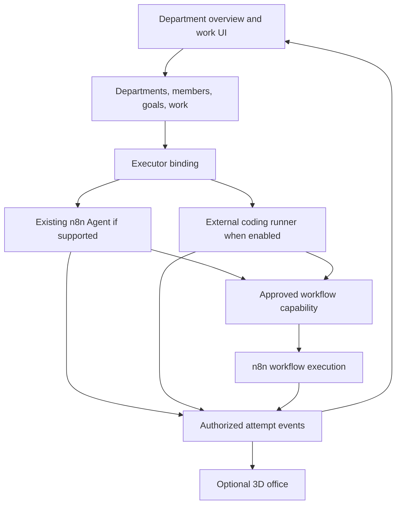

# AI Department SDD Roadmap

**Date**: 2026-11-02
**Status**: Planning baseline with partial backend implementation in 002 and 003. Acceptance and enablement gates remain open as listed below.
**Constitution**: [Canonical constitution](../.specify/memory/constitution.md)
**Shared interface**: [Interface design](AI-DEPARTMENT-DESIGN.md)

## Product Goal and Boundaries

Build one AI Department product. A person creates departments, assigns roles to AI
members, defines work, selects an executor, follows attempts, and reviews results.
n8n supplies workflows and integrations that members can call as tools. A member is
not required to be a saved n8n Agent. Existing n8n Agents may be reused through a
verified binding. External coding runtimes use a separate adapter boundary.

The current hosting proposal uses this n8n repository, its project access, and its UI
shell. The department has its own navigation. Its operation does not require the
user to work on the workflow canvas. Source review selected one CLI-local backend module
at `packages/cli/src/modules/ai-department/` and one frontend module at
`packages/modules/ai-department/frontend/`. The coding runner is a separate workspace
package and process; it never runs inside the n8n server.

## Shared Vocabulary

| Term | Meaning |
|---|---|
| Department member | Stable AI worker identity, role, manager, and department |
| Executor binding | Reference to the runtime configuration used by a member |
| Work item | Business instruction, assignee, review policy, and status |
| Attempt | One execution of a work item; retries create new attempts |
| Business review | Accept or return an attempt's result |
| Tool approval | Permission for one proposed action in one active attempt |
| Availability | Member presence or connection state; separate from work status |

## Delivery Order

Feature numbers are stable document IDs. Delivery order follows dependencies below.

| Step | Feature or slice | Deliverable | Prerequisite |
|---|---|---|---|
| 0 | Shared design | Review navigation, overview, details, and states before coding | Constitution and product intent |
| 1 | [002 Directory](002-ai-department-directory/plan.md) | Departments, members, roles; archive service fails closed until its guard is registered | Shared design |
| 2 | [003 Work management](003-ai-department-work-management/plan.md) | Goals, work lifecycle, attempt/executor contracts, and the 002 archive guard | 002 foundation; archive completion follows guard integration |
| 3 | [006A Operations shell](006-ai-department-operations-ui/plan.md) | Usable 2D directory, queue, detail, business review, organization and work relationships | 002 and parity-ready 003 contracts; seeded attempts may demonstrate runtime separately from work |
| Proposed 4 | [009 Work coordination](009-ai-department-work-coordination/plan.md) | Structured reports, durable help requests, deterministic routing, and delegated child Work in the 006A module | 002/003 contracts; Agent answers and requester continuation remain gated by Agents owner and G1 acceptance |
| 5 | [004 Workflow bridge](004-ai-department-workflows/plan.md) | Approved workflow capabilities and execution correlation | 003 and at least one verified executor binding |
| 6 | [006B Live operations](006-ai-department-operations-ui/plan.md) | Real attempts, workflow results, recovery, approvals | 006A and the enabled executor/004 integration |
| Optional | [005 External runtime](005-ai-department-runtime-bridge/plan.md) | One coding runtime adapter with isolated runner | 003; can run in parallel after its security gate |
| Optional | [007 Office](007-ai-department-3d-office/plan.md) | 3D view with full 2D fallback | 006B; 005 is not required |

006A is one feature slice, not a second UI project. The operations UI is independent
of 005. A disabled external runtime is shown as unavailable and does not block core
organization or work management. A production execution release requires one working
executor. Seeded data proves interface behavior only.

Spec 009 supersedes the manual meeting product direction in Spec 008. It follows 006A and
uses the directory, Work, and Agent owner contracts. Its UI extends the AI Department
module established by 006A. Agent answers and requester continuation stay disabled until
the Agents invocation and G1 wake/recovery gates pass. Remove meeting creation from the
active UI when the replacement Work views are available. Preserve existing meeting data
until its retention and migration path is approved. Keep the local feature pointer on the
selected feature; creating Spec 009 does not select it for implementation automatically.

Spec 008 remains as a superseded design and historical acceptance record. Its provider,
stop, and browser evidence does not establish acceptance for Spec 009.

Historical Spec 008 acceptance evidence: an isolated n8n instance and local Ollama model completed two
schema-valid participant contributions, quorum closure, and one synthesis that produced
cited draft minutes with attributed disagreement positions. This is partial provider
evidence only. Stop recovery across restart passed in one isolated main-process scenario.
A live facilitator binding revocation during synthesis also passed on the isolated
single-process SQLite/Ollama path: the meeting entered `stop_pending`, the domain
invocation and owner receipt became `cancelled` at sequence 5, and the correlated native
Agent execution became `cancelled`. This does not cover other access-loss modes,
execution modes, or restart scenarios. Quota/deadline boundaries, the full controlled
acceptance matrix, and complete browser acceptance remain open in Spec 008.
Spec 004 G4/G5 and its provider-backed workflow quickstart also remain open.

## Reference Contributions

| Reference | Adopt selectively | Preserve the department boundary |
|---|---|---|
| Paperclip | Organization, delegation, goals, work, review, activity | Keep department identity independent of any runtime |
| Orca | Provider adapters and isolated coding workspaces | Do not embed its Electron application |
| 3D Claude Hub Remote | Session lifecycle and permission interactions | Provider details stay behind the runner contract |
| My Office | Office scenes, characters, department presentation | Scene state never owns business state |
| n8n | Workflows, integrations, credentials; existing Agents where useful | Calls remain authorized tools; no duplicate workflow engine |

## SDD Artifact Status

All six feature directories contain spec, plan, research, data model, contracts,
quickstart, requirements checklist, and story tasks. Features 006 and 007 also have
screen-level `design.md` documents. Requirements review and task coverage are document
checks, not implementation evidence. Implementation status is partial and must be read
from each feature's tasks and recorded evidence; open acceptance tasks remain release gates.

| Feature | Design result | Implementation/enablement gate |
|---|---|---|
| 002 | Directory CRUD, member hierarchy and bindings, project scopes, resolver, and focused tests are implemented | T024–T026 and T030–T034 passed current-revision acceptance; runtime stop/recovery remains under C3 |
| 003 | Backend planning, attempts, inbox lanes, admission rechecks, durable handoff, blocked release recovery, authenticated Agent owner operations, and controlled C2 coverage are implemented through T030 | Verify real-Agent stop/restart/revocation, access loss, browser, timing, and scale acceptance |
| 004 | Published workflow capability and invocation contracts | Add the native owner adapter and verify caller/credential policy and invocation-key recovery |
| 005 | Claude Agent SDK adapter design, isolated runner, action mediation | Pin versions and pass real provider/isolation/approval matrix before enablement |
| 006 | One module with 006A/006B, scoped projections, command recovery, i18n | 006A needs parity-ready directory/work APIs; UI must show org hierarchy, work relationships, activity, claims, and separate run/business state. Browser validation belongs here. 006B needs a verified live Agent and timing/access checks |
| 007 | Lazy Three.js view using new procedural primitives | Measure declared device budgets, resource cleanup, and complete fallback before enablement |
| 009 | Structured work reports, help requests, deterministic routing, and child delegation | Agent answers and requester continuation require G1 and a verified Agents consultation owner; meeting table retirement requires data disposition approval |

## Cross-Feature Contracts

- Stable member IDs come from 002. Attempts in 003 retain binding references and versions.
- The directory owns the archive guard contract; work persistence implements it. Archive
  and new assignment share a transaction/admission fence. Directory setup precedes work;
  archive activation follows the guard provider.
- Command identity is project/user/requestId with a payload hash. Updates use the current
  resource version. Reconnect resolves the same command instead of sending a fresh one.
- 003 owns business transitions and the department projection sequence. 004 owns capability
  and invocation references; n8n owns actual workflow execution and credentials.
- 005 implements the executor contract from 003. Its optional workflow tool channel uses
  the authenticated capability contract from 004. It has no generic shell or webhook bypass.
- 006 reads authorized snapshots and uses project-filtered invalidations. 007 consumes the
  same projection and detail routes; renderer state never authorizes a command.

The local `.specify/feature.json` currently points to the older saved-Agent feature.
This roadmap does not change that pointer or create six branches. Select one explicit
feature directory when work begins. Keep branch names separate from feature IDs.

## Initial Validation Assumptions

Use one project with up to 10 departments, 100 members, 1,000 work items, and 20 active
attempts as the planning fixture. Numeric responsiveness targets in specs are proposed
acceptance targets, not measured performance. Adjust them with evidence before release.
Multiple tenants, multiple n8n instances, automatic hiring, and organization-wide
budget enforcement are outside this baseline.

## Proposed Feature Contract v1 — 2026-11-03

See the [dependency-ordered contract package](feature-contracts/ai-department/README.md).
It records approved decisions, requirements, model/API deltas, acceptance, and evidence
for Specs 002–006. Contract-specific owner gates remain open. It does not generate tasks
for slices whose gates remain open.

## Feature Contract v1 approval and slice gates — 2026-11-03

D1–D9 are approved in [Feature Contract v1](feature-contracts/ai-department/README.md).
The D1 wake trigger and C2-R3 acceptance are aligned. The C6 five-second target applies
only to a healthy push connection and visible page. Fallback polling latency is measured
separately.

C1 design and acceptance are closed by T030–T034. G2 controlled stop tests and a same-process
live Ollama stop pass. Separate restart evidence covers receipt recovery after the old model
process ended; no model request must survive restart. Durable sequence acceptance remains
open. Historical sequence 5 and 13 are not persisted. Thread counters 68/70 differ from
attempt `lastOwnerSequence` 54/56. G1 wake/coalescing acceptance remains open and blocks new
C2/C3 runtime enablement. G3 blocks Agent
review authority only. G4–G5 block workflow invocation. G6 blocks live push only. C6A can
proceed with controlled data after its API contracts are available. Runtime, browser and
provider gates remain open for the contracts that own them; C1 browser acceptance passed.
