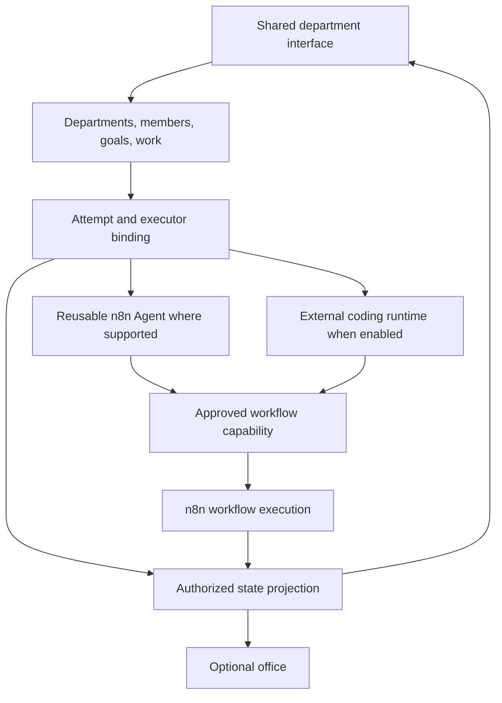

# AI Department Research

**Initial review**: 2026-11-02
**Planning revision**: 2026-11-02
**Status**: Source observations and a draft product proposal. No runtime validation is claimed.

## Goal

Build one AI Department product using selected organization, work, session, and office
concepts from the four references. Members call n8n workflows as authorized tools.
Keep member identity separate from any specific runtime configuration.

## Evidence and Limits

The initial review inspected reference source trees and documentation in temporary
storage under `/tmp/ai-dept-research.pVDVY2`. It also inspected the local n8n Agents
backend, runtime, and API types. That temporary checkout is not a permanent source pin.
The initial review did not record immutable reference commit IDs. Pin the exact commit
and file provenance before copying code or assets. No upstream or end-to-end behavior
has been revalidated during this documentation revision.

Local guidance checked for this revision includes `AGENTS.md`,
`packages/cli/src/modules/agents/AGENTS.md`, `packages/frontend/AGENTS.md`,
`scripts/backend-module/backend-module-guide.md`, and
`packages/@n8n/module-cli/frontend-module-guide.md`. These establish repository
boundaries. They do not establish a department start/stop API.

## Reference Findings from the Initial Review

| Reference | Observed focus | Department use |
|---|---|---|
| My Office | Local Claude-oriented 3D office, characters, hooks, and session status | Scene and spatial interaction reference |
| 3D Claude Hub Remote | Session status, transcripts, prompts, and permission interactions | Session lifecycle and provider bridge concepts |
| Orca | Desktop coding workspace, agent processes, terminals, worktrees, and remote access | Provider and isolated-workspace boundaries |
| Paperclip | Organization, goals, assignment, approval, cost, and audit concepts | Department governance and work model |

These observations do not prove that a provider permits every required control through
a supported interface. In particular, observing a hook does not prove that a bridge can
pause, approve, stop, and resume a coding action safely.

## Local n8n Findings

The earlier source review found saved Agents, publication/version state, scheduled tasks,
background work, checkpoints, approval suspension, workflow tools, spend controls, and
user-scoped update infrastructure. These are reuse candidates. A department hierarchy,
stable member roles, business goals, and one shared work board still require a product
model above execution.

The Agents module instructions keep repositories and runtime reconstruction private.
They list specific supported service contracts for existing callers. They do not grant
a new department module permission to import arbitrary internals. The supported saved-Agent
start, cancellation, and lifecycle contract is now specified as a new owner-side adapter in Plan 003. It must be implemented and verified before live execution is enabled.

The module guides prefer a packaged backend when dependencies permit it. A CLI-local
module is an allowed option when CLI-owned contracts are required. Frontend modules
belong under `packages/modules/<name>/frontend` and cannot import private editor aliases
or sibling modules. The previous plan treated CLI placement as decided too early; the
revised plans required evidence before selecting one backend placement. The feature research now selects one CLI-local backend because the initial adapters depend on CLI-owned execution policy. It retains module-private persistence and one separate frontend module.

## Revised Product Proposal

A department member may exist without an executor. One binding is fixed for an active
attempt. Work planning and business review can be delivered before live execution.
The product needs one verified executor before a production execution release.

n8n remains the workflow and integration owner. Reusing its Agent runtime is a candidate
implementation path, not a rule that every employee must be a saved n8n Agent. Existing
credentials, checkpoints, prompts, run details, and spend records remain with their owners.
The department keeps its own work state, attempt identity, references, and safe summaries.

## Source Reuse and Licenses

The initial review reported MIT repository licenses for the four references. Treat that
as historical evidence, not blanket asset clearance. Check the exact file, pinned commit,
third-party assets, dependency terms, and required notices before reuse. The earlier
review noted separate third-party terms in My Office and in the Hub's video dependencies.
Do not infer that every bundled asset inherits the repository license.

## Superseded Planning Choices

The revised baseline replaces the old mandatory saved-Agent membership model, fixed CLI
module placement, runtime-before-UI dependency, and ambiguous simulation fallback. Detailed
old endpoint and scope guesses are removed; they were proposals without verified contracts.

Use [the roadmap](AI-DEPARTMENT-ROADMAP.md), [shared design](AI-DEPARTMENT-DESIGN.md),
and Specs 002-007 as the current product baseline. Each plan records remaining source
checks and required Phase 1 artifacts. No data model, public endpoint, or provider control
is approved merely because it appeared in this research note.

## Sources

- [My Office source](https://github.com/khanh020905/my-office)
- [3D Claude Hub Remote source](https://github.com/NinelXram/3d-claude-hub-remote)
- [Orca source](https://github.com/stablyai/orca)
- [Paperclip source](https://github.com/paperclipai/paperclip)
- Local source areas reviewed previously: `packages/cli/src/modules/agents/`,
  `packages/@n8n/agents/src/`, and `packages/@n8n/api-types/src/agents/`.
