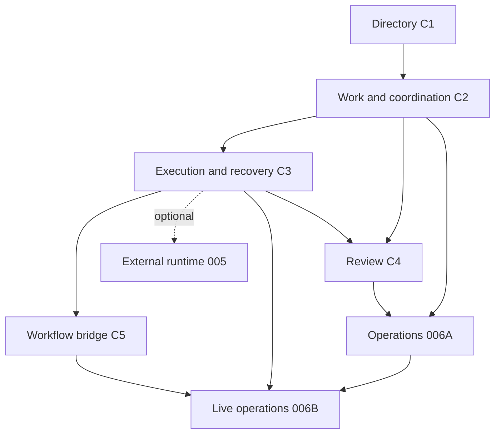

# AI Department Feature Contract v1

**Date:** 2026-11-03, Asia/Ho_Chi_Minh.
**Status:** Approved v1 on 2026-11-03.
**Approval record:** D1–D9 accepted. No decision change requested.
**C1 acceptance:** Closed on 2026-11-03 with integration tests, schema checks, and browser-assisted UI timing.
**Task gate:** C1 is closed. Other task gates follow their named dependencies and owner proofs.

## Authority and evidence

The constitution, roadmap, shared design, and feature specs define the product boundary.
This package records approved amendments to Specs 002–006. The user approved D1–D9,
including the aligned D1/C2-R3 trigger and the healthy-push-only C6 timing target.
Existing tasks record earlier work. Their presence does not authorize this expanded scope.
The business-capabilities document remains analysis.

Reference behavior comes from Paperclip at
`fea61638114a041ffe60cba178f2438bbb06e57b` in
`/Users/haison/Documents/GitHub/paperclip`. The earlier parity review and progress report
used `8ea2402`; their implementation conclusions are historical evidence.
Paperclip schema, server, permissions, and heartbeat runtime are not target architecture.
No source is copied. [Evidence](evidence.md) records direct source and log checks.

## Contract boundaries and dependency order

| ID | Contract | Spec owner | Prerequisite | Current code | Acceptance |
|---|---|---|---|---|---|
| C1 | [Directory](directory.md) | 002 | Project access | Partial, archive guard registered | CLOSED |
| C2 | [Goals, work, coordination](coordination.md) | 003 | C1 | Planning/graphs/actions exist; inbox/handoff incomplete | OPEN |
| C3 | [Agent execution and recovery](execution.md) | 003; optional 005 adapter | C1 + C2 identity and admission | Native owner integration exists; recovery incomplete | OPEN |
| C4 | [Business review](review.md) | 003 | C2 + C3 result/fencing | Basic review exists; stages/policies missing | OPEN |
| C5 | [Workflow bridge](workflow.md) | 004 | C2 + verified C3 | Native workflow tools exist; department bridge missing | OPEN |
| C6 | [Operations UI and live updates](operations.md) | 006 | A: C1/C2/C4; B: verified C3 and enabled C5 | Partial UI; delivery protocol missing | OPEN |

C2 defines coordination. C3 implements its execution boundary. They must agree before
execution tasks are generated. C6A can use controlled examples while C3 is not enabled.
Those examples cannot satisfy C6B. C5 is required for workflow capability acceptance.
005 is optional and must implement the same attempt boundary after its own provider gate.
007 is outside this contract package and remains optional after C6B.

## Approved decisions

D1–D9 are accepted product decisions. Their status does not certify implementation.
The remaining gates are technical evidence or owner-contract checks.

| ID | Technical question | Selected v1 behavior | Remaining gate |
|---|---|---|---|
| D1 | What is the inbox and what wakes an Agent? | Durable member inbox; readiness, ready reassignment, review return, completed handoff and explicit start create eligibility. Assignment in backlog does not run work. Coalesce scheduling signals within the same authority/binding lane. Each execution attempt handles one work item. | C2/C3 owner admission and lost-wake proof |
| D2 | What does handoff mean? | Explicit destination member plus reason. Fence old actions immediately. Wait for owner-confirmed stop, then atomically reassign, set ready, and create destination wake. Release alone keeps assignee and blocks work. | C2 pending-transfer model and recovery |
| D3 | When can work be reclaimed? | Five-minute server lease; renew under current authority. Expiry alone never transfers ownership. A different run requires confirmed old-run stop and a new attempt with a larger claim generation. Unknown stop retains reservation. | C3 authoritative stop and restart proof |
| D4 | Which review stages and actors? | Ordered stages, one verdict per stage per result round. Participant rule: authorized writers or explicit users/members. Actor filter: anyone, not_creator, or human_only. Default required policy: one human_only stage. Return starts a new execution/result round. | C4 authenticated Agent reviewer context and native permissions |
| D5 | What does not_creator exclude? | The authenticated principal that requested this result review. Store actor kind and ID with the result round. Missing requester denies a verdict. | C4 requester/round persistence |
| D6 | Which workflow version and schema? | Published owner-supported workflow only. Pin publication and input-schema fingerprint in capability revision. A changed publication requires capability revalidation before a new call. Record actual execution version at acceptance. | C5 owner compatibility and atomic version acceptance |
| D7 | What happens after access revocation? | Deny new actions and result delivery. Request stop through the owner control plane for active parent/children. Keep pending/unknown until confirmed. Retain audit references. | C3/C5 system stop authority; no user-policy bypass |
| D8 | What is the live protocol? | Existing n8n push infrastructure with a new typed department invalidation and authorized subscription. Department revision orders snapshots. Reconnect always reads a full snapshot; no durable event replay cursor in v1. Visible fallback polls every four seconds. The five-second update target applies only to healthy push on a visible page. | C6 current-access checks at send time and revision allocation |
| D9 | Do due dates schedule execution? | RFC 3339 UTC timestamps; local display. Dates are planning metadata and do not create timer wakes. | UI acceptance only |

D3 deliberately tightens the current same-attempt reclaim design. D4 changes the current
required-policy default from unrestricted project writers to a human review stage. D6
requires explicit capability revalidation after publication changes. These choices need
user approval because they affect recovery, review access, and workflow upgrades.

## Common command, identity, and access rules

- User command identity is `(projectId, userId, requestId)`. Bind a canonical validated
  payload hash and operation to it. Same identity/content returns the prior authorized
  acknowledgment. Different content returns 409. Check current access before replay.
- Agent command identity includes the authenticated owner run and stable tool-call ID.
  Persist that context across approval resume and process reconstruction. A caller cannot
  choose its actor, initiating user, binding, or attempt in tool arguments.
- Resource updates carry `expectedVersion`. Replay lookup precedes stale-version checks
  after authorization. Reconnect resolves unknown commands with the same identity.
- Use existing `agent:list` for collections, `agent:read` for detail, `agent:create` for
  creation, and `agent:update` for mutations. Execution also requires `agent:execute`
  and current owner access. These scopes match inspected department controllers.
  Generic project:read/update labels in older 003/004/006 contracts are amendment targets.
- A role or participant record grants no platform scope. Filter object lookup by project
  and department. Hide inaccessible references with 404. Use 403 for insufficient scope,
  409 for stale identity/version/reservation, and 400 for invalid fields or transitions.
- Keep TypeORM and transactions in persistence. Admission, state, receipt, audit, and
  projection revision changes commit atomically. External owner calls use durable intents
  outside the database transaction. Revalidate the version and authority on return.
- Store safe summaries and owner references. Owners retain credentials, prompts,
  checkpoints, full tool arguments, execution payloads, and retention policy.
- Runtime success is not a business result. Business review is not tool approval.
  Late owner events never update a newer attempt or reverse terminal work.

## Spec amendments and task gate

Each linked contract contains requirements, model deltas, service/API shapes, acceptance
cases, source status, and a spec mapping. These accepted sections amend Specs 002–006.
The links in each feature artifact point to the amendment. Historical checkboxes remain
unchanged. C1 tasks are generated below; other task coverage remains open.

C1 task generation record:

- [x] User accepted D1–D9 in Feature Contract v1.
- [x] C1 contract and owning 002 artifacts are synchronized.
- [x] C1 has no unresolved design or security decision.
- [x] C1 tasks T031–T034 are added with acceptance IDs and prerequisites.
- [x] C1 runtime acceptance and final validation have current evidence.

C2 task generation record:

- [x] G1 ownership design is closed from current source review.
- [x] G2 stop/recovery owner contract is defined in `execution.md`.
- [x] C2 tasks T022–T030 are generated as the next dependency slice only.
- [ ] G1/G2 runtime acceptance remains open; do not enable unverified wake or stop behavior.

C2 implementation progress:

- [x] T022 eligibility/lane persistence model, migration, repository methods, ownership-transfer policy, and generated schema docs are in place.
- [x] T023 eligibility writes for readiness, ready reassignment, review return, and explicit start are wired with replay protection. Handoff eligibility remains T027; lane coalescing/drain recovery remain T025. C2 acceptance remains open.
- [x] T024 lane-bound assigned-work inbox service/API with project/member/binding checks and stable keyset pagination is implemented. Runtime Agent invocation remains T029.
- [ ] T025–T030 remain open.

C1 design and acceptance are closed. G1 and G2 ownership designs are closed, with runtime
acceptance still open. C2 tasks may now be generated as one dependency slice. G2 runtime
proof remains required for handoff/recovery acceptance. G3 blocks only Agent-review
authority. G4–G5 block workflow invocation. G6 blocks
live push. C6A remains independently schedulable after its API inputs. Runtime acceptance
may remain open after task generation when the contract and design are settled.
Do not change `.specify/feature.json`. Do not generate tasks for all contracts at once.
